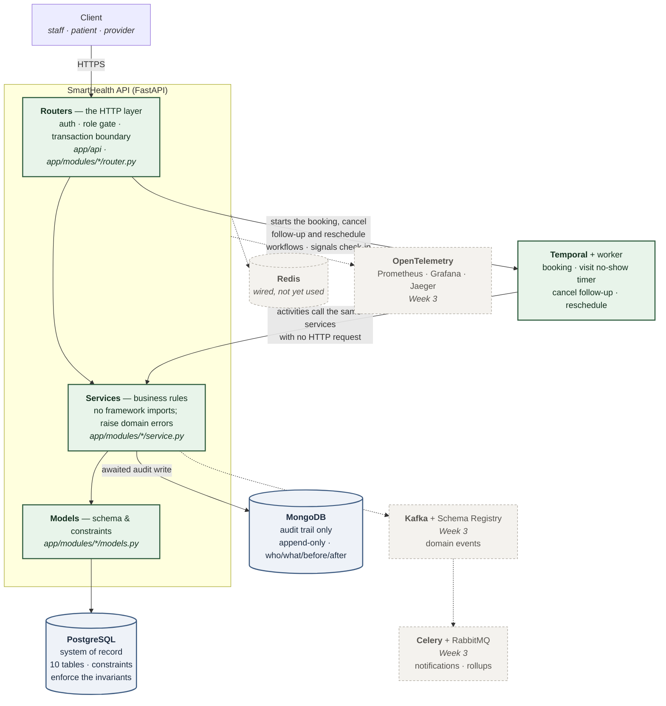
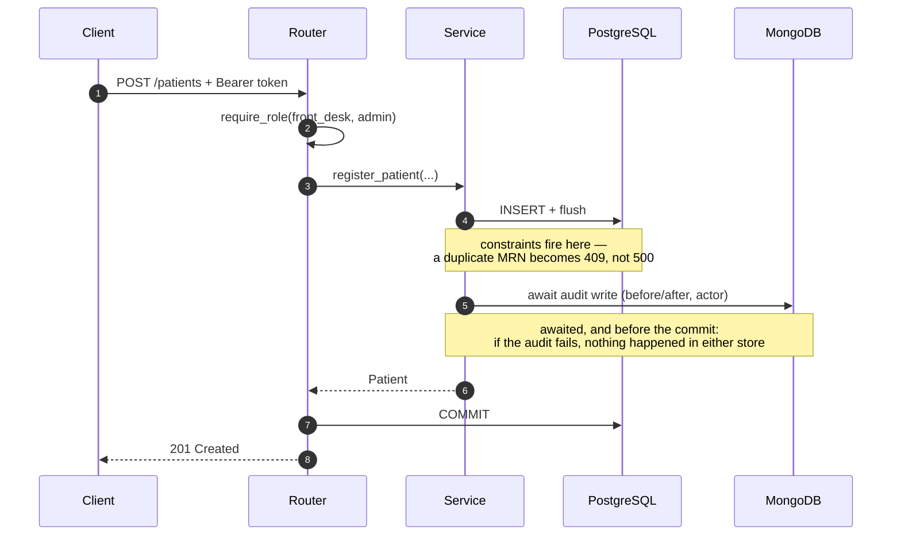
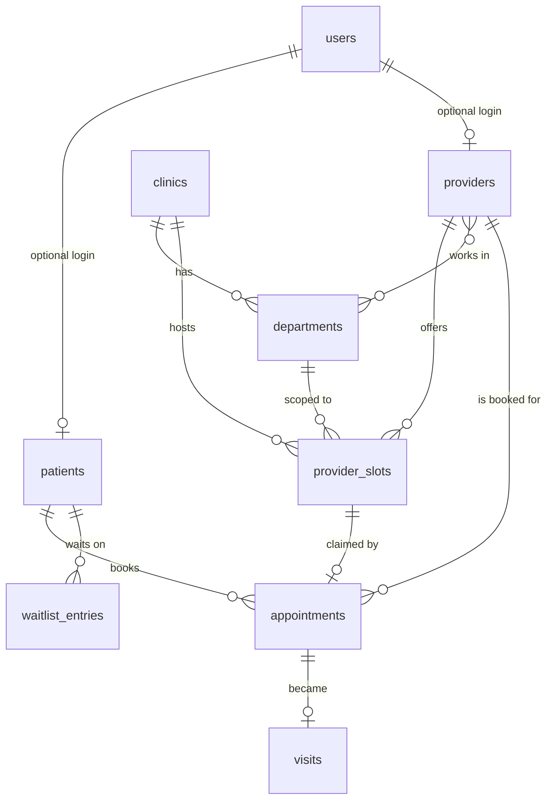

# SmartHealth

Intelligent Healthcare Operations & Patient Engagement Platform — a backend built for MediNova,
a fictional healthcare network, as a structured engineering assignment.

The project is delivered in two parts:

- **Part A — Core Platform** (Weeks 1–3): patient/provider management, appointment scheduling
  with durable workflows, visit lifecycle, event-driven background processing, observability.
- **Part B — GenAI Layer** (Weeks 4–5): operational data ingestion and embeddings, semantic
  retrieval, an AI healthcare assistant, generated patient communication, streaming responses.

## Status

**Weeks 1 and 2 complete.** Auth, patient and provider management, an
audited mutation path, a CLI to create the first user, and the application containerised
behind a compose profile. Week 2 has landed a Temporal worker, the **booking workflow**
(an appointment is confirmed only after every step succeeds, and compensated to `failed`
otherwise) and the **visit lifecycle**: check-in, seen and complete are synchronous writes,
and a durable workflow marks an appointment `no_show` if nobody checks in by the slot's end
plus a grace period. It has also landed **cancel, reschedule and the waitlist**: a cancel frees the
slot in the same transaction that cancels the appointment, a reschedule books the new slot
before it releases the old one, and a freed slot is offered to waiting patients. Patient
self-service closes Week 2: a patient lists their own appointments (`GET /appointments`),
staff list them with filters, and `python -m app.cli link-patient` connects a patient login
to its record. Week 3 (Kafka, Celery, notifications, analytics, observability) is next. A demo web client ([Frontend](#frontend)) sits on top of the API. See [API surface](#api-surface) for what is callable today.

## Architecture

Solid lines are wired and exercised by tests today; dashed lines are provisioned
infrastructure that no code connects to yet.



**This is a modular monolith, deliberately.** One deployable, one schema, one migration
history — and an import graph with a shape that two meta-tests enforce rather than
document. A plain monolith and a modular one are indistinguishable from the outside; the
only difference is whether anything may import anything, and here it may not.

**The layering rule** (vertical): services never import FastAPI. They raise domain errors that the
router layer translates to HTTP. That is what lets the booking workflow's Temporal activities
call the same service functions from a worker process with no web request — and distinguish
a permanent failure (*"the slot is taken"*) from a retryable one (*"the connection
dropped"*), which an HTTP status code cannot express.

**The module rule** (horizontal): `app/modules/<x>` does not import `app/modules/<y>`.
Every `service.py` imports only shared infrastructure and its own module; the only
cross-module edges in the codebase are declared as explicit pairs in
`tests/meta/test_import_boundaries.py` — nine router-layer auth edges onto `identity`, two
from scheduling (its router and its activities) onto `patients/public.py`, and the same two
onto `providers/public.py` — the one file each of those modules publishes for others. Scheduling shows
why the rule is about code and not data: `appointments` carries foreign keys into two
other modules' tables (`patients`; `providers`, `clinics`, `departments`), declared as table-name strings, so it is fully coupled in the
database and not coupled at all in Python. Shared schema is what a modular monolith *is*;
the modularity lives in the import graph, and that is what keeps each module extractable
as bounded work rather than archaeology.

### Request lifecycle — `POST /patients`



The router owns the commit; services only flush. That is what lets one request compose
several services into a single transaction — and lets each booking activity wrap one
service call in its own transaction, so claiming a slot and attaching it to the appointment
commit together.

### Data model



Four decisions shape this, each rejecting a more obvious alternative:

1. **A user account is not a person.** `users` is credentials only; `patients` and
   `providers` link to one *optionally*, so front desk can register a walk-in who has no
   email and no password.
2. **Bookable time is a row, not a calculation.** Booking is
   `UPDATE provider_slots SET status='held', version=version+1 WHERE id=:id AND status='free'` — zero rows
   affected *is* the conflict, with no window between checking and acting.
3. **An appointment is not a visit.** The booking and what actually happened have
   different lifecycles. Split, Average Wait Time is `seen_at - checked_in_at` and a
   no-show is an appointment with no visit.
4. **PostgreSQL is the system of record; MongoDB owns only the audit trail** — which is
   append-only, shape-varying per entity, and unbounded.

**What the database guarantees**, rather than trusting application code: at most one
*live* appointment per slot (a partial unique index, so cancelling frees it); no
overlapping slots for one provider (a GiST exclusion constraint); a slot, provider and
clinic that actually agree (composite foreign keys); at most one *live* appointment
replacing any given appointment (a second partial unique index, so two reschedules of one
appointment cannot both confirm); and a confirmed appointment that must hold a slot (a
CHECK) — the assignment's headline invariant, made structural.

## Documentation

| Document | Purpose |
| --- | --- |
| [`docs/PRD.md`](docs/PRD.md) | **Product requirements** — use cases, numbered requirements, milestones, and feature traceability |
| [`docs/requirements/part-a-core-platform.md`](docs/requirements/part-a-core-platform.md) | Part A problem statement, functional requirements, tech stack |
| [`docs/requirements/part-b-genai-layer.md`](docs/requirements/part-b-genai-layer.md) | Part B GenAI scope and requirements |
| [`docs/requirements/execution-guidelines.md`](docs/requirements/execution-guidelines.md) | Weekly plan, submission guidelines, evaluation criteria |
| [`docs/superpowers/specs/2026-09-01-testing-harness-design.md`](docs/superpowers/specs/2026-09-01-testing-harness-design.md) | Testing harness design |
| [`docs/superpowers/specs/2026-09-02-week1-foundation-design.md`](docs/superpowers/specs/2026-09-02-week1-foundation-design.md) | Domain model and schema decisions |
| [`docs/superpowers/specs/2026-09-03-week1-management-apis-design.md`](docs/superpowers/specs/2026-09-03-week1-management-apis-design.md) | Management API design, and what Week 1 deliberately deferred |
| [`docs/superpowers/specs/2026-10-28-week2-scheduling-workflows-design.md`](docs/superpowers/specs/2026-10-28-week2-scheduling-workflows-design.md) | Week 2 scheduling workflows — booking, visit, cancel/reschedule, waitlist and patient self-service (all built) |
| [`docs/ARCHITECTURE.md`](docs/ARCHITECTURE.md) | Module breakdown, data flows for every built endpoint, the booking, visit, cancel and reschedule workflows, and the designed event flows |
| [`tests/README.md`](tests/README.md) | How to run and author tests |

The original `.docx` files are kept in `docs/requirements/` and are authoritative.

## Tech stack

**Backend:** Python · FastAPI · PostgreSQL · NoSQL DB · Redis · Celery + RabbitMQ ·
Kafka + Schema Registry · Temporal

**Observability:** OpenTelemetry · Prometheus + Grafana · Jaeger

**GenAI:** LangGraph / LangChain · LLM provider (OpenAI / Groq / Anthropic) · Vector DB

**DevOps:** Docker · Docker Compose

## Setup

```bash
python -m venv .venv
source .venv/Scripts/activate     # Windows (Git Bash);  .venv\Scripts\Activate.ps1 in PowerShell
# source .venv/bin/activate       # POSIX
pip install -e ".[dev]"

python -m pytest -m "not docker"    # fast tests, no containers

docker compose -p smarthealth-test --env-file .env.test -f docker-compose.infra.yml up -d --wait
python -m pytest -m docker          # tests that need infrastructure
```

See [`tests/README.md`](tests/README.md) for the tier model and how to author a test case.

## API surface

| Method | Path | Roles |
| --- | --- | --- |
| POST | `/auth/login` | public |
| POST | `/patients` | `front_desk`, `admin` |
| GET | `/patients`, `/patients/{id}` | `front_desk`, `admin`, `provider` |
| PATCH | `/patients/{id}` | `front_desk`, `admin` |
| POST | `/providers` | `admin` |
| PATCH | `/providers/{id}` | `admin` |
| GET | `/providers`, `/providers/{id}` | any authenticated |
| GET | `/patients/me` | `patient` — the record linked to the caller's login; 404 if none is linked |
| GET | `/slots` | any authenticated — a provider's free, future slots; `provider_id` is required, and `from`/`to` must carry a timezone or the answer is a 422 |
| POST | `/appointments` | `patient` (for themselves only), `front_desk`, `admin` — answers **202**; optional `Idempotency-Key` header |
| GET | `/appointments` | `patient` (always their own: another `patient_id` is a **403**, a login with no linked record a **404**), `provider`, `front_desk`, `admin` (filters `patient_id`, `provider_id`, `status`, `from`, `to`; `from`/`to` bound the slot's start, inclusive and exclusive, and must carry a timezone or the answer is a 422). Paginated, newest slot first, appointments with no slot last; each item carries `starts_at` |
| GET | `/appointments/{id}` | the owning `patient`, `provider`, `front_desk`, `admin` |
| POST | `/appointments/{id}/check-in` | `front_desk`, `admin` — answers **200** `VisitRead`; 409 on an illegal step |
| POST | `/appointments/{id}/seen`, `/appointments/{id}/complete` | `provider`, `admin` — answer **200** `VisitRead`; 409 on an illegal step |
| GET | `/appointments/{id}/visit` | the owning `patient`, `provider`, `front_desk`, `admin` — 404 until a check-in exists |
| POST | `/appointments/{id}/cancel` | the owning `patient`, `front_desk`, `admin` — body `{reason}`; answers **200** with the appointment; 409 unless it is `pending` or `confirmed` with no visit, and also while the reschedule that created it is still completing |
| POST | `/appointments/{id}/reschedule` | the owning `patient`, `front_desk`, `admin` — body `{new_slot_id, reason?}`; answers **202** with the new appointment's id; only a `confirmed` appointment (no visit); 409 otherwise; optional `Idempotency-Key` header |
| POST | `/waitlist` | `patient` (for themselves only), `front_desk`, `admin` — answers **201** |
| GET | `/waitlist` | `patient` (their own entries, whatever `patient_id` they send), `front_desk`, `admin` |

`GET /health` and `GET /ready` are public.

**Booking is asynchronous.** `POST /appointments` with `{patient_id, slot_id, reason?}`
answers `202 {appointment_id, status: "pending"}` and starts a Temporal workflow; poll
`GET /appointments/{id}` until `status` is `confirmed` or `failed`. Repeating a request
with the same `Idempotency-Key` returns the same booking; the same key with a different
body is a 422. A patient booking for someone else is 403; a patient reading someone
else's appointment is 404. Temporal unreachable is a 503. Details:
[`docs/ARCHITECTURE.md`](docs/ARCHITECTURE.md) §2.8 and §3.2.

**Visit actions are synchronous.** Check-in, seen and complete are written in the request
itself and answer `200` with the visit; an action that is not legal now — a second
check-in, `seen` before check-in, `complete` before `seen`, anything on a cancelled or
no-show appointment — is a `409`, and an unknown appointment a `404`. The only thing that
runs in the background is the no-show timer: a workflow started when a booking confirms
marks the appointment `no_show` once the slot's end plus a grace period passes with no
check-in. Details: [`docs/ARCHITECTURE.md`](docs/ARCHITECTURE.md) §2.9 and §3.2a.

**Cancel is synchronous; reschedule is not.** A cancel writes the appointment and its slot
in one transaction and answers `200`; a repeat, a checked-in patient, or an appointment
that is not `pending` or `confirmed` is a `409`. A workflow then stops the visit timer,
issues the refund (a stand-in until Week 3) and offers the freed slot to the waitlist; if
that workflow cannot be started the cancel still stands, and the refund and the promotion
are lost until Week 3 (PRD R-17). A reschedule answers `202` with the **new** appointment's
id: poll `GET /appointments/{id}` on it. The new slot is booked first and the old one
released only when that confirmed, so a failed reschedule leaves the original appointment;
the old one then reads `rescheduled`. A patient acts only on their own appointments (another's
is a `404`). Waiting patients join with `POST /waitlist` (a time window, optionally one
provider or department); every release is offered to up to three matching entries, oldest
first, each as a booking that confirms or fails by itself. Details:
[`docs/ARCHITECTURE.md`](docs/ARCHITECTURE.md) §3.3.

**Not built by cancel and reschedule:** a notification to the patient, a billing update on
reschedule, and the domain events (Week 3); the known limits are PRD R-17 to R-22.

**Try it in a browser.** With the stack running, FastAPI serves interactive API
documentation generated from the route definitions and response models:

| URL | What it is |
| --- | --- |
| <http://localhost:8000/docs> | Swagger UI — get a token from `POST /auth/login`, paste its `access_token` into **Authorize** (`BearerAuth`), then execute any endpoint against the running system |
| <http://localhost:8000/redoc> | ReDoc — a reference-style read of the same schema |
| <http://localhost:8000/openapi.json> | The raw OpenAPI schema |

The backend has no UI of its own (see [`docs/PRD.md`](docs/PRD.md) §2, non-goals). `/docs`
is the way to exercise it by hand; the [demo client](#frontend) is a convenience on top.

**Layering:** `router → service → SQLAlchemy`. Services never import FastAPI — they raise
domain errors that exception handlers translate, so the booking workflow's Temporal
activities call the same functions. The router (in the worker, the activity) owns the
transaction boundary; services flush.

**Every mutation is audited** to Mongo with actor, action and before/after, awaited so a
Mongo outage fails the request rather than silently dropping the record.

**Not built by the visit lifecycle:** billing and follow-up on completion (Week 3), and a
provider being restricted to their own patients' visits (any provider may mark any visit seen
or complete — PRD R-14).

**Patient self-service.** A patient reads their own record (`GET /patients/me`), an
appointment they own, and their own list (`GET /appointments`), which is forced to their
record server-side. All of it needs the login to be linked to a patient record
(`link-patient`, below). Provider per-object scoping is still not built: a provider's list
is every appointment (PRD R-14).

### Running it

```bash
# the whole system in containers
docker compose --profile app -f docker-compose.infra.yml up -d --build --wait
curl http://localhost:8000/health

# an account to log in with, created inside the container against the stack's own database
docker compose --profile app -f docker-compose.infra.yml exec app \
  python -m app.cli create-user --email you@example.com --password "..." --role admin

curl -X POST http://localhost:8000/auth/login -H 'Content-Type: application/json' \
  -d '{"email": "you@example.com", "password": "..."}'
```

`--build` matters: without it compose reuses an existing image and runs old code.

**Or run the API and worker on the host** against the infrastructure containers alone —
handy for a debugger. `Settings` defaults to the dev stack's ports on `localhost` and its
`smarthealth` credentials; a different stack needs `SMARTHEALTH_POSTGRES_PORT` and friends
(every variable is in `.env.example`, which `cp .env.example .env` turns into config). Stop
the `app` profile's `app` and `worker` first, or they share the task queue and port 8000:

```bash
docker compose -f docker-compose.infra.yml up -d --wait     # infrastructure only, no profile
python -m alembic upgrade head
python -m app.worker                                        # terminal 1
uvicorn app.main:app --port 8000                            # terminal 2
```

A `--role patient` login also needs linking to its patient record before it can read its own
data: `python -m app.cli link-patient --email … --mrn …`, described under
[Frontend](#frontend).

To stop the stack, keeping its data: `docker compose --profile app -f docker-compose.infra.yml down`.
Adding `-v` also deletes the dev stack's volumes, and with them all dev data.

**Seed a demonstrable clinic network** — two clinics in different timezones,
departments, five providers with specialties, one login per role, 50 patients (most of
them walk-ins with no user account), and a two-week window of bookable slots:

```bash
docker compose --profile app -f docker-compose.infra.yml exec app \
  python -m app.cli seed --password "..." --patients 50
```

Idempotent — rerunning changes nothing, because every row is matched on its natural
key, including passwords: seeded logins keep the password from the first run.
`--clear` removes exactly what it created and nothing else — but once any appointment
references a seeded slot (a failed booking included), `--clear` refuses with a
foreign-key error, by design (PRD R-10). To start over, remove the dev stack's volumes with
`docker compose --profile app -f docker-compose.infra.yml down -v`; `-v` deletes all dev data.

It deliberately seeds **no appointments, visits or waitlist entries**. Those are
workflow outputs that Week 2 produces: an appointment reaches `confirmed` only after
slot reservation, the billing pre-check and notification scheduling have all succeeded,
so hand-writing one would fabricate state no workflow ever ran — and Week 2 would then
be tested against fiction. See [`app/seed.py`](app/seed.py).

`--profile app` starts two services from the same image: `app` (the API) and `worker`
(the Temporal worker, `python -m app.worker`), plus `frontend`, the demo client (its own
image; see [Frontend](#frontend)). They sit behind a compose profile so the
test stack, which uses the same file, does not start them — the tests drive the
application in-process. The worker starts only once `app` is healthy, because the `app`
container applies the migrations. Its healthcheck, `python -m app.worker --check`,
executes a canary workflow, so `--wait` returns only when a worker is actually polling
and executing — not merely when the process is up. It runs the booking, visit, cancel follow-up and
reschedule workflows. The design of all five Week 2 slices is in
[`docs/superpowers/specs/2026-10-28-week2-scheduling-workflows-design.md`](docs/superpowers/specs/2026-10-28-week2-scheduling-workflows-design.md).

**Book an appointment.** After seeding (above), log in as the seeded front-desk user with
the password you gave `seed`. If the stack was seeded earlier with a password you do not
know, create your own logins with
`python -m app.cli create-user --email … --password … --role front_desk` (and again with
`--role provider` for the visit demo below) and use those instead.
`GET /slots?provider_id=…` lists a provider's free slots, but
the snippet below picks a slot and a patient straight from Postgres, which needs no
provider id (bash / Git Bash):

```bash
TOKEN=$(curl -s -X POST http://localhost:8000/auth/login -H 'Content-Type: application/json' \
  -d '{"email": "frontdesk@medinova.example", "password": "..."}' \
  | python -c 'import json,sys; print(json.load(sys.stdin)["access_token"])')

sql() { docker compose --profile app -f docker-compose.infra.yml exec -T postgres \
  psql -U smarthealth -d smarthealth -tAc "$1"; }
SLOT=$(sql "select id from provider_slots where status = 'free' and starts_at > now() order by starts_at limit 1")
PATIENT=$(sql "select id from patients order by created_at limit 1")

KEY=demo-$(date +%s)   # once per run: the same key with a different slot is a 422
book() { curl -s -X POST http://localhost:8000/appointments \
  -H "Authorization: Bearer $TOKEN" -H 'Content-Type: application/json' \
  -H "Idempotency-Key: $KEY" \
  -d "{\"patient_id\": \"$PATIENT\", \"slot_id\": \"$SLOT\"}"; }
book    # 202 {"appointment_id":"…","status":"pending"}
APPOINTMENT=$(book | python -c 'import json,sys; print(json.load(sys.stdin)["appointment_id"])')

curl -s http://localhost:8000/appointments/$APPOINTMENT -H "Authorization: Bearer $TOKEN"
# repeat until "status" is "confirmed" (or "failed")
```

Poll on `status`, not `in_progress`: `in_progress: true` appears only on the answer for a
booking whose row does not exist yet. A pending appointment that has a row reads
`in_progress: false`.

The second `book` is itself the idempotency demonstration: the same `Idempotency-Key` and
body return the same `appointment_id` and book nothing new. (To book again, generate
a new `KEY`: the same key with a different slot is a 422, and `$APPOINTMENT` stays empty.) The appointment's audit trail —
`booking_requested`, `slot_claimed`, `confirmed` — is in Mongo, and the workflow's history
(`booking-<appointment_id>`) is in Temporal.

**Seeing a workflow.** The `app` profile runs Temporal's web UI at <http://localhost:8080>
(`TEMPORAL_UI_PORT` to move it): search for the workflow id — `booking-<id>`, `visit-<id>`,
`cancel-<id>`, `reschedule-<id>` — for its every step, retry and failure. Without a browser,
the same history from the CLI inside the Temporal container:

```bash
docker compose -f docker-compose.infra.yml exec temporal \
  temporal workflow show -w booking-$APPOINTMENT --address temporal:7233
```

**Run a visit.** Continue from the booking above once `$APPOINTMENT` reads `confirmed`.
Check-in is the front desk's; `seen` and `complete` are a provider's, and the seeded
provider login `a.osei@medinova.example` (same password as the other seeded logins) can
do both. To use a login of your own instead, create one the way the admin was created above,
with `--role provider`.

```bash
: "${APPOINTMENT:?booking failed}"
login() { curl -s -X POST http://localhost:8000/auth/login -H 'Content-Type: application/json' \
  -d "{\"email\": \"$1\", \"password\": \"...\"}" \
  | python -c 'import json,sys; print(json.load(sys.stdin)["access_token"])'; }
PROVIDER_TOKEN=$(login a.osei@medinova.example)

act() { curl -s -X POST http://localhost:8000/appointments/$APPOINTMENT/$1 -H "Authorization: Bearer $2"; }
act check-in  $TOKEN            # 200 {"status":"checked_in", "checked_in_at":"…", …}
act check-in  $TOKEN            # 409 — a repeat is refused, not silently accepted
act seen      $PROVIDER_TOKEN   # 200 {"status":"in_progress", "seen_at":"…", …}
act complete  $PROVIDER_TOKEN   # 200 {"status":"completed", "completed_at":"…", …}

curl -s http://localhost:8000/appointments/$APPOINTMENT/visit -H "Authorization: Bearer $TOKEN"
curl -s http://localhost:8000/appointments/$APPOINTMENT       -H "Authorization: Bearer $TOKEN"
# the appointment is now "completed"; completion never frees a slot
```

Each action is audited in Mongo with the acting user. The no-show side needs no request: a
confirmed appointment nobody checks in for becomes `no_show` at the slot's end plus
the grace setting (default 15 minutes; only the `worker` process reads it: set
`NO_SHOW_GRACE_MINUTES` on the compose command line, e.g.
`NO_SHOW_GRACE_MINUTES=1 docker compose --profile app -f docker-compose.infra.yml up -d --build --wait worker`,
or `SMARTHEALTH_NO_SHOW_GRACE_MINUTES` for a host-run worker)
and its workflow, `visit-<appointment_id>`, ends `no_show` in Temporal (see *Seeing a
workflow*, above). The slot you
booked is in the future, so you will not see that happen in a demo without waiting; the test
`test_nobody_checking_in_becomes_a_no_show_on_the_real_timer` runs it against a real
timer with a one-second slot.

**Cancel, reschedule and the waitlist.** Continue in the same shell: `$TOKEN` (front desk)
and `sql` are the ones defined in "Book an appointment". The visit demo completed its
appointment, so this books a fresh one on a new key, reschedules it to a second slot, and
cancels the replacement while a second patient is waiting for that slot. It needs two free
slots and two patients; the snippet stops at the first id it cannot find (bash / Git Bash):

```bash
: "${TOKEN:?log in first, as in Book an appointment}"
field() { python -c "import json,sys; print(json.load(sys.stdin)['$1'])"; }
status_of() { curl -s http://localhost:8000/appointments/$1 -H "Authorization: Bearer $TOKEN" | field status; }
until_status() { for _ in $(seq 30); do [ "$(status_of $1)" = "$2" ] && return 0; sleep 1; done
  echo "$1 is $(status_of $1), not $2" >&2; return 1; }

SLOT_A=$(sql "select id from provider_slots where status = 'free' and starts_at > now() order by starts_at limit 1")
SLOT_B=$(sql "select id from provider_slots where status = 'free' and starts_at > now() and id <> '$SLOT_A' and provider_id = (select provider_id from provider_slots where id = '$SLOT_A') order by starts_at limit 1")
PATIENT=$(sql "select id from patients order by created_at limit 1")
WAITER=$(sql "select id from patients order by created_at limit 1 offset 1")
: "${SLOT_A:?no free slot}" "${SLOT_B:?need a second free slot}" "${PATIENT:?no patient}" "${WAITER:?need a second patient}"

KEY=demo-$(date +%s)   # once per run; the booking and the reschedule derive different ids from it
post() { curl -s -X POST "http://localhost:8000$1" -H "Authorization: Bearer $TOKEN" \
  -H 'Content-Type: application/json' -H "Idempotency-Key: $KEY" -d "$2"; }

OLD=$(post /appointments "{\"patient_id\": \"$PATIENT\", \"slot_id\": \"$SLOT_A\"}" | field appointment_id)
: "${OLD:?booking failed}"
until_status $OLD confirmed

# Reschedule: 202 at once. The new appointment is pending and the old one still stands
# until the new one confirms; then the old one reads "rescheduled" and its slot is free.
NEW=$(post /appointments/$OLD/reschedule "{\"new_slot_id\": \"$SLOT_B\", \"reason\": \"demo\"}" | field appointment_id)
: "${NEW:?reschedule refused}"
until_status $NEW confirmed
until_status $OLD rescheduled

# A second patient waits for a slot starting within a minute of SLOT_B's start.
FROM=$(sql "select to_char((starts_at - interval '1 minute') at time zone 'UTC', 'YYYY-MM-DD\"T\"HH24:MI:SS\"Z\"') from provider_slots where id = '$SLOT_B'")
UNTIL=$(sql "select to_char((starts_at + interval '1 minute') at time zone 'UTC', 'YYYY-MM-DD\"T\"HH24:MI:SS\"Z\"') from provider_slots where id = '$SLOT_B'")
: "${FROM:?no window}" "${UNTIL:?no window}"
# No Idempotency-Key: the waitlist ignores it, so re-running this line adds another entry.
curl -s -X POST http://localhost:8000/waitlist -H "Authorization: Bearer $TOKEN" \
  -H 'Content-Type: application/json' \
  -d "{\"patient_id\": \"$WAITER\", \"window_start\": \"$FROM\", \"window_end\": \"$UNTIL\"}"   # 201, "status":"active"

# Cancel the replacement: 200 with the appointment, the slot freed in the same transaction.
curl -s -X POST http://localhost:8000/appointments/$NEW/cancel -H "Authorization: Bearer $TOKEN" \
  -H 'Content-Type: application/json' -d '{"reason": "demo"}'

# The follow-up workflow offers SLOT_B to the waiter: their entry becomes "fulfilled" and
# they hold a confirmed appointment on it.
for _ in $(seq 30); do
  curl -s "http://localhost:8000/waitlist?patient_id=$WAITER" -H "Authorization: Bearer $TOKEN" \
    | grep -q '"status":"fulfilled"' && break
  sleep 1
done
sql "select id, status from appointments where patient_id = '$WAITER' and slot_id = '$SLOT_B'"
```

Promotion goes to the *oldest* matching entries first (at most three per release), so
entries left by earlier runs of this demo can take the slot before the waiter does. The
workflows are `reschedule-<new id>`, `booking-<new id>`, `cancel-<new id>` and
`booking-wl-<entry id>` in Temporal; the audit trail in Mongo shows `rescheduled` on the old
appointment, `cancelled` on the replacement, and `joined` and `fulfilled` on the waitlist entry.

To create a user in a **test** stack instead (`-p smarthealth-test`, which publishes
Postgres on the offset port 15432), point the CLI at it from the host:

```bash
SMARTHEALTH_POSTGRES_PORT=15432 SMARTHEALTH_POSTGRES_DB=smarthealth \
  python -m app.cli create-user --email you@example.com --password "..." --role admin
```

These are two different databases and the distinction is easy to lose: `--profile app`
starts the *dev* project, whose Postgres publishes 5432 and which the app container
reaches over the internal network. A user created against 15432 does not exist in the
containerised stack.

If port 7233 is already taken by another Temporal instance, pass `TEMPORAL_PORT=7234` —
without it `up --wait` stops with `Bind for 0.0.0.0:7233 failed: port is already
allocated`:

```bash
TEMPORAL_PORT=7234 docker compose --profile app -f docker-compose.infra.yml up -d --build --wait
```

## Frontend

`frontend/` is a small React + TypeScript demo client for the API. It is **not part of the
graded backend** and not a requirement (PRD §2); it exists so the booking flow can be shown
in a browser. Design: [`docs/superpowers/specs/2026-10-28-frontend-demo-client-design.md`](docs/superpowers/specs/2026-10-28-frontend-demo-client-design.md).
It talks to the backend only over HTTP, through a same-origin `/api` proxy, so the backend
needs no CORS configuration.

Screens: login; patients (front desk, admin, provider); providers (every role); Book
(patient, front desk, admin), which picks a patient, provider and slot, then follows the
appointment until it reads `confirmed` or `failed`; and Appointments (every role), which
lists appointments (a patient's own; staff get status and provider filters) and cancels a
`pending` or `confirmed` one. The navigation shows only what the
login's role may use; the API still enforces it. Known demo-client limitation: the staff
Appointments table shows no patient name, because the API returns only `patient_id`.

**Dev mode** — the backend on `:8000`, then:

```bash
cd frontend && npm install && npm run dev     # http://localhost:5173
```

Vite proxies `/api` to `http://localhost:8000`; set `SMARTHEALTH_API` to point it elsewhere.

**Compose mode** — the `frontend` service is in the `app` profile, so the command above
that starts the system also serves the client, at <http://localhost:5173>: nginx serves the
built client and proxies `/api/*` to `app`. If 5173 is taken (a local Vite dev server, say),
pass `FRONTEND_PORT=5174`:

```bash
FRONTEND_PORT=5174 docker compose --profile app -f docker-compose.infra.yml up -d --build --wait
```

**Tests** — `cd frontend && npm test` (Vitest).

**A patient login needs a linked record.** `GET /patients/me` finds the patient whose
`user_id` is the caller's login. Create the login with `app.cli create-user --role patient`,
then link it to the patient record with that MRN (the MRN is on the record, from
`GET /patients` or the registration answer):

```bash
docker compose --profile app -f docker-compose.infra.yml exec app \
  python -m app.cli link-patient --email patient@example.com --mrn MRN-000123
```

It refuses (exit 1, with the reason) an unknown email or MRN, a login whose role is not
`patient`, and a record or login already linked to something else; running it again for the
same pair does nothing. A successful link is audited, with actor `system:cli`. Until a
login is linked, `/patients/me` and `GET /appointments` answer 404 for it. The seeded
patient login (`j.okonkwo@example.com`) is already linked, to `MRN-000001`.
