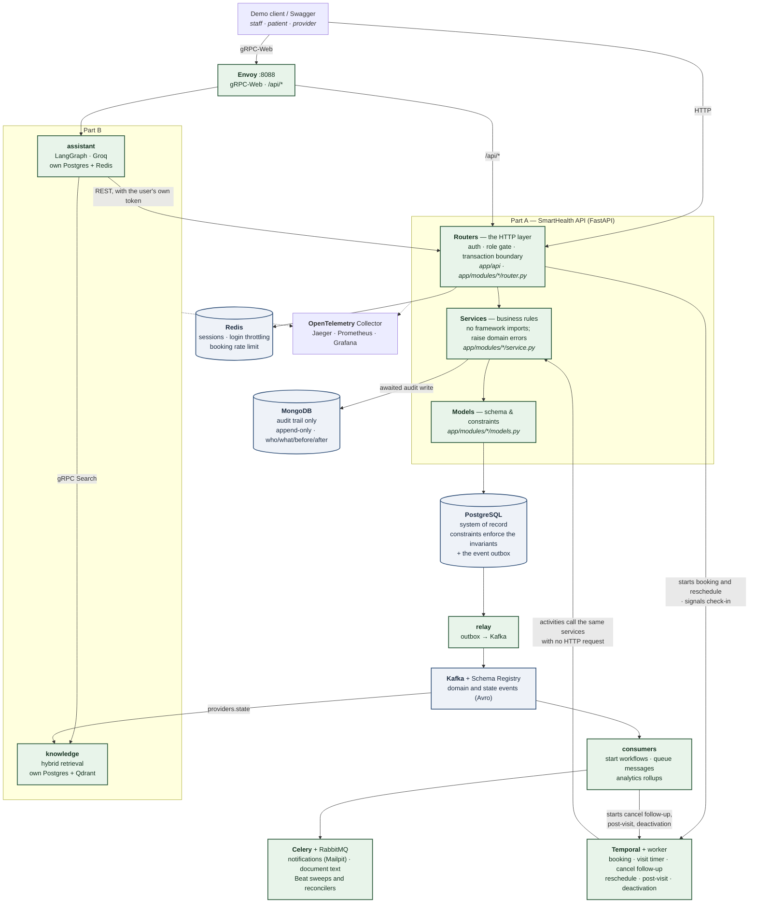
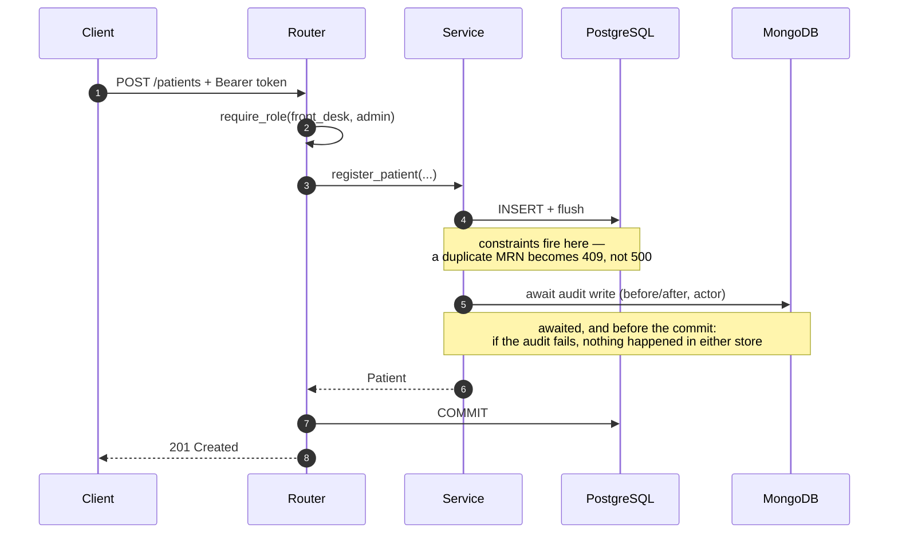
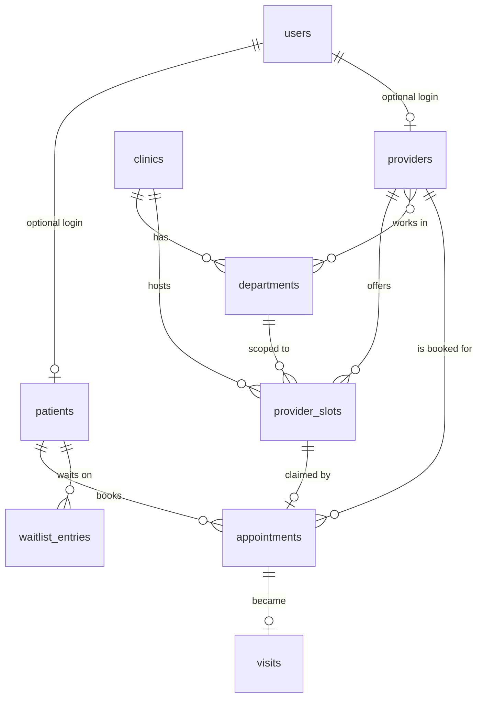

# SmartHealth

Intelligent Healthcare Operations & Patient Engagement Platform — a backend built for MediNova,
a fictional healthcare network, as a structured engineering assignment.

The project is delivered in two parts:

- **Part A — Core Platform** (Weeks 1–3): patient/provider management, appointment scheduling
  with durable workflows, visit lifecycle, event-driven background processing, observability.
- **Part B — GenAI Layer** (Weeks 4–5): operational data ingestion and embeddings, semantic
  retrieval, an AI healthcare assistant, generated patient communication, streaming responses.

> **Documentation website:** [`docs/index.html`](docs/index.html) — an illustrated tour of the
> architecture, the flows and the decisions, published with GitHub Pages from the `/docs`
> folder of `main`.

## Status

**All five weeks are complete.** Three services share Kafka, Envoy and one observability
stack, and never a store:

- **Part A** (`app/`, a modular monolith): patients, providers, scheduling on Temporal
  (booking, visits, cancel, reschedule, the waitlist), the clinical record (versioned notes,
  prescriptions, test orders, uploaded reports), billing against a fake gateway, events
  through a transactional outbox to Kafka with Avro in Schema Registry, Celery notifications
  over RabbitMQ (email to Mailpit), analytics, Redis sessions, and OpenTelemetry into
  Jaeger, Prometheus and Grafana.
- **`knowledge`** (`services/knowledge`): ingestion of the clinic's documents (Markdown and
  PDF) and hybrid retrieval over Qdrant, filtered by the caller's audience, measured by a
  golden set.
- **`assistant`** (`services/assistant`): a LangGraph agent on Groq. Guided, click-driven
  use cases for every role, grounded chat with sources, human-confirmed writes, threads,
  drafts staff approve, background reports, and per-user usage — see [The assistant](#the-assistant-part-b).

A demo web client ([Frontend](#frontend)) sits on top. See [API surface](#api-surface) for
Part A's endpoints. The fast suite (`python -m pytest -m "not docker"`) is 1361 passed,
2 skipped; the docker lane runs against the compose test stack.

## Run it

Docker and Docker Compose are all you need. One command builds and starts everything —
Part A, its workers, the Part B services, the infrastructure and the demo client:

```bash
docker compose --profile app --profile partb -f docker-compose.infra.yml up -d --build --wait

# a demonstrable clinic network: clinics, departments, providers, patients, slots,
# and one login per role, all with the password you choose here
docker compose -f docker-compose.infra.yml exec app python -m app.cli seed --password "..."
```

Then open the demo client at <http://localhost:5173> and log in as one of the seeded users
below. For the assistant to answer typed questions with a live model, put
`ASSISTANT_LLM_API_KEY` (and the provider/model, see [The assistant](#the-assistant-part-b))
in a git-ignored `.env` beside the compose file before `up`; without a key it still runs
every guided flow. `--build` matters: without it compose reuses an existing image and runs
old code. To stop, keeping the data: the same command with `down` in place of
`up -d --build --wait`; `down -v` also deletes the volumes.

**Seeded logins** (every one has the password given to `seed`):

| Login | Role |
| --- | --- |
| `admin@medinova.example` | `admin` |
| `frontdesk@medinova.example` | `front_desk` |
| `a.osei@medinova.example` | `provider` (linked to provider `LIC-100001`) |
| `j.okonkwo@example.com` | `patient` (linked to record `MRN-000001`) |

### Demo data (for a deployed review environment)

`seed` gives a small, empty network for development. For a demo that looks lived-in:

```bash
python -m app.cli demo-seed --password '<choose one>' --api-url http://localhost:8000 --allow-demo-data
python -m app.cli demo-refresh --password '<same>' --api-url http://localhost:8000 --allow-demo-data
```

`demo-seed` builds 3 clinics, 15 providers across all 10 documented specialties and 800
patients; imports six months of history up to yesterday (visits, signed notes, prescriptions,
test results, cancellations, no-shows, billing and analytics), marked
`appointments.origin = 'legacy_import'` (no events are emitted for it, and analytics are
written so the nightly reconcile reports zero drift); opens two weeks of slots; and books live
activity through the API (bookings, one cancel, one reschedule, two waitlist joins), so
Temporal, Kafka, Celery and Mailpit all have something to show. Run `demo-refresh` before a
review to bring history up to yesterday and top up live bookings. Both take `--timezone`, both
refuse without `--allow-demo-data`, both refuse a database holding non-demo patients,
`demo-refresh` also refuses a database with no demo network, and both exit non-zero if a live
booking fails (or the API cannot be reached; history up to that point stays committed).
`--password` may be omitted when `SMARTHEALTH_DEMO_PASSWORD` is set. Changing the password on a
refresh does **not** change the password of logins that already exist. Each refresh also ages
the imported clinical state: orders become reviewed (with their result) and prescriptions
completed as time passes.

Live bookings nobody checks in become no-shows through `VisitWorkflow` once their slot passes
(on a stopped server, when it restarts), so recent no-show rates are higher than the imported
history's; reviewers can check patients in and complete visits to avoid that. Each such no-show
keeps its billing hold (PRD R-33). The live phase tops up to 12 upcoming appointments. Design:
`docs/superpowers/specs/2026-11-16-demo-seed-data-design.md`.

Logins, all with the password you chose:

| Login | Role |
| --- | --- |
| `demo.admin@medinova.example` | `admin` |
| `demo.desk1@medinova.example`, `demo.desk2@medinova.example` | `front_desk` |
| `amara.osei@medinova.example`, `lena.fischer@medinova.example`, `kenji.watanabe@medinova.example`, `priya.raman@medinova.example`, `ravi.chandrasekhar@medinova.example`, `grace.abara@medinova.example`, `mateo.alvarez@medinova.example`, `sofia.lindgren@medinova.example`, `noor.haddad@medinova.example`, `daniel.mensah@medinova.example`, `hannah.brooks@medinova.example`, `oliver.grant@medinova.example`, `mei.lin@medinova.example`, `samuel.okafor@medinova.example`, `elena.petrova@medinova.example` | `provider` (one each) |
| `liam.smith2@example.com`, `mia.patel3@example.com`, `noah.kowalski4@example.com`, `zara.rossi5@example.com`, `ethan.haddad6@example.com` | `patient` (linked to their records) |

Where it shows: the demo client (appointments, visits, analytics, the provider's notes), Grafana
*Platform analytics* (six months of trends), Temporal UI and Jaeger (the live bookings only;
imported history has no workflows or traces), and Mailpit (live-booking emails only).
Imported rows are told apart by `appointments.origin = 'legacy_import'`.

### Where everything is

Default host ports; each can be moved with the variable named in
[`docker-compose.infra.yml`](docker-compose.infra.yml) (e.g. `APP_PORT`, `FRONTEND_PORT`).

| URL | What | Profile |
| --- | --- | --- |
| <http://localhost:5173> | Demo client (nginx: `/api/*` to the API, the assistant's gRPC-Web path to Envoy) | `app` |
| <http://localhost:8000/docs> | Part A API — Swagger UI (also `/redoc`, `/openapi.json`, `/health`, `/ready`) | `app` |
| <http://localhost:8088> | Envoy, the front door — gRPC-Web to `assistant` and `knowledge`, `/api/*` to Part A | `partb` |
| <http://localhost:8080> | Temporal UI — every workflow's history (`booking-<id>`, `visit-<id>`, …) | `app` |
| <http://localhost:3000> | Grafana — anonymous read-only; log in as `admin` / `GRAFANA_ADMIN_PASSWORD` (default `smarthealth`). Folder **SmartHealth**: Service overview, Async backbone, Platform analytics, Assistant | — |
| <http://localhost:16686> | Jaeger — traces | — |
| <http://localhost:9090> | Prometheus — metrics | — |
| <http://localhost:15672> | RabbitMQ management — `smarthealth` / `smarthealth`, vhost `part-a` | — |
| <http://localhost:8025> | Mailpit — every email the platform sends | — |
| <http://localhost:8081> | Schema Registry — the Avro schemas of every topic (`/subjects`) | — |
| <http://localhost:6333/dashboard> | Qdrant dashboard — the knowledge service's vectors | `partb` |
| <http://localhost:8090> | `payments-mock`, the fake card gateway (`POST /_chaos` makes it misbehave) | — |

"—" means the service is in the plain infrastructure stack and needs no profile. The
databases are published too (Postgres 5432, Mongo 27017, Redis 6379, Kafka 9092, Temporal
7233), all with the `smarthealth` development credentials from the compose file.

## Kubernetes (k3d)

The same system on Kubernetes: 29 pods (one per compose service) installed by one
`helm upgrade --install` into a local k3d cluster capped at 8 GB, the stand-in for a single
8 GB server. Design: `docs/superpowers/specs/2026-11-17-helm-charts-k3d-design.md`.

**Prerequisites:** Docker Desktop, and the `helm` and `k3d` binaries on your `PATH`
(`winget install Helm.Helm k3d.k3d`; if winget is unavailable, download them from
get.helm.sh and the k3d GitHub releases). Stop the compose stacks first -- Docker Desktop
needs the memory (about 10 GB):
`docker compose -p smarthealth -f docker-compose.infra.yml --profile app --profile partb stop`
(`... start` brings the dev stack back afterwards).

```bash
bash scripts/k3d_up.sh          # cluster, five images built and imported, helm install (~15 min first time)
python scripts/k3d_smoke.py     # every pod Ready, login, gRPC-Web, tool logins, demo seed, memory vs budget
bash scripts/k3d_down.sh        # delete the cluster
```

| URL | What |
| --- | --- |
| <http://localhost:8080/> | Demo client |
| <http://localhost:8080/api/docs> | Part A API -- Swagger UI |
| <http://localhost:8080/grafana> | Grafana |
| <http://localhost:8080/jaeger> | Jaeger |
| <http://localhost:8080/temporal> | Temporal UI |
| <http://localhost:8080/mailpit> | Mailpit |
| <http://localhost:8080/rabbitmq> | RabbitMQ management |
| <http://localhost:8080/prometheus> | Prometheus |

The tool paths (everything except `/` and `/api`) sit behind one basic-auth login,
`reviewer` / `smarthealth` (k3d only; set `toolsAuth` in `values-local.yaml`), stored as
the one key (`users`) of the Secret `smarthealth-tools-auth`, which the Traefik middleware
reads. Qdrant stays
internal: `kubectl -n smarthealth port-forward svc/qdrant 6333`. Demo data (the smoke script
does this itself) is two suspended CronJobs, `demo-seed` and `demo-refresh`, started on
demand: `kubectl -n smarthealth create job --from=cronjob/demo-seed demo-seed-1`.

**Chart layout:** `deploy/helm/smarthealth` is the umbrella (`values.yaml` is the 8 GB
profile with the measured memory budget in comments; `values-local.yaml` is k3d);
`deploy/helm/sh-lib` is a library chart whose templates every component uses (deployment, PVC,
service, probes, wait-for init container) and which only the umbrella depends on; `deploy/helm/charts/` holds 21 component charts, `core`
being Part A's six processes from one image (`core-api` is the Service `app`); the umbrella
installs `postgres` three times and `redis` twice by alias. Config files under `ops/` are
copied into charts by `python scripts/sync_chart_files.py` (a meta-test fails on drift).
Persistent data lives in PVCs kept on `helm uninstall` and on Argo CD deletion.

## Deploying to AWS

The same charts on one small AWS server, reachable by a reviewer from anywhere at one
`https://<id>.cloudfront.net/` address, started with one command before a review and
stopping itself. **Deployed on 2026-11-17, all but CloudFront**: AWS must verify a new
account before it creates a distribution (PRD R-35); everything behind it runs and was
checked from inside the server. What happened on that first deploy: `docs/ARCHITECTURE.md` 8.8. Design and
rejected alternatives: `docs/superpowers/specs/2026-11-17-aws-deploy-design.md`
(decisions D-42 ... D-54 in `docs/PRD.md`); the walkthrough is `docs/ARCHITECTURE.md` section 8.

```
browser --HTTPS--> CloudFront (d....cloudfront.net)
                      | VPC origin: AWS's private network, HTTP :80
VPC 10.20.0.0/16, one availability zone, ap-southeast-2
  public subnet:  NAT instance (t4g.micro) --> internet gateway --> GHCR, GitHub, Groq
  private subnet: k3s server (m7i-flex.large, no public IP, 40 GB encrypted disk)
                  Traefik --> the 29 pods;  Argo CD watches GitHub `main`
SSM Parameter Store /smarthealth/* (secrets)   S3 (Terraform state, CloudFront logs)
```

The server has no public address and no SSH: CloudFront reaches it over a VPC origin, you
reach it through AWS Systems Manager, and it reaches the internet through the NAT instance.
It stops itself 3 hours after every boot.

**Prerequisites:** an AWS project (Free plan, `ap-southeast-2`, with the $100 credits) and the
AWS CLI v2 with a profile named `smarthealth` (`aws login --profile smarthealth`; on Windows
the scripts also find it in `~/AppData/Local/Programs/Amazon/AWSCLIV2`); Terraform 1.10 or
newer; the Session Manager plugin for the AWS CLI (only for `scripts/aws_shell.sh`);
`docker login ghcr.io` with a token that can write packages; and the Groq key in the
git-ignored `.env` (`ASSISTANT_LLM_API_KEY`, optional: without it the assistant runs offline).
Every script runs under bash (Git Bash on Windows).

**First deploy** (nothing is created in AWS until you have read a plan):

```bash
scripts/tf.sh bootstrap init && scripts/tf.sh bootstrap apply   # the S3 bucket that holds Terraform state
scripts/aws_init.sh                    # writes the git-ignored backend.hcl, terraform init
scripts/tf.sh plan -out=tfplan         # READ every resource before the next line
scripts/tf.sh apply tfplan             # VPC, NAT, server, CloudFront, SSM, log bucket
scripts/aws_secrets.sh                 # the JWT signing key and the Groq key into SSM
```

Then, on GitHub, make the five packages public (Packages, each package's settings, Change
visibility), so the server pulls without a secret. Then:

```bash
scripts/release.sh                     # builds and pushes five images to ghcr.io/sadainiqrar, records the tag
                                       # and the CloudFront URL in values-aws.yaml, renders the charts with
                                       # them (tests; needs helm), commits "release: <sha>"
# fast-forward main to that commit and push it
scripts/aws_start.sh                   # starts NAT and server, waits for /api/ready (up to 15 min)
scripts/aws_seed.sh                    # first time only, once Argo CD has synced: the demo data
python scripts/aws_smoke.py            # ready, login, gRPC-Web, tool logins, /argocd, caching
```

`scripts/aws_start.sh` prints the URL. The first start installs k3s and pulls every image,
so allow up to 15 minutes.

**Passwords** are generated by Terraform:

| For | Command |
| --- | --- |
| The tool login (`reviewer`: Grafana, Jaeger, Temporal UI, Mailpit, RabbitMQ, Prometheus, `/argocd`) | `scripts/tf.sh output -raw tools_password` |
| Every demo login (see Demo data) | `scripts/tf.sh output -raw demo_password` |
| Argo CD's `admin` | `scripts/tf.sh output -raw argocd_admin_password` |

**The review routine:**

```bash
scripts/aws_start.sh --refresh   # start, wait, and re-run the demo refresh (moves the history to today)
scripts/aws_extend.sh            # another 3 hours, when a review runs long
scripts/aws_stop.sh              # stop now; the disks keep everything
scripts/aws_shell.sh             # a root shell on the server (`k3s kubectl ...`)
```

To ship a change: commit, `scripts/release.sh`, fast-forward `main`, push. Argo CD polls
every 3 minutes and syncs whenever the server is running.

**Cost** (approximate, about 10 hours a week of running):

| Item | Per month |
| --- | --- |
| Server and NAT instance, running time | about $6 |
| 48 GB of encrypted disks (server 40, NAT 8), also while stopped | about $4.60 |
| Public IPv4 on the NAT instance, while running | about $0.20 |
| CloudFront, S3, SSM Parameter Store | within the free tiers |
| **Total** | **about $11, roughly 9 months of the $100 credits** |

There is no managed NAT gateway (about $35 a month even idle) and no WAF, by decision.
**There are no backups**: all data sits on the server's disk (PRD R-34).

**Teardown:**

```bash
scripts/tf.sh destroy                # the stack
scripts/tf.sh bootstrap destroy      # the state bucket (empty it first if Terraform says it is not empty)
```

The server's root disk is **kept when the instance is terminated** (it holds all the data), so
after `destroy` delete the volume by hand: EC2, Volumes, the 40 GB volume that is not
attached, Delete. The SSM parameters `jwt-private-key` and `llm-api-key` were put by
`aws_secrets.sh`, not Terraform, so delete them too (`/smarthealth/jwt-private-key` and
`/smarthealth/llm-api-key` in Parameter Store).

## Architecture

The three services, and what connects them. Part A is one deployable; `knowledge` and
`assistant` each own their stores and reach Part A only over its HTTP API, its public key and
Kafka.



Dotted lines are telemetry: every process exports traces and metrics to the collector.

**This is a modular monolith, deliberately.** One deployable, one schema, one migration
history — and an import graph with a shape that two meta-tests enforce rather than
document. A plain monolith and a modular one are indistinguishable from the outside; the
only difference is whether anything may import anything, and here it may not.

**The layering rule** (vertical): services never import FastAPI. They raise domain errors that the
router layer translates to HTTP. That is what lets the booking workflow's Temporal activities
call the same service functions from a worker process with no web request — and distinguish
a permanent failure (*"the slot is taken"*) from a retryable one (*"the connection
dropped"*), which an HTTP status code cannot express.

**The module rule** (horizontal): `app/modules/<x>` does not import `app/modules/<y>`.
Every `service.py` imports only shared infrastructure and its own module; the only
cross-module edges in the codebase are declared as explicit pairs in
`tests/meta/test_import_boundaries.py` — nine router-layer auth edges onto `identity`, two
from scheduling (its router and its activities) onto `patients/public.py`, and the same two
onto `providers/public.py` — the one file each of those modules publishes for others. Scheduling shows
why the rule is about code and not data: `appointments` carries foreign keys into two
other modules' tables (`patients`; `providers`, `clinics`, `departments`), declared as table-name strings, so it is fully coupled in the
database and not coupled at all in Python. Shared schema is what a modular monolith *is*;
the modularity lives in the import graph, and that is what keeps each module extractable
as bounded work rather than archaeology.

### Request lifecycle — `POST /patients`



The router owns the commit; services only flush. That is what lets one request compose
several services into a single transaction — and lets each booking activity wrap one
service call in its own transaction, so claiming a slot and attaching it to the appointment
commit together.

### Data model



Four decisions shape this, each rejecting a more obvious alternative:

1. **A user account is not a person.** `users` is credentials only; `patients` and
   `providers` link to one *optionally*, so front desk can register a walk-in who has no
   email and no password.
2. **Bookable time is a row, not a calculation.** Booking is
   `UPDATE provider_slots SET status='held', version=version+1 WHERE id=:id AND status='free'` — zero rows
   affected *is* the conflict, with no window between checking and acting.
3. **An appointment is not a visit.** The booking and what actually happened have
   different lifecycles. Split, Average Wait Time is `seen_at - checked_in_at` and a
   no-show is an appointment with no visit.
4. **PostgreSQL is the system of record; MongoDB owns only the audit trail** — which is
   append-only, shape-varying per entity, and unbounded.

**What the database guarantees**, rather than trusting application code: at most one
*live* appointment per slot (a partial unique index, so cancelling frees it); no
overlapping slots for one provider (a GiST exclusion constraint); a slot, provider and
clinic that actually agree (composite foreign keys); at most one *live* appointment
replacing any given appointment (a second partial unique index, so two reschedules of one
appointment cannot both confirm); and a confirmed appointment that must hold a slot (a
CHECK) — the assignment's headline invariant, made structural.

## Documentation

| Document | Purpose |
| --- | --- |
| [`docs/index.html`](docs/index.html) | **The documentation website** (GitHub Pages, served from `/docs` on `main`) — the guided tour; start here |
| [`docs/PRD.md`](docs/PRD.md) | **Product requirements** — use cases, numbered requirements, milestones, and feature traceability |
| [`docs/requirements/part-a-core-platform.md`](docs/requirements/part-a-core-platform.md) | Part A problem statement, functional requirements, tech stack |
| [`docs/requirements/part-b-genai-layer.md`](docs/requirements/part-b-genai-layer.md) | Part B GenAI scope and requirements |
| [`docs/requirements/execution-guidelines.md`](docs/requirements/execution-guidelines.md) | Weekly plan, submission guidelines, evaluation criteria |
| [`docs/superpowers/specs/2026-09-01-testing-harness-design.md`](docs/superpowers/specs/2026-09-01-testing-harness-design.md) | Testing harness design |
| [`docs/superpowers/specs/2026-09-02-week1-foundation-design.md`](docs/superpowers/specs/2026-09-02-week1-foundation-design.md) | Domain model and schema decisions |
| [`docs/superpowers/specs/2026-09-03-week1-management-apis-design.md`](docs/superpowers/specs/2026-09-03-week1-management-apis-design.md) | Management API design, and what Week 1 deliberately deferred |
| [`docs/superpowers/specs/2026-10-28-week2-scheduling-workflows-design.md`](docs/superpowers/specs/2026-10-28-week2-scheduling-workflows-design.md) | Week 2 scheduling workflows — booking, visit, cancel/reschedule, waitlist and patient self-service (all built) |
| [`docs/superpowers/specs/2026-11-10-weeks3-5-architecture-design.md`](docs/superpowers/specs/2026-11-10-weeks3-5-architecture-design.md) | Weeks 3–5 — the event backbone, billing, notifications, analytics, observability, and the Part B services (decisions D-17 … D-31) |
| [`docs/ARCHITECTURE.md`](docs/ARCHITECTURE.md) | Module breakdown, data flows for every built endpoint, the booking, visit, cancel and reschedule workflows, and the event flows |
| [`tests/README.md`](tests/README.md) | How to run and author tests |

The original `.docx` files are kept in `docs/requirements/` and are authoritative.

## Tech stack

**Backend:** Python · FastAPI · PostgreSQL · NoSQL DB · Redis · Celery + RabbitMQ ·
Kafka + Schema Registry · Temporal

**Observability:** OpenTelemetry · Prometheus + Grafana · Jaeger

**GenAI:** LangGraph / LangChain · LLM provider (OpenAI / Groq / Anthropic) · Vector DB

**DevOps:** Docker · Docker Compose

## Setup

```bash
python -m venv .venv
source .venv/Scripts/activate     # Windows (Git Bash);  .venv\Scripts\Activate.ps1 in PowerShell
# source .venv/bin/activate       # POSIX
pip install -e ".[dev]"

python -m pytest -m "not docker"    # fast tests, no containers

docker compose -p smarthealth-test --env-file .env.test -f docker-compose.infra.yml up -d --wait
python -m pytest -m docker          # tests that need infrastructure
```

See [`tests/README.md`](tests/README.md) for the tier model and how to author a test case.

## API surface

| Method | Path | Roles |
| --- | --- | --- |
| POST | `/auth/login` | public — returns an access token (10 min) and a single-use refresh token |
| POST | `/auth/refresh` | public — spends a refresh token for a new pair; a spent one ends the session |
| POST | `/auth/logout`, `/auth/logout-all` | any role — end this session, or every session of the login |
| GET | `/.well-known/jwks.json` | public — the Ed25519 key that verifies access tokens |
| POST | `/patients` | `front_desk`, `admin` |
| GET | `/patients`, `/patients/{id}` | `front_desk`, `admin`, `provider` |
| PATCH | `/patients/{id}` | `front_desk`, `admin` |
| POST | `/providers` | `admin` |
| PATCH | `/providers/{id}` | `admin` |
| GET | `/providers`, `/providers/{id}` | any authenticated |
| GET | `/patients/me` | `patient` — the record linked to the caller's login; 404 if none is linked |
| GET | `/slots` | any authenticated — a provider's free, future slots; `provider_id` is required, and `from`/`to` must carry a timezone or the answer is a 422 |
| POST | `/appointments` | `patient` (for themselves only), `front_desk`, `admin` — answers **202**; optional `Idempotency-Key` header |
| GET | `/appointments` | `patient` (always their own: another `patient_id` is a **403**, a login with no linked record a **404**), `provider`, `front_desk`, `admin` (filters `patient_id`, `provider_id`, `status`, `from`, `to`; `from`/`to` bound the slot's start, inclusive and exclusive, and must carry a timezone or the answer is a 422). Paginated, newest slot first, appointments with no slot last; each item carries `starts_at` |
| GET | `/appointments/{id}` | the owning `patient`, `provider`, `front_desk`, `admin` |
| POST | `/appointments/{id}/check-in` | `front_desk`, `admin` — answers **200** `VisitRead`; 409 on an illegal step |
| POST | `/appointments/{id}/seen`, `/appointments/{id}/complete` | `provider` (the appointment's own; another provider gets a 404), `admin` — answer **200** `VisitRead`; 409 on an illegal step, and `complete` is a 409 until the visit's note is signed |
| GET | `/appointments/{id}/visit` | the owning `patient`, `provider`, `front_desk`, `admin` — 404 until a check-in exists |
| POST | `/appointments/{id}/cancel` | the owning `patient`, `front_desk`, `admin` — body `{reason}`; answers **200** with the appointment; 409 unless it is `pending` or `confirmed` with no visit, and also while the reschedule that created it is still completing |
| POST | `/appointments/{id}/reschedule` | the owning `patient`, `front_desk`, `admin` — body `{new_slot_id, reason?}`; answers **202** with the new appointment's id; only a `confirmed` appointment (no visit); 409 otherwise; optional `Idempotency-Key` header |
| POST | `/waitlist` | `patient` (for themselves only), `front_desk`, `admin` — answers **201** |
| GET | `/waitlist` | `patient` (their own entries, whatever `patient_id` they send), `front_desk`, `admin` |
| PUT, GET | `/appointments/{id}/note` | `provider` (the appointment's own) — the visit's draft note; `GET` also the patient (no clinician-only section) |
| POST | `/appointments/{id}/note/sign`, `/note/amend` | `provider` (the appointment's own) — sign the draft (creates its prescriptions and test orders); amend starts a new draft version |
| GET | `/patients/me/record`, `/patients/{id}/record` | `patient` (own, no clinician-only notes); `provider` with a care relationship; `front_desk` sees test-order status only — every read audited |
| POST | `/patients/{id}/documents` | `patient` (own), `front_desk`, the treating `provider` — body is the file (PDF, PNG, JPEG, ≤ 10 MB); text is extracted in the background |
| GET | `/patients/{id}/documents/{doc}` | `patient` (own), the treating `provider` — with the extracted text |
| POST | `/test-orders/{id}/review` | `provider` (who ordered it) |
| GET | `/analytics/summary`, `/analytics/timeseries` | `admin`, `front_desk` — the five Part A metrics over `from`/`to` |
| GET | `/analytics/utilisation` | `admin`, `front_desk` — per department: slots offered over `from`/`to`, how many are booked, and the share |
| GET | `/users?ids=…` | `admin` — name, email and role for given login ids (the AI usage page) |
| POST | `/notifications` | `front_desk`, `admin`, a `provider` for a patient they treat — send a message a person approved; `Idempotency-Key` required; answers **202** `queued` / `duplicate` / `unreachable` |

`GET /health` and `GET /ready` are public.

**Booking is asynchronous.** `POST /appointments` with `{patient_id, slot_id, reason?}`
answers `202 {appointment_id, status: "pending"}` and starts a Temporal workflow; poll
`GET /appointments/{id}` until `status` is `confirmed` or `failed`. Repeating a request
with the same `Idempotency-Key` returns the same booking; the same key with a different
body is a 422. A patient booking for someone else is 403; a patient reading someone
else's appointment is 404. Temporal unreachable is a 503. Details:
[`docs/ARCHITECTURE.md`](docs/ARCHITECTURE.md) §2.8 and §3.2.

**Visit actions are synchronous.** Check-in, seen and complete are written in the request
itself and answer `200` with the visit; an action that is not legal now — a second
check-in, `seen` before check-in, `complete` before `seen`, anything on a cancelled or
no-show appointment — is a `409`, and an unknown appointment a `404`. The only thing that
runs in the background is the no-show timer: a workflow started when a booking confirms
marks the appointment `no_show` once the slot's end plus a grace period passes with no
check-in. Details: [`docs/ARCHITECTURE.md`](docs/ARCHITECTURE.md) §2.9 and §3.2a.

**Cancel is synchronous; reschedule is not.** A cancel writes the appointment and its slot
in one transaction and answers `200`; a repeat, a checked-in patient, or an appointment
that is not `pending` or `confirmed` is a `409`. The same transaction writes an
`appointments.cancelled` event to the outbox; the request touches no Temporal at all. The
`relay` publishes the event and the `appointments.cancelled` consumer starts
`CancelFollowUpWorkflow`, which stops the visit timer, releases the card authorisation at
the payment gateway and offers the freed slot to the waitlist — so a follow-up can no longer
be lost (PRD R-17, closed). The patient is told by email. A reschedule answers `202` with the **new** appointment's
id: poll `GET /appointments/{id}` on it. The new slot is booked first and the old one
released only when that confirmed, so a failed reschedule leaves the original appointment;
the old one then reads `rescheduled`. A patient acts only on their own appointments (another's
is a `404`). Waiting patients join with `POST /waitlist` (a time window, optionally one
provider or department); every release is offered to up to three matching entries, oldest
first, each as a booking that confirms or fails by itself. Details:
[`docs/ARCHITECTURE.md`](docs/ARCHITECTURE.md) §3.3.

A completed reschedule releases the old appointment's authorisation and writes an
`appointments.rescheduled` event, from which the patient is notified. The remaining known
limits of these flows are in PRD §9 (R-18 to R-22).

**Try it in a browser.** With the stack running, FastAPI serves interactive API
documentation generated from the route definitions and response models:

| URL | What it is |
| --- | --- |
| <http://localhost:8000/docs> | Swagger UI — get a token from `POST /auth/login`, paste its `access_token` into **Authorize** (`BearerAuth`), then execute any endpoint against the running system |
| <http://localhost:8000/redoc> | ReDoc — a reference-style read of the same schema |
| <http://localhost:8000/openapi.json> | The raw OpenAPI schema |

The backend has no UI of its own (see [`docs/PRD.md`](docs/PRD.md) §2, non-goals). `/docs`
is the way to exercise it by hand; the [demo client](#frontend) is a convenience on top.

**Layering:** `router → service → SQLAlchemy`. Services never import FastAPI — they raise
domain errors that exception handlers translate, so the booking workflow's Temporal
activities call the same functions. The router (in the worker, the activity) owns the
transaction boundary; services flush.

**Every mutation is audited** to Mongo with actor, action and before/after, awaited so a
Mongo outage fails the request rather than silently dropping the record.

**A visit completes with its record.** `seen` and `complete` belong to the appointment's own
provider (PRD R-14, closed), and `complete` needs a signed clinical note. Completion writes a
`visits.completed` event, and its consumer starts `PostVisitWorkflow`, which captures the
charge authorised at booking.

**Patient self-service.** A patient reads their own record (`GET /patients/me`), an
appointment they own, and their own list (`GET /appointments`), which is forced to their
record server-side. All of it needs the login to be linked to a patient record
(`link-patient`, below). A provider's list is still every appointment; the clinical
record and the visit actions are scoped to the provider's own patients (PRD R-14, closed
in Week 4).

### Running it by hand

[Run it](#run-it) above starts everything. Part A alone, without the Part B services, is the
`app` profile:

```bash
# Part A in containers
docker compose --profile app -f docker-compose.infra.yml up -d --build --wait
curl http://localhost:8000/health

# an account to log in with, created inside the container against the stack's own database
docker compose --profile app -f docker-compose.infra.yml exec app \
  python -m app.cli create-user --email you@example.com --password "..." --role admin

curl -X POST http://localhost:8000/auth/login -H 'Content-Type: application/json' \
  -d '{"email": "you@example.com", "password": "..."}'
```

**Sessions.** An access token lives ten minutes and is honoured only while its session
exists in Redis; refresh it with the `refresh_token` from the login
(`POST /auth/refresh -d '{"refresh_token": "..."}'`), which returns a new pair and spends the
old refresh token. `POST /auth/logout` ends the session at once.
`python -m app.cli deactivate-user --email …` stops a login *and* ends its live sessions.
Five failed logins lock an address for fifteen minutes, and the lock answers exactly like
a wrong password. Tokens are signed with a committed development key unless
`SMARTHEALTH_JWT_PRIVATE_KEY` is set (`python -m app.cli generate-signing-key`); the API
refuses that key when `SMARTHEALTH_ENVIRONMENT=production`.

**Or run the API and worker on the host** against the infrastructure containers alone —
handy for a debugger. `Settings` defaults to the dev stack's ports on `localhost` and its
`smarthealth` credentials; a different stack needs `SMARTHEALTH_POSTGRES_PORT` and friends
(every variable is in `.env.example`, which `cp .env.example .env` turns into config). Stop
the `app` profile's containers first, or they share the task queue, the consumer groups and
port 8000:

```bash
docker compose -f docker-compose.infra.yml up -d --wait     # infrastructure only, no profile
python -m alembic upgrade head
python -m app.relay --setup                                 # create topics, register schemas
python -m app.worker                                        # terminal 1
uvicorn app.main:app --port 8000                            # terminal 2
python -m app.relay                                         # terminal 3: outbox -> Kafka
python -m app.consumers                                     # terminal 4: events -> workflows, messages
celery -A app.celery_app worker -Q notifications,maintenance,documents   # terminal 5
```

A `--role patient` login also needs linking to its patient record before it can read its own
data: `python -m app.cli link-patient --email … --mrn …`, described under
[Frontend](#frontend).

To stop the stack, keeping its data: `docker compose --profile app -f docker-compose.infra.yml down`.
Adding `-v` also deletes the dev stack's volumes, and with them all dev data.

**Seed a demonstrable clinic network** — two clinics in different timezones,
departments, five providers with specialties, one login per role, 50 patients (most of
them walk-ins with no user account), and a two-week window of bookable slots:

```bash
docker compose --profile app -f docker-compose.infra.yml exec app \
  python -m app.cli seed --password "..." --patients 50
```

Idempotent — rerunning changes nothing, because every row is matched on its natural
key, including passwords: seeded logins keep the password from the first run.
`--clear` removes exactly what it created and nothing else — but once any appointment
references a seeded slot (a failed booking included), `--clear` refuses with a
foreign-key error, by design (PRD R-10). To start over, remove the dev stack's volumes with
`docker compose --profile app -f docker-compose.infra.yml down -v`; `-v` deletes all dev data.

It deliberately seeds **no appointments, visits or waitlist entries**. Those are
workflow outputs: an appointment reaches `confirmed` only after
slot reservation, the billing pre-check and notification scheduling have all succeeded,
so hand-writing one would fabricate state no workflow ever ran — and the workflows would
then be tested against fiction. See [`app/seed.py`](app/seed.py).

`--profile app` starts six services from the same image — `app` (the API), `worker` (the
Temporal worker, `python -m app.worker`), `relay` (outbox to Kafka), `consumers` (the Kafka
consumers), `celery-worker` and `celery-beat` — plus `temporal-ui` and `frontend`, the demo
client (its own image; see [Frontend](#frontend)). They sit behind a compose profile so the
test stack, which uses the same file, does not start them — the tests drive the
application in-process. The worker starts only once `app` is healthy, because the `app`
container applies the migrations. Its healthcheck, `python -m app.worker --check`,
executes a canary workflow, so `--wait` returns only when a worker is actually polling
and executing — not merely when the process is up. It runs the booking, visit, cancel
follow-up, reschedule, post-visit and provider-deactivation workflows. The design of the
Week 2 scheduling slices is in
[`docs/superpowers/specs/2026-10-28-week2-scheduling-workflows-design.md`](docs/superpowers/specs/2026-10-28-week2-scheduling-workflows-design.md).

**Book an appointment.** After seeding (above), log in as the seeded front-desk user with
the password you gave `seed`. If the stack was seeded earlier with a password you do not
know, create your own logins with
`python -m app.cli create-user --email … --password … --role front_desk` (and again with
`--role provider` for the visit demo below) and use those instead.
`GET /slots?provider_id=…` lists a provider's free slots, but
the snippet below picks a slot and a patient straight from Postgres (bash / Git Bash). The
slot is one of the seeded provider login's own (licence `LIC-100001`), because only the
appointment's own provider may run its visit later:

```bash
TOKEN=$(curl -s -X POST http://localhost:8000/auth/login -H 'Content-Type: application/json' \
  -d '{"email": "frontdesk@medinova.example", "password": "..."}' \
  | python -c 'import json,sys; print(json.load(sys.stdin)["access_token"])')

sql() { docker compose --profile app -f docker-compose.infra.yml exec -T postgres \
  psql -U smarthealth -d smarthealth -tAc "$1"; }
SLOT=$(sql "select s.id from provider_slots s join providers p on p.id = s.provider_id where p.license_number = 'LIC-100001' and s.status = 'free' and s.starts_at > now() order by s.starts_at limit 1")
PATIENT=$(sql "select id from patients order by created_at limit 1")

KEY=demo-$(date +%s)   # once per run: the same key with a different slot is a 422
book() { curl -s -X POST http://localhost:8000/appointments \
  -H "Authorization: Bearer $TOKEN" -H 'Content-Type: application/json' \
  -H "Idempotency-Key: $KEY" \
  -d "{\"patient_id\": \"$PATIENT\", \"slot_id\": \"$SLOT\"}"; }
book    # 202 {"appointment_id":"…","status":"pending"}
APPOINTMENT=$(book | python -c 'import json,sys; print(json.load(sys.stdin)["appointment_id"])')

curl -s http://localhost:8000/appointments/$APPOINTMENT -H "Authorization: Bearer $TOKEN"
# repeat until "status" is "confirmed" (or "failed")
```

Poll on `status`, not `in_progress`: `in_progress: true` appears only on the answer for a
booking whose row does not exist yet. A pending appointment that has a row reads
`in_progress: false`.

The second `book` is itself the idempotency demonstration: the same `Idempotency-Key` and
body return the same `appointment_id` and book nothing new. (To book again, generate
a new `KEY`: the same key with a different slot is a 422, and `$APPOINTMENT` stays empty.) The appointment's audit trail —
`booking_requested`, `slot_claimed`, `confirmed` — is in Mongo, and the workflow's history
(`booking-<appointment_id>`) is in Temporal.

**Seeing a workflow.** The `app` profile runs Temporal's web UI at <http://localhost:8080>
(`TEMPORAL_UI_PORT` to move it): search for the workflow id — `booking-<id>`, `visit-<id>`,
`cancel-<id>`, `reschedule-<id>` — for its every step, retry and failure. Without a browser,
the same history from the CLI inside the Temporal container:

```bash
docker compose -f docker-compose.infra.yml exec temporal \
  temporal workflow show -w booking-$APPOINTMENT --address temporal:7233
```

**Part B, the transport.** `--profile partb` adds the two Part B services, each with its
own stores: `knowledge` (gRPC `Search`; its own Postgres and Qdrant; the clinic's documents
and a provider directory it builds from Part A's `providers.state` topic, re-indexed on
start) and `assistant` (server-streaming gRPC `Chat`; its own Postgres for conversation
checkpoints and its own Redis for resumable turns and a revoked-session deny-list). **Envoy** on
<http://localhost:8088> is the front door: gRPC-Web to Part B, `/api/*` to Part A. Neither
Part B service holds anything of Part A's but its public key, fetched from
`/.well-known/jwks.json`.

```bash
docker compose --profile app --profile partb -f docker-compose.infra.yml up -d --build --wait
docker compose -f docker-compose.infra.yml exec app python -m app.cli seed --password "..."
docker compose -f docker-compose.infra.yml exec app   python -m app.cli create-user --email you@example.com --password "..." --role patient
python scripts/grpcweb_smoke.py --email you@example.com --password "..." --message cardiology
```

The smoke script speaks gRPC-Web exactly as a browser would and prints the streamed turn:
the assistant's answer, then its citations from `knowledge`. The trace runs `assistant` ->
`knowledge` and `assistant` -> Part A (`Part A <METHOD>` spans), with every model call an
`llm chat` span carrying its token counts, in Jaeger. After editing a `.proto` in
`contracts/proto/`, run `python scripts/gen_proto.py`.

**Seeing events and messages.** Every domain change writes an event to the outbox in its
own transaction; the `relay` service publishes it to Kafka (Avro, Schema Registry), and
`consumers` acts on it: a cancel's follow-up, a deactivated provider's cancellations, the
post-visit charge, and patient messages. Messages are sent by `celery-worker` over
RabbitMQ; email lands in **Mailpit** at <http://localhost:8025> (patients need an email on
their record), SMS is a logging fake. Billing goes to `payments-mock` on :8090 —
`curl -X POST localhost:8090/_chaos -H 'Content-Type: application/json' -d '{"decline_customers": ["<patient id>"]}'`
makes the next pre-check for that patient decline, and the booking compensate.
RabbitMQ's management UI is <http://localhost:15672> (vhost `part-a`).

**Seeing a trace, a metric, a dashboard.** Every process exports traces and metrics to an
OpenTelemetry Collector (`otel-collector`), which sends traces to Jaeger and metrics to
Prometheus. These run in the plain infrastructure stack — no profile needed:

| URL | What |
| --- | --- |
| <http://localhost:16686> | Jaeger — services `part-a-api`, `part-a-worker`, `part-a-relay`, `part-a-consumers`, `part-a-celery`, `assistant`, `knowledge`. A request's `StartWorkflow:<type>` span is the parent of the workflow's `RunWorkflow` and `RunActivity` spans on the worker (proved for the canary by case `obs-002`). SQL statements do **not** show up yet — see [Known open items](#known-open-items) |
| <http://localhost:9090> | Prometheus — e.g. `http_server_duration_milliseconds_count{job="smarthealth/part-a-api"}`, `temporal_workflow_completed_total`; it also scrapes RabbitMQ and `kafka-exporter` |
| <http://localhost:3000> | Grafana, anonymous read-only (admin password `GRAFANA_ADMIN_PASSWORD`, default `smarthealth`) — folder **SmartHealth**: **Service overview**, **Async backbone**, **Platform analytics**, **Assistant**, and provisioned alert rules; Jaeger is a datasource under Explore |

Every JSON log line written inside a request or an activity carries `trace_id` and
`span_id`, so a log line leads to its trace. The test stack publishes the same four on
offset ports (`.env.test`: Jaeger 26686, Prometheus 19090, Grafana 13000, collector
14317/14318). To export from a process on the host, set
`SMARTHEALTH_OTEL_ENDPOINT_HTTP=http://localhost:4318` (and, for the worker's Temporal SDK
metrics, `SMARTHEALTH_OTEL_ENDPOINT_GRPC=http://localhost:4317`); unset, nothing is exported.

**Run a visit.** Continue from the booking above once `$APPOINTMENT` reads `confirmed`.
Check-in is the front desk's; `seen`, the clinical note and `complete` belong to the
appointment's own provider — the seeded provider login `a.osei@medinova.example` (same
password as the other seeded logins), whose slot the booking above picked. A visit
completes only once its note is signed, and a note is signed with at least one diagnosis
and a patient summary.

```bash
: "${APPOINTMENT:?booking failed}"
login() { curl -s -X POST http://localhost:8000/auth/login -H 'Content-Type: application/json' \
  -d "{\"email\": \"$1\", \"password\": \"...\"}" \
  | python -c 'import json,sys; print(json.load(sys.stdin)["access_token"])'; }
PROVIDER_TOKEN=$(login a.osei@medinova.example)

act() { curl -s -X POST http://localhost:8000/appointments/$APPOINTMENT/$1 -H "Authorization: Bearer $2"; }
act check-in  $TOKEN            # 200 {"status":"checked_in", "checked_in_at":"…", …}
act check-in  $TOKEN            # 409 — a repeat is refused, not silently accepted
act seen      $PROVIDER_TOKEN   # 200 {"status":"in_progress", "seen_at":"…", …}
act complete  $PROVIDER_TOKEN   # 409 — the visit's note is not signed yet

curl -s -X PUT http://localhost:8000/appointments/$APPOINTMENT/note \
  -H "Authorization: Bearer $PROVIDER_TOKEN" -H 'Content-Type: application/json' \
  -d '{"presenting_complaint": "demo", "diagnoses": [{"description": "Routine check-up"}],
       "patient_summary": "All well; nothing to do."}'                       # 200, a draft
act note/sign $PROVIDER_TOKEN   # 200 {"status":"signed", …}
act complete  $PROVIDER_TOKEN   # 200 {"status":"completed", "completed_at":"…", …}

curl -s http://localhost:8000/appointments/$APPOINTMENT/visit -H "Authorization: Bearer $TOKEN"
curl -s http://localhost:8000/appointments/$APPOINTMENT       -H "Authorization: Bearer $TOKEN"
# the appointment is now "completed"; completion never frees a slot
```

Each action is audited in Mongo with the acting user. The no-show side needs no request: a
confirmed appointment nobody checks in for becomes `no_show` at the slot's end plus
the grace setting (default 15 minutes; only the `worker` process reads it: set
`NO_SHOW_GRACE_MINUTES` on the compose command line, e.g.
`NO_SHOW_GRACE_MINUTES=1 docker compose --profile app -f docker-compose.infra.yml up -d --build --wait worker`,
or `SMARTHEALTH_NO_SHOW_GRACE_MINUTES` for a host-run worker)
and its workflow, `visit-<appointment_id>`, ends `no_show` in Temporal (see *Seeing a
workflow*, above). The slot you
booked is in the future, so you will not see that happen in a demo without waiting; the test
`test_nobody_checking_in_becomes_a_no_show_on_the_real_timer` runs it against a real
timer with a one-second slot.

**Cancel, reschedule and the waitlist.** Continue in the same shell: `$TOKEN` (front desk)
and `sql` are the ones defined in "Book an appointment". The visit demo completed its
appointment, so this books a fresh one on a new key, reschedules it to a second slot, and
cancels the replacement while a second patient is waiting for that slot. It needs two free
slots and two patients; the snippet stops at the first id it cannot find (bash / Git Bash):

```bash
: "${TOKEN:?log in first, as in Book an appointment}"
field() { python -c "import json,sys; print(json.load(sys.stdin)['$1'])"; }
status_of() { curl -s http://localhost:8000/appointments/$1 -H "Authorization: Bearer $TOKEN" | field status; }
until_status() { for _ in $(seq 30); do [ "$(status_of $1)" = "$2" ] && return 0; sleep 1; done
  echo "$1 is $(status_of $1), not $2" >&2; return 1; }

SLOT_A=$(sql "select id from provider_slots where status = 'free' and starts_at > now() order by starts_at limit 1")
SLOT_B=$(sql "select id from provider_slots where status = 'free' and starts_at > now() and id <> '$SLOT_A' and provider_id = (select provider_id from provider_slots where id = '$SLOT_A') order by starts_at limit 1")
PATIENT=$(sql "select id from patients order by created_at limit 1")
WAITER=$(sql "select id from patients order by created_at limit 1 offset 1")
: "${SLOT_A:?no free slot}" "${SLOT_B:?need a second free slot}" "${PATIENT:?no patient}" "${WAITER:?need a second patient}"

KEY=demo-$(date +%s)   # once per run; the booking and the reschedule derive different ids from it
post() { curl -s -X POST "http://localhost:8000$1" -H "Authorization: Bearer $TOKEN" \
  -H 'Content-Type: application/json' -H "Idempotency-Key: $KEY" -d "$2"; }

OLD=$(post /appointments "{\"patient_id\": \"$PATIENT\", \"slot_id\": \"$SLOT_A\"}" | field appointment_id)
: "${OLD:?booking failed}"
until_status $OLD confirmed

# Reschedule: 202 at once. The new appointment is pending and the old one still stands
# until the new one confirms; then the old one reads "rescheduled" and its slot is free.
NEW=$(post /appointments/$OLD/reschedule "{\"new_slot_id\": \"$SLOT_B\", \"reason\": \"demo\"}" | field appointment_id)
: "${NEW:?reschedule refused}"
until_status $NEW confirmed
until_status $OLD rescheduled

# A second patient waits for a slot starting within a minute of SLOT_B's start.
FROM=$(sql "select to_char((starts_at - interval '1 minute') at time zone 'UTC', 'YYYY-MM-DD\"T\"HH24:MI:SS\"Z\"') from provider_slots where id = '$SLOT_B'")
UNTIL=$(sql "select to_char((starts_at + interval '1 minute') at time zone 'UTC', 'YYYY-MM-DD\"T\"HH24:MI:SS\"Z\"') from provider_slots where id = '$SLOT_B'")
: "${FROM:?no window}" "${UNTIL:?no window}"
# No Idempotency-Key: the waitlist ignores it, so re-running this line adds another entry.
curl -s -X POST http://localhost:8000/waitlist -H "Authorization: Bearer $TOKEN" \
  -H 'Content-Type: application/json' \
  -d "{\"patient_id\": \"$WAITER\", \"window_start\": \"$FROM\", \"window_end\": \"$UNTIL\"}"   # 201, "status":"active"

# Cancel the replacement: 200 with the appointment, the slot freed in the same transaction.
curl -s -X POST http://localhost:8000/appointments/$NEW/cancel -H "Authorization: Bearer $TOKEN" \
  -H 'Content-Type: application/json' -d '{"reason": "demo"}'

# The follow-up workflow offers SLOT_B to the waiter: their entry becomes "fulfilled" and
# they hold a confirmed appointment on it.
for _ in $(seq 30); do
  curl -s "http://localhost:8000/waitlist?patient_id=$WAITER" -H "Authorization: Bearer $TOKEN" \
    | grep -q '"status":"fulfilled"' && break
  sleep 1
done
sql "select id, status from appointments where patient_id = '$WAITER' and slot_id = '$SLOT_B'"
```

Promotion goes to the *oldest* matching entries first (at most three per release), so
entries left by earlier runs of this demo can take the slot before the waiter does. The
workflows are `reschedule-<new id>`, `booking-<new id>`, `cancel-<new id>` and
`booking-wl-<entry id>` in Temporal; the audit trail in Mongo shows `rescheduled` on the old
appointment, `cancelled` on the replacement, and `joined` and `fulfilled` on the waitlist entry.

To create a user in a **test** stack instead (`-p smarthealth-test`, which publishes
Postgres on the offset port 15432), point the CLI at it from the host:

```bash
SMARTHEALTH_POSTGRES_PORT=15432 SMARTHEALTH_POSTGRES_DB=smarthealth \
  python -m app.cli create-user --email you@example.com --password "..." --role admin
```

These are two different databases and the distinction is easy to lose: `--profile app`
starts the *dev* project, whose Postgres publishes 5432 and which the app container
reaches over the internal network. A user created against 15432 does not exist in the
containerised stack.

If port 7233 is already taken by another Temporal instance, pass `TEMPORAL_PORT=7234` —
without it `up --wait` stops with `Bind for 0.0.0.0:7233 failed: port is already
allocated`:

```bash
TEMPORAL_PORT=7234 docker compose --profile app -f docker-compose.infra.yml up -d --build --wait
```

## The assistant (Part B)

```bash
# everything, Part B included (knowledge, assistant, their stores, Envoy on :8088)
docker compose --profile app --profile partb -f docker-compose.infra.yml up -d --build --wait
```

**The model** is chosen by three settings, read from a git-ignored `.env` beside the compose
file (see `.env.example`); switching provider is these three lines:

```bash
ASSISTANT_LLM_PROVIDER=groq            # groq | anthropic | openai
ASSISTANT_LLM_MODEL=openai/gpt-oss-120b  # empty: the provider's default
ASSISTANT_LLM_API_KEY=...              # never in a tracked file
```

`ASSISTANT_LLM_MODE=auto` (the default) is live when a key is set. With no key the assistant
still runs every guided flow and answers questions by quoting the clinic's documents.

What it does, by role (the starters it offers come from the server, for the caller's role):

| Role | Guided (click-driven) | Typed |
| --- | --- | --- |
| Patient | book, move, cancel, join a waitlist, my appointments, prepare for a test, my prescriptions (word for word), my last visit, my reports (never interpreted) | questions answered from the clinic's guides, with sources; red flags get urgent-care advice, never a booking |
| Provider | my day, brief me on my next patient, results to review, write patient instructions (into the draft note) | clinic protocols |
| Front desk | book a walk-in, who's free, today's no-shows, message a doctor's patients | policies for phone queries |
| Admin | operations snapshot; reports written in the background and streamed — weekly and monthly operations, department utilisation, engagement summary; AI usage per user | trends, from the analytics figures |

**Nothing changes without a click on a confirmation**: the model never writes; it hands
actions to a guided flow, and every write in a flow asks first. Bookings carry an
`Idempotency-Key` and the conversation's id.

How to see it: the Assistant page of the demo client; Grafana's **SmartHealth — Assistant**
dashboard (<http://localhost:3000>); traces in Jaeger (<http://localhost:16686>).
`python scripts/grpcweb_smoke.py` speaks gRPC-Web to it through Envoy without a browser.

## Frontend

`frontend/` is a small React + TypeScript demo client for the API. It is **not part of the
graded backend** and not a requirement (PRD §2); it exists so the booking flow can be shown
in a browser. Design: [`docs/superpowers/specs/2026-10-28-frontend-demo-client-design.md`](docs/superpowers/specs/2026-10-28-frontend-demo-client-design.md).
It talks to the backend only over HTTP, through a same-origin `/api` proxy, so the backend
needs no CORS configuration.

Screens: login; patients (front desk, admin, provider); providers (every role); Book
(patient, front desk, admin), which picks a patient, provider and slot, then follows the
appointment until it reads `confirmed` or `failed`; and Appointments (every role), which
lists appointments (a patient's own; staff get status and provider filters) and cancels a
`pending` or `confirmed` one. Opening an appointment shows its visit and the one next
visit step the login's role may take — **Check in** (front desk, admin), **Mark seen** and
**Complete visit** (provider, admin) — plus **Move to another time** (a reschedule: pick a
slot, then follow the new appointment) and **Cancel**, offered only before check-in.
Waitlist (patient, front desk, admin) lists entries (a patient's own) and adds one: a
patient, an optional provider, and a window. The navigation shows only what the
login's role may use; the API still enforces it. Known demo-client limitation: the staff
Appointments table shows no patient name, because the API returns only `patient_id`.

Week 5 added **Assistant** (every role: chats in a sidebar, starters, the prompt input with
attachments and stop, choices, confirmations, result cards and sources), **Reports** and
**AI usage** (admin). They are built from shadcn's AI Elements patterns on Tailwind v4 and
React 19, and reach the assistant over gRPC-Web through Envoy with a typed Connect client
generated from `contracts/proto` (`npm run gen:proto`).

**Dev mode** — the backend on `:8000`, then:

```bash
cd frontend && npm install && npm run dev     # http://localhost:5173
```

Vite proxies `/api` to `http://localhost:8000` and the assistant's gRPC-Web path to Envoy on
`http://localhost:8088`; set `SMARTHEALTH_API` / `SMARTHEALTH_ENVOY` to point them elsewhere.

**Compose mode** — the `frontend` service is in the `app` profile, so the command above
that starts the system also serves the client, at <http://localhost:5173>: nginx serves the
built client, proxies `/api/*` to `app` and the assistant's gRPC-Web path to `envoy` (the
Assistant page needs `--profile partb` as well; without it the rest of the client works and
the assistant answers 502). If 5173 is taken (a local Vite dev server, say),
pass `FRONTEND_PORT=5174`:

```bash
FRONTEND_PORT=5174 docker compose --profile app -f docker-compose.infra.yml up -d --build --wait
```

**Tests** — `cd frontend && npm test` (Vitest).

**A patient login needs a linked record.** `GET /patients/me` finds the patient whose
`user_id` is the caller's login. Create the login with `app.cli create-user --role patient`,
then link it to the patient record with that MRN (the MRN is on the record, from
`GET /patients` or the registration answer):

```bash
docker compose --profile app -f docker-compose.infra.yml exec app \
  python -m app.cli link-patient --email patient@example.com --mrn MRN-000123
```

It refuses (exit 1, with the reason) an unknown email or MRN, a login whose role is not
`patient`, and a record or login already linked to something else; running it again for the
same pair does nothing. A successful link is audited, with actor `system:cli`. Until a
login is linked, `/patients/me` and `GET /appointments` answer 404 for it. The seeded
patient login (`j.okonkwo@example.com`) is already linked, to `MRN-000001`.

## Known open items

Stated rather than hidden; each is small and none breaks a flow.

- **SQL spans do not appear in Jaeger.** `instrument_engine` is called for the API and the
  consumers (`app/main.py`, `app/consumers.py`), yet a request's trace shows its HTTP,
  Temporal and outbound spans but no SQL statements. The cause is not yet found.
- **`smarthealth_analytics_drift` has no dashboard panel or alert.** The nightly analytics
  reconcile records it (`app/modules/analytics/tasks.py`) and Prometheus collects it, but no
  Grafana panel shows it and no alert rule watches it.
- **Assistant reports run in-process.** A background report is an asyncio task inside the
  `assistant` process (`services/assistant/assistant_service/reports.py`), not a durable
  worker: a restart mid-report marks that report failed, and it must be asked for again.
