# SmartHealth — Technical Documentation

**Scope:** the submission deliverable named in
[`docs/requirements/execution-guidelines.md`](requirements/execution-guidelines.md) §3 —
service/module breakdown, data flows, event flows, key design decisions, assumptions and
tradeoffs.

**Companion documents.** [`docs/PRD.md`](PRD.md) owns requirements and traceability;
[`README.md`](../README.md) owns the orientation diagrams and how to run the thing. This
document owns the internals: what each module is for, what happens inside a request, and
how the asynchronous half of Part A and the two Part B services work.

The documentation site, [`docs/index.html`](index.html) (GitHub Pages), is the guided entry
point to this document, the PRD and the README.

---

## Status and scope

**All five weeks are complete** (2026-11-11), and this document describes the system as it
runs today (revised 2026-11-16). §1-§3 cover Part A's monolith — its modules, its request
paths, and its asynchronous half (Temporal workflows, the Kafka event backbone, Celery jobs);
§6 covers the Part B services. The Weeks 3-5 design, with decisions D-17 ... D-36, is
`docs/superpowers/specs/2026-11-10-weeks3-5-architecture-design.md`; `docs/PRD.md` is the
status of record, requirement by requirement. Where an earlier design was replaced, the
section says so and keeps the reason.

Everything described here is code that exists and is exercised by tests, with these
exceptions, stated where they apply: the worker's signal handling depends on POSIX signals
and is verified manually with `docker stop`, not by tests; SQLAlchemy spans are installed
(`instrument_engine`) but do not show up in Jaeger (§3.8); the analytics drift counter has
no Grafana panel or alert yet (§3.8); and assistant reports are in-process asyncio tasks, not
a separate worker (§6.4).

What runs, and where its code is:

| Thing | Container in compose | Code |
| --- | --- | --- |
| PostgreSQL | `postgres` (Part A), `knowledge-db`, `assistant-db` | Part A: `app/db`, every module's `models.py`, migrations `0001`-`0009`; Part B: each service's own tables |
| MongoDB | `mongo` | the audit trail (`app/core/audit.py`) |
| Redis | `redis` (Part A state: sessions, throttles), `assistant-redis` (turn and report streams, the revoked-session deny-list) | `app/modules/identity/sessions.py`, `app/core/ratelimit.py`; `services/assistant/assistant_service/stores.py` |
| Temporal | `temporal`, `temporal-ui`, `worker` | `app/core/temporal.py`, `app/worker.py`, `app/components.py`, `app/modules/scheduling/{booking,visits,followups,workflows,activities,contracts}.py` |
| Kafka + Schema Registry | `kafka`, `schema-registry`, `relay`, `consumers` | `app/events/` (outbox, relay, consumer runtime, catalogue), `app/relay.py`, `app/consumers.py`, every module's `consumers.py`, `contracts/events/`; Part B consumes `providers.state`, `identity.sessions_revoked` and `appointments.booked` |
| Celery + RabbitMQ | `rabbitmq`, `celery-worker`, `celery-beat` | `app/celery_app.py`; tasks in `app/modules/{notifications,scheduling,analytics,clinical}/tasks.py` and `app/events/maintenance.py` |
| Payment gateway (a mock) | `payments-mock` | `services/payments_mock`; the client is `app/modules/billing/gateway.py` |
| Email (a local inbox) | `mailpit` | `app/modules/notifications/channels.py` (SMTP; SMS is a logging fake) |
| Qdrant | `qdrant` | `services/knowledge/knowledge_service/index.py` |
| The LLM (Groq) | none — an external API | `services/assistant/assistant_service/llm.py` |
| Envoy (gRPC-Web edge) | `envoy` | `ops/envoy/envoy.yaml` |
| OpenTelemetry, Jaeger, Prometheus, Grafana | `otel-collector`, `jaeger`, `prometheus`, `grafana`, `kafka-exporter` | `app/core/telemetry.py`, each service's `telemetry.py`, `ops/` (four dashboards, eight alert rules) |

Of the four scheduling tables, slices 2–4 read and write all four: `appointments` (created
`pending`, then `confirmed` or `failed`; a confirmed one moves to `completed` or `no_show`
through the visit, or to `cancelled` or `rescheduled`, and a `pending` one may be
`cancelled`), `provider_slots` (`free → held → booked`, back to `free` on compensation, cancel
or reschedule — no visit path writes it), `visits` (inserted at check-in, then
`in_progress` and `completed`) and `waitlist_entries` (inserted `active` by `POST /waitlist`
and set `fulfilled` by a promotion; no code sets `expired` or `cancelled`, PRD R-18).

---

## At a glance: where it is a monolith, and where it is microservices

SmartHealth is both, on purpose, and the line falls exactly where the data does.

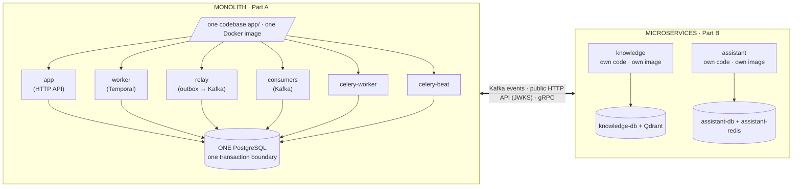

| | Part A — modular monolith | Part B — microservices |
| --- | --- | --- |
| Code | One package `app/`, eight modules (§1) | `services/knowledge`, `services/assistant`, no shared imports |
| Deployable | One image run as six processes, each scaled on its own | One image per service |
| Data | One PostgreSQL: the invariants are constraints and single transactions | Each owns its stores; never reads Part A's |
| Talks by | Published interfaces (`public.py`) in-process, and domain events | gRPC (`contracts/proto`), Part A's public HTTP API, Kafka |
| Why | "Confirm only after every step", "slot and appointment change together" need one transaction; constraints do not cross a service boundary | Different runtime (models, LLM calls) and failure profile; nothing transactional crosses the line |
| Enforced by | `tests/meta/test_import_boundaries.py` | `tests/meta/test_service_independence.py` |

Six processes is not six services: they share one codebase and one database, so they are one
monolith whose parts scale independently. Part B is genuinely separate: own code, own image,
own stores, contracts at the boundary. The documentation site (`docs/index.html`) draws the
rest — the request paths, every flow, the generated event map and schemas.

---

## Contents

- [At a glance: where it is a monolith, and where it is microservices](#at-a-glance-where-it-is-a-monolith-and-where-it-is-microservices)
- [1. Service / module breakdown](#1-service--module-breakdown)
  - [1.1 Dependency direction](#11-dependency-direction)
  - [1.2 The framework-free rule](#12-the-framework-free-rule)
  - [1.3 The module-boundary rule](#13-the-module-boundary-rule)
  - [1.4 Module by module](#14-module-by-module)
- [2. Data flows](#2-data-flows)
  - [2.1 The transaction boundary rule](#21-the-transaction-boundary-rule)
  - [2.2 POST /auth/login](#22-post-authlogin)
  - [2.3 POST /patients](#23-post-patients)
  - [2.4 GET /patients — search and pagination](#24-get-patients--search-and-pagination)
  - [2.5 PATCH /patients/{id}](#25-patch-patientsid)
  - [2.6 GET /ready](#26-get-ready)
  - [2.7 Error translation](#27-error-translation)
  - [2.8 POST /appointments and GET /appointments/{id}](#28-post-appointments-and-get-appointmentsid)
  - [2.9 POST /appointments/{id}/check-in, and the other visit actions](#29-post-appointmentsidcheck-in-and-the-other-visit-actions)
  - [2.10 GET /appointments — a patient's own list, and staff's filtered one](#210-get-appointments--a-patients-own-list-and-staffs-filtered-one)
- [3. Event flows](#3-event-flows)
  - [3.1 The three-way split](#31-the-three-way-split)
  - [3.2 The booking workflow](#32-the-booking-workflow)
  - [3.2a The visit lifecycle](#32a-the-visit-lifecycle)
  - [3.3 Cancellation, reschedule, the waitlist, and what follows a visit](#33-cancellation-reschedule-the-waitlist-and-what-follows-a-visit)
  - [3.4 Domain event catalogue, the outbox and the relay](#34-domain-event-catalogue-the-outbox-and-the-relay)
  - [3.5 Consumers and idempotency](#35-consumers-and-idempotency)
  - [3.6 Open inconsistencies](#36-open-inconsistencies)
  - [3.7 Celery jobs and the beat sweeps](#37-celery-jobs-and-the-beat-sweeps)
  - [3.8 Observability](#38-observability)
- [4. Key design decisions](#4-key-design-decisions)
- [5. Assumptions and tradeoffs](#5-assumptions-and-tradeoffs)
- [6. Part B — `knowledge` and `assistant`, as built](#6-part-b--knowledge-and-assistant-as-built)
  - [6.1 `knowledge`](#61-knowledge-servicesknowledgeknowledge_service)
  - [6.2 `assistant`](#62-assistant-servicesassistantassistant_service)
  - [6.3 One chat turn](#63-one-chat-turn)
  - [6.4 Reports](#64-reports)
  - [6.5 Usage and observability](#65-usage-and-observability)
  - [6.6 Degradation](#66-degradation)
  - [6.7 How Part B is tested](#67-how-part-b-is-tested)

---

## 1. Service / module breakdown

Part A is one codebase and one image, run as six processes, each its own compose service:

| Process | Entry point | Does |
| --- | --- | --- |
| `app` | `app/main.py` (`create_app`) | the FastAPI HTTP API |
| `worker` | `python -m app.worker` | the Temporal worker: every scheduling workflow and activity |
| `relay` | `python -m app.relay` | publishes outbox rows to Kafka (§3.4) |
| `consumers` | `python -m app.consumers` | every registered Kafka consumer (§3.5) |
| `celery-worker` | `celery -A app.celery_app worker -Q notifications,maintenance,documents` | fire-and-forget jobs: sending messages, sweeps, text extraction |
| `celery-beat` | `celery -A app.celery_app beat` | the schedule for the four sweeps (§3.7) |

plus an operational CLI (`app/cli.py`) that is deliberately not part of the request path.
Every process that can enqueue a Celery task — `app`, `worker` and `consumers` — is given
`SMARTHEALTH_RABBITMQ_*` in compose (commit `a37778a`: without it they fell back to
defaults, and patient emails arrived one to two minutes late, through the stuck-row sweep
rather than the direct enqueue). Under `--profile app` compose also runs `frontend`, the demo
client in its own nginx image (§1.4), which is not part of that codebase; under `--profile
partb` it runs the two Part B services (§6). Several processes sharing one codebase is the
reason the internal layering is stricter than a single-process application would need.

Inside the deployable, modules are grouped **by domain, not by technical layer** —
`identity`, `patients`, `providers`, `scheduling` (Weeks 1-2), `billing`, `notifications`,
`analytics` (Week 3) and `clinical` (Week 4) — so a feature's router, schemas, service and
models change together and live together
(`docs/superpowers/specs/2026-09-02-week1-foundation-design.md` §4). Cross-cutting
infrastructure that is not a domain lives beside them: `app/core`, `app/db`, `app/api`, and
`app/events` (the outbox, relay and consumer runtime).

### 1.1 Dependency direction

Dependencies point inward. Inside `app/core` the only imports of the rest of `app` are
`app/settings.py` (from `ratelimit.py`, `telemetry.py`, `temporal.py`) and one edge into
`app/db`: `app/core/ratelimit.py` uses `app.db.redis.namespaced_key`. The rest are within
`app/core` itself (`audit` → `clock`, `circuit` and `ratelimit` → `errors`, `temporal` →
`registry` and `temporal_canary`).

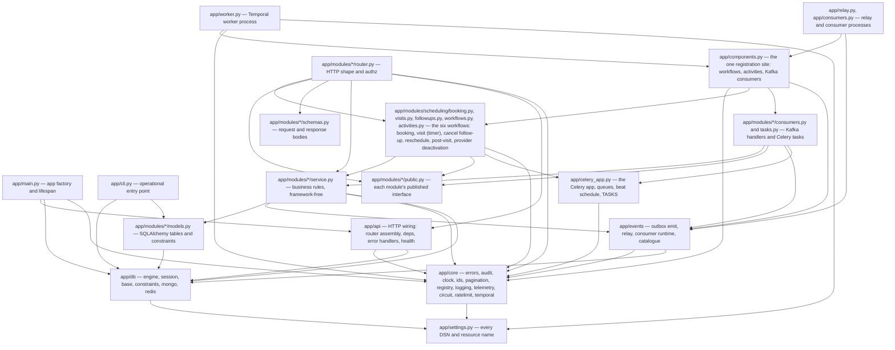

Read the arrows as "may import". The rule that matters is the absence of the reverse
arrows: `app/core` never imports `app/modules` or `app/api`, `app/events` never imports a
module, and `app/modules/*/service.py` never imports `app/api`, `fastapi`, or another
module. A service writes events through `app/events/outbox.py:emit` and nothing else of
the event machinery.

### 1.2 The framework-free rule

**`app/core/**`, `app/db/*`, `app/events/*`, `app/modules/*/models.py`, every
`app/modules/*/service.py`, every `public.py`, `consumers.py` and `tasks.py`, and the
Temporal code (`app/modules/scheduling/workflows.py`, `activities.py`, `booking.py`) must
not import FastAPI or Starlette.** Verified — the complete set of framework-bound modules
(`FRAMEWORK_BOUND` in `tests/meta/test_import_boundaries.py`) is:

```
app/main.py, app/api/deps.py, app/api/error_handlers.py, app/api/health.py,
app/api/router.py,
app/modules/identity/deps.py, app/modules/identity/router.py,
app/modules/analytics/router.py, app/modules/clinical/router.py,
app/modules/notifications/router.py, app/modules/patients/router.py,
app/modules/providers/router.py, app/modules/scheduling/router.py
```

`app/db` has no exception. `get_session`, a FastAPI dependency because it takes a
`Request`, lives in `app/api/deps.py` (`:54`) beside `get_audit_log`; the session
*factory* (`create_session_factory`, `app/db/session.py:20`) is framework-free and is what
the CLI and the worker use. `tests/meta/test_import_boundaries.py` lists the framework-bound
modules (`FRAMEWORK_BOUND`) and fails if anything else reaches FastAPI, directly or
transitively.

**Why the rule exists.** Temporal activities, Kafka consumers and Celery tasks call the same
service functions from processes that have no ASGI stack, no `Request`, and no exception
handlers. An
activity that caught `HTTPException` would be nonsense — and worse, a status code cannot
express the distinction the workflow engine actually needs: *permanent* failure ("this slot
is already taken, stop retrying") versus *retryable* failure ("the connection dropped, try
again"). Both are 409-or-500-shaped over HTTP. So services raise `DomainError` subclasses
(`app/core/errors.py:17-62`), which carry business meaning, and `app/api/error_handlers.py`
— and nothing else — maps them onto status codes. The module docstrings at
`app/core/errors.py:8-11`, `app/core/audit.py:9-17`, `app/core/pagination.py:3-11` and
`app/db/constraints.py:3-6` each record this obligation in place; PRD D-6 records the
decision.

`app/api/deps.py` exists for the same reason: it is the seam where a FastAPI `Request`
becomes a plain object. `get_audit_log` (`app/api/deps.py:31`) builds an `AuditLog` from
`request.app.state.mongo`; a Temporal activity constructs the identical `AuditLog` from a
collection and a clock with no request involved. `page_params` (`app/api/deps.py:46`) does
the same for `limit`/`offset`, so a service takes a `PageParams` value, never a
`Query`-bound parameter.

### 1.3 The module-boundary rule

**`app/modules/<x>` must not import `app/modules/<y>`.** §1.2 is the *vertical* rule —
nothing outside the HTTP layer reaches a web framework. This is the *horizontal* one, and
it is the property the phrase "modular monolith" actually names.

SmartHealth is one deployable, one codebase, one schema and one migration history. So is a
plain monolith: the two are indistinguishable on every externally visible axis. The single
difference is whether the import graph has a deliberate shape. Verified — the complete set
of cross-module edges in the application is:

```
patients.router, providers.router      → identity.{deps, models, security}
scheduling.router                      → identity.{deps, models, security},
                                         patients.public, providers.public, clinical.public
analytics.router                       → identity.{deps, models, security},
                                         patients.public, providers.public, scheduling.public
clinical.router                        → identity.{deps, models, security},
                                         patients.public, providers.public, scheduling.public
notifications.router                   → identity.{deps, models, security},
                                         providers.public, scheduling.public
identity.router                        → patients.public, providers.public
scheduling.activities                  → patients.public, providers.public,
                                         billing.public, notifications.public
scheduling.tasks                       → billing.public
analytics.tasks                        → scheduling.public
notifications.public                   → patients.public
```

Thirty-eight edges, every one declared as an explicit `(importer, imported)` pair, with a
comment saying why, in `CROSS_MODULE_ALLOWED` (`tests/meta/test_import_boundaries.py`).
Eighteen are auth at the router layer: `require_role`, `UserRole`, `TokenClaims`, imported
by the six routers that are not identity's own. The other twenty go through exactly one kind
of file, the owning module's published interface — `app/modules/<x>/public.py` (PRD D-15) —
which returns ids, flags or plain dataclasses and raises domain errors, never an ORM object.
Six modules publish one:

| Interface | What it answers | Used by |
| --- | --- | --- |
| `patients/public.py` | `ensure_bookable_patient`, `patient_id_for_user`, `contact_for`, `count_patients`, `names_for_users` | booking's `validate_booking`; ownership checks in scheduling and clinical; notifications' recipient; analytics' Total Patients; `GET /users` |
| `providers/public.py` | `ensure_bookable_provider`, `is_active_provider` (R-24), `provider_id_for_user`, `names_for_users`, `clinic_and_department_names` | booking; `GET /slots`; a provider's own-visit check (R-14); `GET /users`; utilisation names |
| `scheduling/public.py` | `daily_counts`, `visit_facts`, `appointment_parties`, `has_care_relationship`, `slot_use_by_department` | the analytics reconcile and utilisation; the clinical record's and `POST /notifications`'s care-relationship check |
| `billing/public.py` | the gateway client and `authorize` / `capture` / `release` | booking pre-check and compensation, cancel refund, reschedule, post-visit capture, the stale-pending reconciler |
| `notifications/public.py` | `recipient_for`, `queue_reminder` | the visit workflow's reminder activity |
| `clinical/public.py` | `has_signed_note` | `POST /appointments/{id}/complete` (a visit completes only with a signed note) |

Every `service.py` imports only `app/core`, `app/db`, `app/events` (to `emit`) and its own
module (identity's also reads `app/settings.py`) — no exceptions, `scheduling/service.py`
included. Week 1 expected that file to be the first with a real
reason to cross the boundary; it was not, because the cross-module work was pushed up a
layer. The activity performs the patient and provider checks and then calls the service
with ids only, so `service.py` never needs to know a patient or provider table exists. That was not optional: rule 4
(`NEVER_CROSS`) forbids `service.py`, `models.py` and `schemas.py` any cross-module import,
allowlist or not.

**Two rules, not one, and they are asymmetric.**
`test_modules_do_not_import_each_other` takes an allowlist (`CROSS_MODULE_ALLOWED`, the
thirty-eight pairs above) because a router, an activity, a task or a published interface is a
composition point and a declared exception there is legitimate. `test_the_service_layer_never_crosses_a_module_boundary` takes none: a
`service.py`, `models.py` or `schemas.py` edge is always a bug, because the service layer
is the unit of extraction and the models are what it owns. An allowlist entry for a service
would grant precisely the coupling the boundary exists to prevent. Both lists are checked
for staleness, so an exemption cannot outlive its reason.

**What the rule deliberately does not touch: the database.** `appointments` carries foreign
keys into two other modules' tables — `patients`, and `providers`/`clinics`/`departments`
(all owned by `providers`) — plus scheduling's own `provider_slots` (moved into scheduling
by D-9), and `app/modules/scheduling/models.py` imports none of the foreign ones — they are
declared as table-name strings (`ForeignKey("patients.id")`). Scheduling is therefore fully
coupled in the database and not coupled at all in Python. That is not a loophole; a shared
schema is what a modular monolith *is*. The modularity lives in the import graph, which is
why extracting scheduling later would mean moving its four tables (`appointments`, `visits`,
`waitlist_entries`, `provider_slots`) and turning the foreign keys onto
`patients`/`providers`/`clinics`/`departments` into API calls or event payloads — bounded, well-understood work — whereas if
`scheduling/service.py` imported `patients/service.py` there would be no list of call sites
to work from.

**Why it existed before Week 2.** Until it did, the property was true but unguarded:
`patients/service.py` could import `providers/service.py` and the whole suite stayed green.
Week 2's booking needs patient, provider, slot and clinic data; a direct import is the path
of least resistance and looks entirely reasonable in a diff. The three ways to get that data
are a direct import (the modular monolith silently becomes a monolith), a published
interface on the owning module, or a domain event. Booking used the second for patients,
and needed nothing for the rest: slots moved into `scheduling` (PRD D-9), and provider,
clinic and department ids are copied from the slot row by `create_pending`. Since Week 3 the
third is used wherever one module must *react* to another rather than ask it something:
deactivating a provider reaches scheduling as a `providers.state` event (R-25), a completed
visit reaches billing's capture as `visits.completed`, and notifications and analytics learn
everything they know from events (§3.4, §3.5).

### 1.4 Module by module

#### `app/api` — HTTP wiring

**Responsibility:** everything that is true because this is an HTTP server, and would be
false in a worker process.

| File | Public surface | Notes |
| --- | --- | --- |
| `router.py:16-28` | `api_router` | The only place a module's router is mounted: health, the three identity routers (`/auth`, `/.well-known/jwks.json`, `/users`), analytics, clinical, notifications, patients, providers, and scheduling's three (`/appointments`, `/slots`, `/waitlist`). |
| `deps.py:32,47,55,78,84` | `get_audit_log`, `page_params`, `get_session`, `get_temporal`, `get_rate_limiter` | The framework / framework-free seam (§1.2). `get_audit_log` declares `clock` as a `Depends` rather than calling `get_clock()` inline, because only a declared dependency can be replaced through `app.dependency_overrides` (`app/api/deps.py:32-40`). `get_temporal` hands routers the app's lazy Temporal client, and is what contract tests override so they never reach a real server. |
| `error_handlers.py:33` | `register_error_handlers` | One handler on `DomainError` covers every subclass via Starlette's MRO walk; a second on `Exception` keeps `{"error", "detail"}` as the shape of *every* failure, including unanticipated ones. |
| `health.py:37,89` | `GET /health`, `GET /ready` | See §2.6. |

May import: `fastapi`, `app.core`, `app.db`, `app.settings`. Must not import: any
`app/modules/*/service.py` (routers do that).
**Status: implemented.**

#### `app/core` — framework-free utilities

**Responsibility:** the vocabulary every other module shares — errors, audit, time,
pagination, registries, logging — with no dependency on how the process was started.

| File | Public surface | Notes |
| --- | --- | --- |
| `errors.py:17-62` | `DomainError`, `NotFound` (404), `Conflict` (409), `PermissionDenied` (403), `InvalidCredentials` (401), `Unprocessable` (422), `ServiceUnavailable` (503) | The status code is a class attribute, read only by the HTTP layer. A booking activity turns any `DomainError` into a non-retryable Temporal failure (§3.2). |
| `audit.py:70-124` | `AuditEvent`, `AuditLog.record()` | Takes a `_Collection` **protocol** (`audit.py:82`), not a pymongo type, so it does not even import `app.db.mongo`. `_normalise` (`audit.py:31`) converts exactly the types BSON cannot encode and passes everything else through, so an unsupported type fails loudly rather than being silently stringified. |
| `clock.py:13-35` | `Clock`, `FixedClock`, `get_clock` | Harness requirement 6: no `datetime.utcnow()` inline anywhere. |
| `pagination.py:23-38` | `PageParams`, `Page[T]`, `MAX_LIMIT=200`, `DEFAULT_LIMIT=50` | The maximum exists so one request cannot ask for every row. |
| `registry.py:17-54` | `Registry[T]` | Harness requirement 3. Duplicate names raise, because two handlers silently claiming one name is exactly how an event gets processed twice (`registry.py:20-22`). Four instances: `WORKFLOWS` and `ACTIVITIES` in `temporal.py` (seven workflows with the canary, eighteen activities — see `app/components.py` below), `CONSUMERS` in `app/events/consumer.py` (five Kafka consumers) and `TASKS` in `app/celery_app.py` (six Celery tasks). Each is enumerated by a meta-test. |
| `temporal.py` | `WORKFLOWS`, `ACTIVITIES`, `TASK_QUEUE`, `connect_client`, `build_worker`, `check_worker`, `bind_activities` | `bind_activities` binds each registered activity method to the instance of its class built at worker start, which holds the session factory, audit log and clock. The client is lazy by default so the API boots with Temporal down. `build_worker` always includes the canary. `check_worker` is true only if a worker on the queue executed the canary within `CANARY_TIMEOUT` (5 s). `tests/meta/test_temporal_registry.py` discovers every `@workflow.defn` / `@activity.defn` in `app/` by `ast` and fails if one is unregistered or a registered workflow fails sandbox validation. |
| `temporal_canary.py` | `CanaryWorkflow` (type name `Canary`) | A workflow with no activities, used only as the worker's readiness probe. Free of import-time side effects because Temporal re-imports it inside the sandbox. |
| `logging.py` | `JsonFormatter`, `configure_logging` | JSON lines. `configure_logging` removes only handlers it previously installed, never pytest's `caplog` handler. A line written inside an OpenTelemetry span carries its `trace_id` and `span_id` (`logging.py:41`), so a log line leads to its trace in Jaeger. |
| `telemetry.py` | `build_telemetry`, `install`, `setup_telemetry`, `instrument_engine` | One tracer and meter provider per process, exporting OTLP/HTTP to the collector (spec D-28). **The first install wins**: the test suite installs in-memory providers before the app is imported (`tests/harness/telemetry.py`), and the app reuses them — harness requirement 5. Export is off unless `SMARTHEALTH_OTEL_ENDPOINT_HTTP` is set. `instrument_engine` attaches SQLAlchemy instrumentation to an engine (called by the API, relay, consumers and worker); see §3.8 for why its spans do not reach Jaeger. FastAPI is instrumented in `app/main.py`, which excludes `/health` and `/ready`. |
| `circuit.py` | `CircuitBreaker`, `CircuitOpen` | Per-process, in memory: after `threshold` consecutive failures calls fail at once for `cooldown`, then one trial call. Used by the payment gateway client so a gateway outage does not fill the worker's activity slots with calls that cannot succeed. |
| `ratelimit.py` | `RedisRateLimiter`, `InMemoryRateLimiter`, `enforce`, `RateLimited` (429) | Fixed-window counters in Redis: the login throttle (five failures lock an address, answered exactly like a wrong password) and the per-user booking/reschedule limit. |
| `ids.py` | `uuid7` | Time-ordered primary keys (`PART-A-NFR-5`). |

Must not import: `fastapi`, `starlette`, `app.api`, `app.modules`. The one edge into `app.db`
is `ratelimit.py` → `app.db.redis.namespaced_key` (§1.1).
**Status: implemented.**

#### `app/db` — persistence plumbing

**Responsibility:** constructing and shaping connections; not deciding anything about the
domain.

| File | Public surface | Notes |
| --- | --- | --- |
| `base.py:25-59` | `Base`, `UUIDPrimaryKeyMixin`, `TimestampMixin`, `NAMING_CONVENTION` | The naming convention is load-bearing: without it Postgres generates constraint names and Alembic diffs become unstable. `__mapper_args__ = {"eager_defaults": True}` (`base.py:41`) is the fix for the `MissingGreenlet` PATCH failure — see §2.5. |
| `engine.py:15` | `create_engine(settings)` | Lazy: builds a pool without connecting, which is what lets the contract-test lane run the real lifespan with no database present. |
| `session.py:20` | `create_session_factory` | `expire_on_commit=False`. Framework-free: the request-scoped `get_session` lives in `app/api/deps.py`, so the CLI and the worker can build sessions without importing FastAPI. |
| `constraints.py:17` | `violated_constraint(IntegrityError) -> str \| None` | Reads the constraint name off a failed write. Non-obvious and empirically verified: the asyncpg error carrying `constraint_name` hangs off `exc.orig.__cause__`, not `exc.orig` — matching on `exc.orig` alone turned a duplicate MRN into a 500. |
| `mongo.py:21-43` | `create_mongo_client`, `get_audit_collection`, `ensure_audit_indexes`, `AUDIT_COLLECTION` | PyMongo's async driver, not Motor (deprecated May 2026). Indexes are created by explicit tooling, not at startup, so boot needs no database. |
| `redis.py:10-26` | `create_redis_client`, `namespaced_key` | Part A's *state* Redis: sessions and refresh-token families (`identity/sessions.py`), login-throttle and booking-limit counters (`core/ratelimit.py`), and the notification send throttle. No cache is built (PRD R-7, partly closed): slots are read from Postgres. |
| `all_models.py:14-22` | `ALL_TABLES`, `Base` | The single import site that makes `Base.metadata` complete; without it Alembic autogenerate silently drops tables. |

Must not import: `app.modules` (except `all_models.py`, whose whole job is to import them),
`app.api`, `fastapi`.
**Status: implemented.**

#### `app/modules/identity` — authentication and authorisation

**Responsibility:** who is calling, and may they do this. A `User` is a login, not a person
(`models.py:1-6`).

| File | Public surface | Status |
| --- | --- | --- |
| `models.py` | `UserRole` (`patient`/`provider`/`front_desk`/`admin`), `User`, `role_column` | implemented |
| `security.py` | `hash_password`, `verify_password`, `create_access_token` / `decode_access_token` (EdDSA — **Ed25519** — signed, ten minutes, naming a session as `sid`), `public_jwk`, `generate_signing_key`, `TokenClaims`, `InvalidToken` | implemented — pure functions over explicit inputs, no implicit clock. The committed default key is a development key, refused at start-up when `SMARTHEALTH_ENVIRONMENT=production` (`app/main.py`) |
| `sessions.py` | `SessionStore` (`RedisSessionStore`, `InMemorySessionStore`) | implemented — one server-side session per login, which is also one refresh-token family; rotation is one Lua script, and a spent refresh token presented again revokes the session (spec D-25) |
| `service.py` | `authenticate`, `refresh`, `logout`, `logout_everywhere`, `deactivate_user` | implemented — see §2.2. `deactivate_user` writes `identity.sessions_revoked` through the outbox, which the assistant consumes into its deny-list (§6.2) |
| `router.py` | `POST /auth/login`, `/auth/refresh`, `/auth/logout`, `/auth/logout-all`; `GET /.well-known/jwks.json` (the public key, for Part B); `GET /users` (admin directory, names from `patients.public` / `providers.public`) | implemented |
| `deps.py:54` | `require_role(*allowed)` | implemented — a dependency factory, so enforcement happens before the handler body runs; it verifies the token **and** that its session still exists, so logout and deactivation take effect on the next request |

`require_role` was first written to raise `HTTPException`, on the reasoning that it is
HTTP-layer machinery and 401 has no domain meaning
(`docs/superpowers/specs/2026-09-03-week1-management-apis-design.md` §3.1). The cost was
PRD R-6, now closed: it raises `DomainError` subclasses instead, so 401/403 bodies carry the
same `{error, detail}` envelope as every other failure rather than Starlette's own.

#### `app/modules/patients` — patient records

**Responsibility:** the patient as a person receiving care, whose existence does not depend
on having credentials (`models.py:1-5`).

| File | Public surface | Status |
| --- | --- | --- |
| `models.py:19-33` | `Patient` — `mrn` unique, names, DOB, contact, nullable-unique `user_id` | implemented |
| `schemas.py` | `PatientCreate`, `PatientUpdate`, `PatientRead` | implemented. `PatientUpdate` rejects an explicit `null` on NOT NULL columns (`app/modules/patients/schemas.py:33-46`) — without it `{"first_name": null}` becomes a client-triggerable 500 instead of a 422 — and requires at least one field (`app/modules/patients/schemas.py:48-52`). |
| `service.py:57,85,101,135` | `register_patient`, `get_patient`, `list_patients`, `update_patient` | implemented |
| `router.py:30,54,64,80` | `POST /patients`, `GET /patients/{id}`, `GET /patients`, `PATCH /patients/{id}` | implemented |
| `router.py:43`, `service.py:173` | `GET /patients/me` → `service.get_patient_for_user` | implemented — `patient` only; 404 when no record is linked to the login. Declared before `/{patient_id}` (`router.py:43-51`), or FastAPI parses `me` as a UUID and answers 422 |
| `service.py:182` | `link_user(session, audit, *, mrn, user_id, actor_user_id)` — sets `patients.user_id` | implemented — called by `app/cli.py` `link-patient` only; there is no HTTP route. Locks the patient row (`FOR UPDATE`). Idempotent: the same pair again returns the patient and writes no audit entry. `NotFound` for an unknown MRN; `Conflict` when the record already belongs to another login or the login to another record (the unique constraint `uq_patients_user_id` backstops the login side). Audits `account_linked` with before/after. Does not read `users`: whether `user_id` is a real patient-role login is the caller's check |

Writers are `front_desk` and `admin`; readers add `provider` (`router.py:25-26`). A patient
reads their own record through `GET /patients/me` only, never `/patients/{id}`: the role
gate stays per-role, and the per-object part is the lookup by `user_id` (PRD R-5, read half
closed; the appointment list, the other half, is `GET /appointments`, §2.10).

#### `app/modules/providers` — clinics, departments, providers

**Responsibility:** the supply side — who can be seen, and where. *When* (`ProviderSlot`)
moved to `scheduling` in Week 2 (PRD D-9).

| File | Public surface | Status |
| --- | --- | --- |
| `models.py:26-86` | `Clinic`, `Department`, `Provider`, `provider_departments` | **models implemented; only `Provider` has a service and endpoints** |
| `service.py:116,150,166,214` | `register_provider`, `get_provider`, `list_providers`, `update_provider` | implemented — every provider write also emits `providers.state` (the full current row, keyed by provider id) through the outbox |
| `service.py:63-112` | `emit_provider_state`, `emit_clinic_state`, `emit_department_state`, `republish_all` | implemented — the producers of the three compacted state topics; `republish_all` (`python -m app.cli republish`, and the seed) back-fills a downstream copy |
| `router.py:34,48,58,77` | `POST /providers`, `GET /providers/{id}`, `GET /providers`, `PATCH /providers/{id}` | implemented — writes admin-only, reads open to any authenticated role |

**Clinic and department management has no endpoints** (PRD `PART-A-FR-1.5`, deliberately
deferred): the tables and their constraints exist, they are seeded by `python -m app.cli
seed`, and their state is published on `clinics.state` / `departments.state` by the seed
and the `republish` command.

**`app/modules/providers/public.py`** is the module's published interface (PRD D-15, R-24;
the table in §1.3). Deactivating a provider (`PATCH` with `is_active=false`) refuses new
bookings through it and, since Week 3, cancels the provider's future appointments through
the `providers.state` event (R-25, §3.3).

`ProviderUpdate` deliberately omits `license_number`
(`app/modules/providers/schemas.py:21-26`): it identifies the clinician to a regulator, and
changing it
silently would break the audit trail's link to a real person.

#### `app/modules/scheduling` — appointments, visits, waitlist

**Responsibility:** bookable time (`ProviderSlot`), the booking (`Appointment`), what
actually happened (`Visit`), and who to promote when a slot frees up (`WaitlistEntry`).

**Status: implemented** — booking, the visit lifecycle, cancel/reschedule, the waitlist and
the appointment list (Week 2), and since Week 3 the events every change emits, the three
Kafka consumers that start workflows, the post-visit charge, provider deactivation, the
reminder timer and the stale-pending reconciler.

| File | Responsibility |
| --- | --- |
| `models.py` | `ProviderSlot` and `SlotStatus` (moved here from `providers`, PRD D-9), `Appointment`, `Visit`, `WaitlistEntry` and their status enums |
| `state.py` | `APPOINTMENT_TRANSITIONS` as data, `can_transition`, `require_transition` (raises `Conflict`) and `require_cancellable` (`state.py:40`: `pending` or `confirmed`, and no visit row); and for visits `VisitAction`, `VISIT_PRECONDITIONS` / `VISIT_RESULT` as data, `require_visit_action` (`state.py:86`) and `NoShowOutcome` (`state.py:51`). Pure; every status write asks it first |
| `service.py` | The idempotent booking operations — `create_pending` (`:307`), `ensure_slot_bookable` (`:368`), `claim_slot` (`:463`), `confirm_booking` (`:531`, which emits `appointments.booked`), `fail_booking` (`:572`), `get_appointment` (`:97`) — the visit operations: the **strict** staff actions `check_in` (`:670`), `mark_seen` (`:703`), `complete_visit` (`:720`, which emits `visits.completed`), called only by the endpoints; the **idempotent** timer operations `no_show_deadline` (`:655`), `mark_no_show` (`:754`, which emits `appointments.no_show`) and `reminder_facts` (`:144`), called only by activities; and the read `get_visit` — the cancel and reschedule operations: `cancel_appointment` (`:823`, **strict**, emits `appointments.cancelled`), `complete_reschedule` (`:868`, **idempotent**, emits `appointments.rescheduled`), `_release_slot` (`:812`, the one release write both use) and the chain guard `_lock_with_predecessor` / `require_reschedule_settled` (`:252`, `:268`) — provider deactivation's `future_live_appointments` (`:165`) — the waitlist operations `add_waitlist_entry`, `list_waitlist`, `waitlist_candidates` and `fulfil_waitlist_entry` (`:959`–`:1068`) — and the reads `slot_starts_at` (`:112`), `list_appointments` (`:184`, §2.10) and `list_free_slots` (`:1070`): a provider's free slots that have not started, earliest first, the same two conditions `claim_slot` enforces. `GET /slots` takes a required `provider_id` and optional `from`/`to`, which must carry a timezone (`AwareDatetime`) or the answer is a 422; any authenticated role may call it. Framework-free and Temporal-free; flushes, never commits; every event is written with `emit` in the caller's transaction. **The only file in `app/` that writes slot status** (`tests/meta/test_slot_writes.py`) |
| `public.py` | The published interface (§1.3): `daily_counts` (the analytics reconcile), `visit_facts`, `appointment_parties`, `has_care_relationship` (who may read a clinical record or be messaged), `slot_use_by_department` (utilisation) |
| `consumers.py` | Three Kafka consumers that start workflows (§3.5): `scheduling.cancel-follow-up` (`appointments.cancelled` → `CancelFollowUpWorkflow`), `scheduling.provider-deactivation` (`providers.state` with `is_active=false` → `ProviderDeactivationWorkflow`), `scheduling.post-visit` (`visits.completed` → `PostVisitWorkflow`). Each start uses a deterministic id and `REJECT_DUPLICATE`, so a redelivered event's `WorkflowAlreadyStartedError` is success |
| `tasks.py` | `scheduling.reconcile_stale_pending`, the beat sweep that closes PRD R-9 (§3.7) |
| `contracts.py` | `BookingRequest`, `VisitRequest`, `FollowUpRequest`, `RescheduleRequest`, `PostVisitRequest` and `ProviderDeactivationRequest`, frozen dataclasses of strings passed between a workflow and its activities (fields added later — `BookingRequest.rescheduled_from_id`, `origin`, `conversation_ref` — are last and defaulted, so a request recorded in an older workflow history still decodes), and the pure workflow-id functions `visit_workflow_id` (`visit-<appointment_id>`), `booking_workflow_id` (`booking-<id>`), `reschedule_workflow_id` (`reschedule-<new appointment id>`), `post_visit_workflow_id` (`post-visit-<visit_id>`) and `provider_deactivation_workflow_id` (`provider-deactivation-<provider_id>-<event_id>`, one run per deactivation *event*) (`contracts.py:70-96`). The last two live here rather than beside the code that starts those workflows: the workflow sandbox cannot import `booking` (it pulls in the Temporal client), and `booking` must name a reschedule without importing `followups`, which imports `booking`. Pure, so the workflow sandbox imports it directly |
| `activities.py` | `SchedulingActivities`: eighteen activities — seven `booking.*`, four `visit.*` (`deadline`, `no_show`, `reminder_due`, `remind`), `cancel.refund`, `reschedule.complete`, `post_visit.charge`, `provider.future_appointments`, `provider.cancel_appointment` and `waitlist.candidates` / `waitlist.fulfil` — each a unit of work in its own session and transaction; domain errors become non-retryable `ApplicationError`s. Built with the no-show grace, the reminder lead, the price and the payment gateway, which have no defaults here — `Settings` (through `app/components.py:build_activities`) is their only source. The money moves through `billing.public` (§3.2): `billing_precheck` authorises (a decline is a non-retryable `PaymentDeclined`), `fail_booking` and `cancel.refund` release, `reschedule.complete` releases the old appointment's hold, `post_visit.charge` captures. `booking.schedule_reminders` is now a logging no-op kept so booking histories replay: the reminder is timed by `VisitWorkflow` (§3.2a) |
| `workflows.py` | `BookAppointmentWorkflow` (type name `BookAppointment`): the step sequence, the retry policies, compensation, and the patched start of the visit child; `VisitWorkflow` (type name `Visit`), the reminder and no-show timer (§3.2a); `CancelFollowUpWorkflow` (`CancelFollowUp`) and `RescheduleWorkflow` (`Reschedule`), with the shared helpers `_stop_visit` and `_promote_waitlist` (§3.3); `PostVisitWorkflow` (`PostVisit`, the capture) and `ProviderDeactivationWorkflow` (`ProviderDeactivation`) (§3.3). No I/O, no clock |
| `visits.py` | `notify_checked_in`: the best-effort, 5-second-bounded `checked_in` signal the check-in endpoint sends after its commit, which never raises. Framework-free |
| `booking.py` | Starting a booking from the API: `appointment_id_for` and `reschedule_appointment_id_for` (id derivation; the reschedule one in its own uuid5 name space, `booking.py:46-56`), `start_booking` (`:72`, start policy and fingerprint check), `booking_state` (`:121`, what Temporal knows when no row exists: it asks `booking-<id>`, then `reschedule-<id>`). Framework-free |
| `followups.py` | `start_reschedule` (`reschedule-<new id>`; a failed start is a 503, because nothing was written), `reschedule_fingerprint` and `cancel_workflow_id` (`cancel-<appointment_id>`). The cancel follow-up is no longer started here: until Week 3 slice 4 a best-effort `start_cancel_follow_up` ran after the cancel's commit; now the `scheduling.cancel-follow-up` consumer starts it from the `appointments.cancelled` event (§3.3). Framework-free |
| `schemas.py` | `BookingCreate`, `BookingAccepted`, `AppointmentRead` (its `starts_at`, `schemas.py:39`, is the slot's start: not an ORM column, filled by the router and `None` until a slot is claimed), `VisitRead`, `CancelRequest`, `RescheduleCreate`, `RescheduleAccepted`, `WaitlistCreate`, `WaitlistRead`, `SlotRead` |
| `router.py` | `POST /appointments` (202, `:106`; per-user rate limit shared with reschedule, and an optional `X-Conversation-Ref` header the assistant sets, carried on `appointments.booked`), `GET /appointments` (`:153`, the list, §2.10) and `GET /appointments/{id}` (`:188`) — role gate, patient ownership, and nothing else — with the helper `_read` (`:99`), which builds an `AppointmentRead` and fills `starts_at` through `service.slot_starts_at` for the single-appointment reads (`GET /{id}` and cancel's answer; the list takes `starts_at` from its join instead) — the visit endpoints `POST /appointments/{id}/check-in`, `/seen`, `/complete` (200, `router.py:222-294`; seen and complete are the appointment's own provider's, `_treating`, `:242`, and complete needs a signed note) and `GET /appointments/{id}/visit` (`:391`), `POST /appointments/{id}/cancel` (200, `:309`) and `POST /appointments/{id}/reschedule` (202, `:333`), plus two more routers: `slots_router` (`router.py:63`; `GET /slots`, `:410`) and `waitlist_router` (`:64`; `POST /waitlist` 201, `:439`, and `GET /waitlist`, `:459`), mounted in `app/api/router.py` |

| Class | Notes |
| --- | --- |
| `AppointmentStatus` (`models.py:34-46`) | `pending` is the only legal initial state; `confirmed` is "reachable only after slot reservation, billing pre-check and notification scheduling have all succeeded"; `failed` records "the booking workflow failed and its compensation ran" |
| `ProviderSlot` (`models.py:96-146`) | `status` (`free`/`held`/`booked`/`blocked`) and `version`, which nothing increments automatically — every write in `service.py` says `version + 1` (PRD R-4) |
| `Appointment` (`models.py:149-225`) | Carries the three constraints §3.2 depends on: the composite FK proving the slot belongs to the named provider and clinic, the composite FK proving the department belongs to the named clinic, and `CHECK (status <> 'confirmed' OR slot_id IS NOT NULL)` — and the one-live-replacement index `ux_appointments_live_reschedule` (`models.py:214-224`, §3.2) |
| `Visit` (`models.py:228-246`) | 1:1 with an appointment via a unique FK. Average Wait Time is `avg(seen_at - checked_in_at)` |
| `WaitlistEntry` (`models.py:249-269`) | Patient plus an optional provider/department and a time window; `active` until a promotion sets it `fulfilled` (§3.3) |

#### `app/modules/billing` — one billing record per appointment (Week 3)

**Responsibility:** the money side of a booking, as a state machine, not a ledger (spec
D-27). No HTTP endpoints; it is reached only through `billing/public.py` by scheduling's
activities and reconciler.

| File | Responsibility |
| --- | --- |
| `models.py` | `BillingRecord` (one per appointment, migration `0006`) and `BillingStatus`: `authorized`, `declined`, `captured`, `voided`, `refunded` |
| `service.py` | `authorize`, `capture`, `release` (void a hold, or refund a capture). Idempotent twice over: by the record's state, and by the gateway's `Idempotency-Key` (`authorize-<id>`, `capture-<id>`, …), which covers the window where the gateway acted but the row was never written. A decline is *returned* and recorded, not raised — the activity raises after its commit. Every change emits `billing.status_updated` |
| `gateway.py` | `PaymentGateway`: HTTP to `services/payments_mock` (compose `payments-mock`; `POST /_chaos` makes it misbehave), with a timeout and a `CircuitBreaker`. A 5xx, timeout, refused connection or open circuit is `GatewayUnavailable` (retryable: the booking waits); a 4xx is `GatewayRejected` (permanent) |

#### `app/modules/notifications` — patient messages (Week 3)

**Responsibility:** telling a patient something happened, by email (SMTP, to Mailpit in
compose) or SMS (a logging fake), at least once and never twice.

| File | Responsibility |
| --- | --- |
| `models.py` | `Notification` (migration `0007`): one row per message, unique on its key (`<topic>:<event_id>` for event-driven ones), `queued → sending → sent` or `failed` |
| `consumers.py` | `notifications.patient-messages`: consumes `appointments.booked`, `.cancelled`, `.rescheduled`, `.no_show`, `billing.status_updated` (refunds only), `clinical.note_signed` and `clinical.test_ordered`, and queues one row per event |
| `service.py` | `queue` (inside the caller's transaction; the Celery enqueue is registered to run **after commit**), `claim` (`queued → sending`, the reason a twice-delivered task sends once), `mark_sent`, `release`, `stuck` |
| `tasks.py` | `notifications.send` (claim, per-patient throttle in Redis, send, retry with backoff up to five times, then reject to `notifications.dlq`) and `notifications.requeue_stuck` (the beat sweep for a row whose enqueue was lost) |
| `templates.py`, `channels.py` | The message text per kind; the SMTP and SMS senders |
| `public.py` | `recipient_for`, `queue_reminder` — what the visit workflow's `visit.remind` activity uses |
| `router.py` | `POST /notifications` (202; front desk and admin to any patient, a provider only to a patient they treat; `Idempotency-Key` required; audited with its text) — how an assistant draft that staff approved reaches a patient (§6.2) |

#### `app/modules/analytics` — the rollup and its endpoints (Week 3)

**Responsibility:** the five `PART-A-FR-5` metrics, built from events rather than queried
from the operational tables.

| File | Responsibility |
| --- | --- |
| `models.py` | `AnalyticsDaily` (migration `0008`): one row per (day, clinic, provider) with booked, cancelled, no-show and completed counts and `wait_seconds_sum` / `wait_count` (Average Wait Time, PRD D-3). Migration `0008` also creates the read-only `analytics_reader` role Grafana's Postgres datasource uses |
| `consumers.py` | `analytics.daily-rollup`: `appointments.booked`, `.cancelled`, `.no_show` and `visits.completed` into `analytics_daily` |
| `router.py` | `GET /analytics/summary`, `/timeseries` and `/utilisation` (admin and front desk). Total Patients is read through `patients.public`; utilisation is the slot inventory through `scheduling.public` |
| `tasks.py` | `analytics.reconcile`, nightly: recomputes the last seven days from `scheduling.public.daily_counts` and reports each disagreeing cell as `smarthealth_analytics_drift` and a log line. It reports, never overwrites (an in-flight event would be double-counted) |

#### `app/modules/clinical` — the clinical record (Week 4)

**Responsibility:** what a visit produced — the versioned note with diagnoses, prescriptions,
test orders against `catalogue.py` — and the reports patients upload (spec §9.6, D-31). None
of its content travels on Kafka: its events carry ids and statuses only, and
`tests/meta/test_event_catalog.py` refuses clinical field names in any schema.

| File | Responsibility |
| --- | --- |
| `models.py` | `ClinicalNote` (versioned: a signed version is never edited; amending opens a new draft, one draft per visit at a time), `Prescription`, `TestOrder`, `PatientDocument` (migration `0009`) |
| `service.py` | Draft, sign (emits `clinical.note_signed` and, per order, `clinical.test_ordered`), amend, review a test order, upload a document (emits `documents.uploaded`) |
| `router.py` | `PUT /appointments/{id}/note`, `POST …/note/sign`, `POST …/note/amend`, `GET …/note`, `GET /patients/me/record`, `GET /patients/{id}/record`, `POST /patients/{id}/documents`, `GET /patients/{id}/documents/{document_id}`, `POST /test-orders/{id}/review`. Who may read is decided by role, the patient's and provider's identity, and the care relationship (`scheduling.public.has_care_relationship`) |
| `storage.py` | `DocumentStore`: a directory on a volume (`part-a-documents`), written file first and row last. The spec named MinIO; its images could not be pulled when this was built, and the interface is what the code depends on |
| `tasks.py` | `clinical.extract_document` on the `documents` queue: text from an uploaded PDF (`pypdf`); any other type is recorded `not_extractable`, a malformed PDF `failed` |
| `public.py` | `has_signed_note` — a visit completes only with a signed note (§2.9) |

#### `app/events` — the event backbone (Week 3)

Not a domain module: infrastructure every module writes through, described in §3.4 and §3.5.

| File | Responsibility |
| --- | --- |
| `catalog.py` | `TOPICS`: every topic's logical name, kind (`EVENT`, seven-day retention; `STATE`, compacted), schema version and partitions; `<topic>.dlt` for dead letters |
| `schemas.py` | Loads and checks the Avro schemas in `contracts/events/` |
| `outbox.py` | `emit(session, topic, key=, payload=)`: validates the payload, adds an `outbox_events` row with the current trace context, never commits |
| `models.py` | `OutboxEvent`, `ProcessedEvent` (migration `0005`) |
| `relay.py` | `Relay`: rows to Kafka, in order, at least once |
| `kafka.py` | Producer and consumer construction, `ensure_topics`, `register_schemas` (compatibility `BACKWARD_TRANSITIVE`), Avro (de)serialisers; every name through `Settings.topic()` |
| `consumer.py` | `ConsumerSpec`, `CONSUMERS`, `ConsumerRunner`: dedupe, retry, dead-letter, commit |
| `deadletters.py` | `replay` behind `python -m app.cli dlt-replay` |
| `maintenance.py` | `events.purge_published`, the daily outbox purge |

#### `frontend/` — a client outside the monolith

**Responsibility:** a demo web client (React + TypeScript), not a module and not a
requirement (PRD §2). It is outside the modular monolith and imports nothing from `app/`:
it talks only to the HTTP API, through a same-origin `/api` prefix that Vite (dev,
`frontend/vite.config.ts`) and nginx (compose, `frontend/nginx.conf`: `/api/` to
`http://app:8000/`) both strip and forward, so the backend needs no CORS. In compose it is
the `frontend` service under `--profile app`, which waits for `app` to be healthy. Its
Appointments page (`frontend/src/pages/Appointments.tsx`) calls `GET /appointments`: a
patient sees their own list, staff get status and provider filters, and a Cancel button
(patient, front desk, admin, on a `pending` or `confirmed` row) calls
`POST /appointments/{id}/cancel`; the API still decides whether a cancel is allowed. Week 5
added the Assistant, Reports and AI usage pages (shadcn AI Elements, Tailwind v4, React 19),
which talk to the Part B services through Envoy with a Connect gRPC-Web client generated by
`npm run gen:proto` (§6). Design:
`docs/superpowers/specs/2026-10-28-frontend-demo-client-design.md`.

#### Supporting files

| File | Responsibility | Status |
| --- | --- | --- |
| `app/settings.py` | Every DSN and every externally-visible resource name. `topic()`, `queue()`, `task_queue()` (`:173-183`) namespace Kafka/RabbitMQ/Temporal names through one prefix — harness requirement 1, so a test run can isolate itself on a shared stack. No call site may hardcode a name. | implemented; `task_queue()` is called by the worker, the scheduling router and the scheduling consumers, `topic()` by `app/events/kafka.py:broker_topic` (every topic and subject), `queue()` by `app/celery_app.py:queues` |
| `app/main.py` | App factory and lifespan. Every client is lazy, so the application boots with no infrastructure running and the contract lane exercises the real startup path without Docker. The lifespan installs telemetry, instruments the engine, and refuses the committed development signing key in production. | implemented |
| `app/relay.py`, `app/consumers.py` | The relay and consumer processes: `python -m app.relay [--setup]` (`--setup` creates topics and registers schemas, then exits; broker auto-creation is off) and `python -m app.consumers` (every registered consumer, one runner each). | implemented |
| `app/celery_app.py` | The Celery app: queues `notifications` (dead-lettered to `notifications.dlq`), `maintenance` and `documents`, all through `Settings.queue()`; `acks_late`, `reject_on_worker_lost`, prefetch 1; the beat schedule; `TASKS`. | implemented |
| `app/worker.py` | The Temporal worker process. `python -m app.worker` registers every component, builds the activities' resources (a Postgres session factory, the Mongo audit log, a `Clock`, and `Settings.no_show_grace_minutes` as a `timedelta`), imports `app/db/all_models.py` so every foreign key resolves in a process that never loads the routers, and polls `Settings.task_queue("scheduling")`; SIGTERM and SIGINT call `worker.shutdown()`, which gives in-flight activities `GRACEFUL_SHUTDOWN` (8 s, `app/core/temporal.py`) to finish before cancelling them, so `docker stop` neither waits out its grace period nor cuts activities off; the compose `stop_grace_period` (15 s) sits above it. `python -m app.worker --check` executes the canary and exits 0/1 — it is the `worker` service's compose healthcheck, connect and canary bounded to 8 s overall (`CHECK_TIMEOUT`) so it fails by exit code inside compose's 12 s timeout. | implemented |
| `app/components.py` | `register_all()`, the one place Temporal workflows, activities and Kafka consumers are registered — not in the workflow modules, because the sandbox re-imports those. Idempotent. Registers the canary, `BookAppointmentWorkflow`, `VisitWorkflow`, `CancelFollowUpWorkflow`, `RescheduleWorkflow`, `PostVisitWorkflow`, `ProviderDeactivationWorkflow`, the eighteen scheduling activities, each under its Temporal name, and the five consumers (three scheduling, one notifications, one analytics); `build_activities()` binds the activities to a `SchedulingActivities` instance at worker start, with the payment gateway, price and reminder lead from `Settings`. Celery tasks register themselves in `TASKS` when `app/celery_app.py` includes their modules. | implemented |
| `app/cli.py` | `create-user` (the way to put a chosen login into the system outside a test fixture), `link-patient` (`link_patient`, `:116`: `--email` and `--mrn`; refuses an unknown email or MRN, a login whose role is not `patient`, and a record or login already linked elsewhere, each with exit 1; calls `patients.service.link_user` as actor `system:cli` in its own transaction, committing only after the audit write, so a Mongo outage fails it rather than linking silently), `seed` (which also creates one login per role), `demo-seed` / `demo-refresh` (`app/demo/`: a demo network, six months of history imported as `appointments.origin = 'legacy_import'` with no outbox events, and live bookings through the API; refused without `--allow-demo-data`), `deactivate-user`, `republish`, `dlt-replay` and `generate-signing-key`. Must never import `app.main` or a router. | implemented |
| `migrations/versions/` | `0001_baseline` (ten tables, `btree_gist`, the GiST exclusion constraint, `ux_appointments_live_slot`, the `updated_at` trigger on nine tables), `0002_coherence_constraints` (composite FKs and `confirmed_requires_slot`), `0003_updated_at_clock_timestamp`, `0004_live_reschedule_unique` (`ux_appointments_live_reschedule`, §3.2), `0005_outbox_and_booking_origin` (`outbox_events`, `processed_events`, the booking origin), `0006_billing_records`, `0007_notifications`, `0008_analytics_daily` (and the `analytics_reader` role), `0009_clinical_records` | implemented |

---

## 2. Data flows

Everything in this section is built and running.

### 2.1 The transaction boundary rule

**The router owns the transaction; services only flush.** Every mutating handler ends with
an explicit `await session.commit()` — `app/modules/patients/router.py:39,91` and
`app/modules/providers/router.py:44,89` — and no service function commits. Outside HTTP the
same rule holds with a different owner: each booking activity opens a session, makes one
service call and commits (`SchedulingActivities._unit_of_work`,
`app/modules/scheduling/activities.py:84`).

This is not ceremony. It is what lets the caller decide the transaction's extent, which the
booking workflow requires: claiming a slot and attaching it to the appointment must either
both happen or neither, and `claim_slot` does both inside the activity's one transaction. A
service that committed on its own would make that impossible without unpicking it later.

The corollary, recorded in both service docstrings (`app/modules/patients/service.py:6-11`):
a `Conflict` raised from inside a failed `flush()` leaves the session in "pending rollback",
where any further statement raises `PendingRollbackError`. The HTTP path is covered because
`get_session` (`app/api/deps.py:70-74`) rolls back on any exception leaving the request. A
Temporal activity or Celery task owns its own session and must roll back itself — which
`_unit_of_work` does, logging rather than raising a failed rollback so the original error
is the one Temporal sees.

### 2.2 POST /auth/login

> **Changed in Week 3 slice 2** (Weeks 3–5 spec D-25). The diagram below is still the
> credential check. What surrounds it now: before the lookup, the login throttle asks
> Redis whether the address has `login_max_failures` failures in the window or the client
> IP `login_ip_max_failures` — if so the attempt still runs `verify_password` and still
> answers the identical 401, so a lock reveals neither itself nor which addresses exist;
> every failure counts against both keys, and a success clears the address. On success a
> **session** is opened in Redis (`app/modules/identity/sessions.py`) and the response
> carries an EdDSA access token naming it (`sid`, ten minutes) and a single-use
> **refresh token**. `require_role` then checks the session on every request, so logout
> (`POST /auth/logout`, `/auth/logout-all`) and deactivation (`python -m app.cli
> deactivate-user`) take effect on the next request. `POST /auth/refresh` rotates the
> refresh token in one Lua script; a spent one presented again revokes the session.
> `GET /.well-known/jwks.json` publishes the verification key.

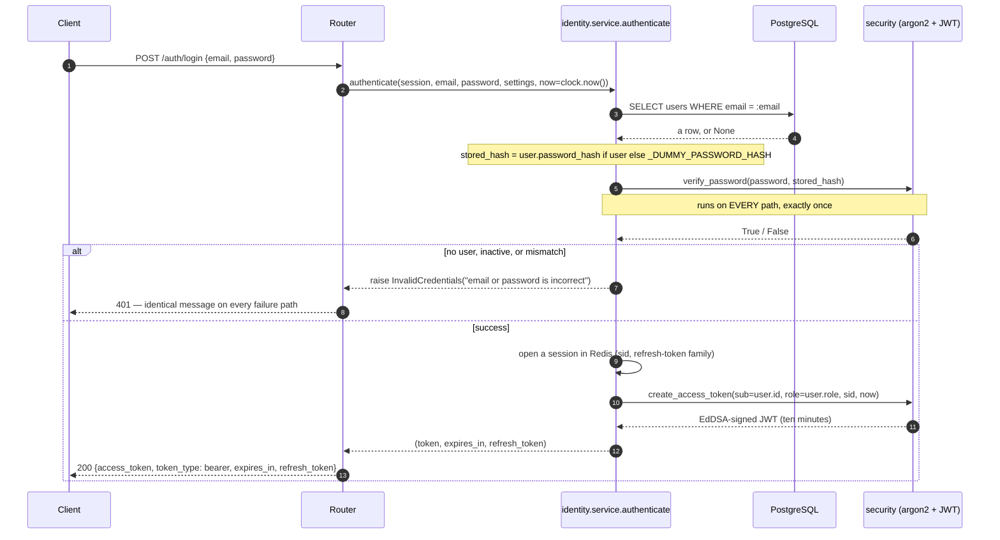

**The constant-time path.** `_DUMMY_PASSWORD_HASH` (`app/modules/identity/service.py:34`) is
a real argon2 hash of a throwaway string, verified against whenever no user matches.

The timing oracle it defeats is specific. An identical error message is not sufficient,
because `or` short-circuits: written the obvious way —
`if user is None or not verify_password(...)` — an unknown address returns *before*
`verify_password` runs, while a known address pays argon2's deliberate ~55 ms. That gap is
trivially readable over a network, so response time alone would enumerate which email
addresses are registered, defeating the identical message entirely. Instead
`verify_password` runs exactly once on every path and its result is consulted afterwards
(`app/modules/identity/service.py:110-113`). The rationale is written out in
`authenticate`'s docstring (`service.py:80-95`).

Two supporting details:

- `verify_password` treats an unparseable stored hash as a failed login rather than raising
  (`app/modules/identity/security.py:56-68`), so a corrupted column cannot turn into a 500
  that leaks a stack trace and signals that *this* account differs from the others.
- `decode_access_token` disables `verify_iat` (`security.py:152-165`) because PyJWT checks
  `iat` against the wall clock with zero leeway, and a few seconds of clock skew between
  issuer and validator would reject a good token. `exp` is still fully enforced.

`is_active` is still read only at login, and that is no longer a gap: deactivating a
login (`identity.service.deactivate_user`, the `deactivate-user` command) also ends every
session it has, and a token without a live session is refused. The cost is one Redis
lookup per request, not the per-request database query the Week 1 spec rejected
(management-APIs spec §11, closed in Week 3 slice 2).

### 2.3 POST /patients

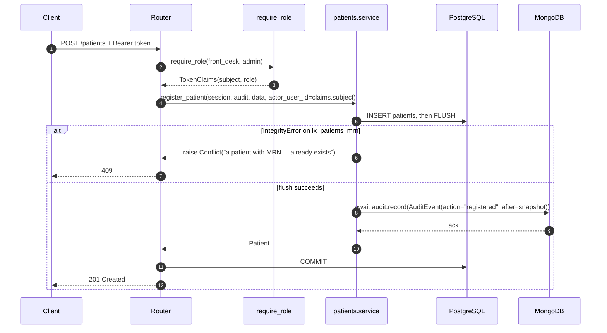

**Why flush, then audit, then commit — in that order.**

*Flush before audit* is what makes the audit entry truthful. The flush is where the database
gets to reject the write, so `patient.id` exists and the constraints have already fired; a
duplicate MRN becomes a 409 (`app/modules/patients/service.py:66-71`) rather than an audit
entry for a patient that was never created. The constraint name is read through
`violated_constraint` (`app/db/constraints.py:17`) and compared against `ix_patients_mrn`
(`service.py:35`) — a unique *index*, not a named constraint, because `Patient.mrn` is
declared `unique=True, index=True`. Providers are genuinely asymmetric here:
`Provider.license_number` has no index, so Postgres enforces it with a named UNIQUE
constraint, `uq_providers_license_number` (`app/modules/providers/service.py:32-37`).
Anything *other* than the expected constraint is re-raised (`providers/service.py:132-135`),
so an unrelated violation surfaces as a 500 that gets investigated rather than a misleading
409.

*Awaited, not fire-and-forget.* `await audit.record(...)` (`patients/service.py:73`) means a
Mongo outage fails the request. The reasoning, at `app/core/audit.py:88-107`: a dropped
audit entry is invisible and unrecoverable, a failed request is neither.

*Audit before commit.* The two stores are not transactional with each other, so one of two
failures is unavoidable. Written this way, a failed audit write propagates, `get_session`
rolls back, and **nothing happened in either store** — the detectable failure. Reversed —
commit first, audit second — a failed audit write would leave a real mutation with nobody
recorded as having made it, which is both worse and undetectable. The residual risk (a
commit that fails *after* a successful audit write, leaving Mongo recording a change that
never took effect) is PRD **R-1**, accepted for Week 1 with the mitigation of keeping the
flush-to-commit distance minimal.

`_snapshot` (`patients/service.py:41-54`) defines the audited shape and includes `user_id`,
so a future account-linking flow reusing the function gets that field in the trail. It is
also the single place to redact from if a field ever must be excluded.

`POST /providers` is the identical flow with `admin`-only writers and the licence-number
constraint.

### 2.4 GET /patients — search and pagination

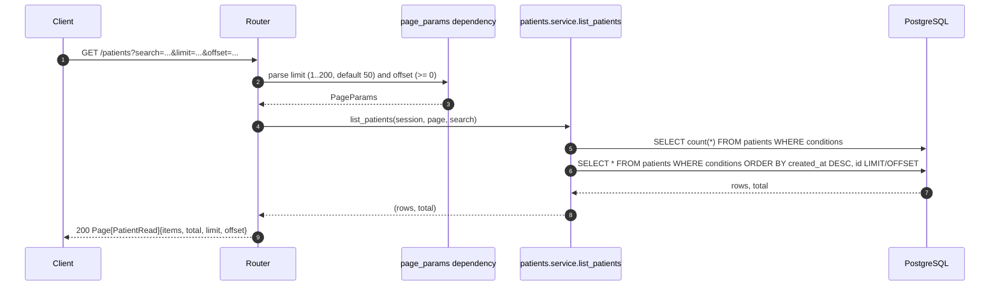

Three details, each a corrected mistake rather than a preference:

**`icontains(..., autoescape=True)`** (`app/modules/patients/service.py:116-122`). `%` and
`_` are LIKE metacharacters. Without `autoescape=True` a search for `a_b` also matches
`axb`, and a search for `%` matches every patient in the system — the same
unescaped-wildcard problem that makes `specialty` filtering use case-insensitive *equality*
rather than ILIKE on the providers side (`app/modules/providers/service.py:182`).
`autoescape=True` escapes `%`, `_` and the escape character itself before wrapping the term
in wildcards.

**`icontains`, not `contains`.** `contains` compiles to a plain `LIKE`, which is
case-sensitive, so "bloggs" would silently stop matching "Bloggs". `icontains` compiles to
`lower(col) LIKE lower(term) ESCAPE '/'`, giving escaping and case-insensitivity together.
The comment says "do not simplify this back to `contains`" for a reason — it was.

**The same `conditions` go to both statements**, and the sort key is `created_at DESC, id`
(`patients/service.py:124-130`). Filtering one and not the other makes `total` describe a
different result set than `items`; `created_at` alone is not unique, and offset pagination
over a non-unique sort key skips and repeats rows across pages
(`providers/service.py:199-208` spells both out).

`MAX_LIMIT = 200` (`app/core/pagination.py:23`) is enforced by the
`Query(..., le=MAX_LIMIT)` bound in `page_params` (`app/api/deps.py:42-47`), so an
out-of-range limit is a 422 before any handler runs.

### 2.5 PATCH /patients/{id}

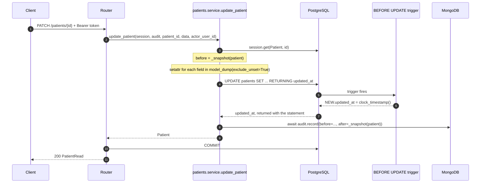

**`eager_defaults` and the `MissingGreenlet` bug.** `updated_at` carries
`onupdate=func.now()` (`app/db/base.py:54-59`), a SQL expression, so after an UPDATE
SQLAlchemy cannot know the resulting value and expires the attribute. Reading it afterwards
— which serialising the PATCH response does — emits a lazy SELECT outside a greenlet
context and raises `MissingGreenlet`. **Every PATCH endpoint returned 500.** The fix is
`__mapper_args__ = {"eager_defaults": True}` on `Base` (`app/db/base.py:41`), which makes
SQLAlchemy append `RETURNING updated_at` to the UPDATE it already issues: no second round
trip, and no per-service `session.refresh()` for every future model to remember. It is set
on `Base` rather than on `TimestampMixin` so it also covers a future model with a server
default that does not use the mixin.

**The trigger, and why `clock_timestamp()`.** `onupdate=func.now()` is a SQLAlchemy-level
construct: verified against the live database, it fires for an ORM flush but **not** for a
raw `text("UPDATE ...")`. Week 2's slot writes are Core `update(ProviderSlot)` statements,
and those *do* apply `onupdate` -- compiled, the claim reads `SET status=..., updated_at=now()`
(checked 2026-10-28) -- but `now()` is the transaction's start time, not the moment the row
changed. So `migrations/versions/0001_baseline.py:207-227` installs a `BEFORE UPDATE` trigger
on all nine timestamped tables that overwrites `updated_at` itself; as first written its body
was `now()`. A trigger also covers raw statements, hand-written SQL and data migrations,
which a coding convention cannot.

`migrations/versions/0003_updated_at_clock_timestamp.py:32-41` then changes the trigger body
from `now()` to `clock_timestamp()`, which is what the paragraph above needs. `now()` is `transaction_timestamp()` — frozen for the
whole transaction — so an update inside a long transaction was backdated to when that
transaction *began*. `updated_at` exists to record when a row actually changed, so it needs
the wall-clock instant. `created_at` deliberately keeps `now()`: creation belongs to the
logical operation, and rows inserted together sharing a timestamp is correct.

So the value returned to the client is the one the trigger wrote, not the one the ORM
guessed (`app/modules/patients/service.py:154-158`).

**Why there is no `IntegrityError` handling here**, unlike `register_patient`:
`PatientUpdate` cannot set `mrn` or `user_id`, the only uniquely-constrained columns, and
`email` has none. The comment at `service.py:143-148` states the obligation if that ever
changes — add the same translation, or the violation surfaces as a 500 instead of a 409.

### 2.6 GET /ready

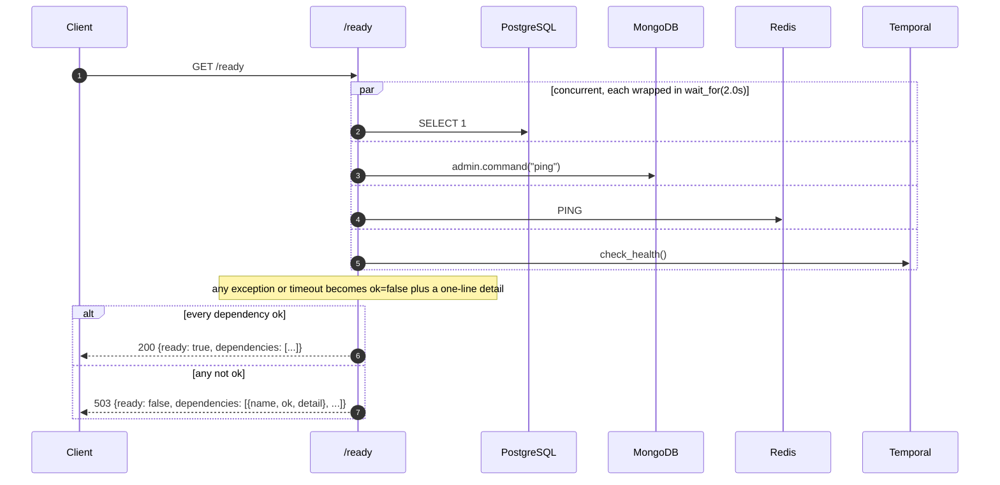

The four checks run concurrently under `asyncio.gather` (`app/api/health.py:100-107`), each
individually bounded by `asyncio.wait_for(..., CHECK_TIMEOUT_SECONDS)` where the timeout is
2.0 s (`health.py:23,94`). Total latency is therefore the slowest dependency, not their sum,
and a hung dependency cannot hang the probe.

The Temporal check (`health.py:79-86`) asks whether the *server* is reachable, because the
API needs it to start workflows. Whether a worker is executing them is a different question,
answered by the `worker` service's own healthcheck (`python -m app.worker --check`).

Each dependency is reported **separately** (`health.py:26-34`), because "something is down"
is far less actionable than "Mongo is down" — which matters given §2.3's decision to make
every mutation depend on Mongo. Failures are summarised to one line capped at 200 characters
(`health.py:48-51`); full tracebacks belong in logs, not in a probe response.

`/health` (`health.py:37`) stays a flat `dict[str, str]`. FastAPI enforces the return
annotation as a response model, so a nested or boolean field raises at runtime — this is why
readiness is a separate endpoint with its own Pydantic model rather than a richer `/health`.

**Known gap:** the compose healthcheck polls `/health`, not `/ready`
(`docker-compose.infra.yml`, the `app` service's `healthcheck`), so the container keeps
reporting healthy while every request fails on a downed Postgres. Deliberate — `--wait` uses
the healthcheck as a startup gate, and a readiness-based gate would make startup depend on
dependencies `depends_on: service_healthy` has already gated (management-APIs spec §11).

### 2.7 Error translation

Two handlers, registered in `app/api/error_handlers.py:33-77`:

| Raised | Response |
| --- | --- |
| any `DomainError` subclass | `exc.status_code` with `{"error": "<ClassName>", "detail": "<message>"}` |
| any other `Exception` | 500 with `{"error": "InternalError", "detail": "an unexpected error occurred"}` |

One registration on the base class covers every subclass, because Starlette resolves
handlers by walking the raised exception's MRO (`error_handlers.py:34-38`).

The `Exception` handler exists so the `{"error", "detail"}` shape survives the failures
nobody anticipated — without it, an unhandled exception falls through to Starlette's own
500, which answers `{"detail": "Internal Server Error"}` and no `error` key, breaking a
client's uniform error parsing on precisely the failure that is hardest to reproduce. The
body says nothing deliberately: `str(exc)` on an unexpected failure routinely carries a DSN
with credentials or the row data that broke a constraint (`error_handlers.py:27-30`). The
text goes to the log with a traceback instead.

Two documented limits: `HTTPException` is handled separately by Starlette, so FastAPI's 404s
and 422s keep their own shapes — this is why `require_role` raises `DomainError` subclasses
rather than `HTTPException`, which is what closed PRD R-6; and a `DomainError` raised inside
a `StreamingResponse` body runs after the response has started and is not caught
(`error_handlers.py:9-13`). No Part A endpoint streams: the streaming the system does is
gRPC server streaming in the assistant service, which reports a failure as an event in the
stream itself (§6.3).

### 2.8 POST /appointments and GET /appointments/{id}

The first endpoint whose work does not finish inside the request. The router writes
nothing: it derives an id, starts a workflow, and answers 202. The workflow (§3.2) creates
the row and drives it to `confirmed` or `failed`; the client polls `GET` to find out which.
Two things sit in front of the diagram below since Week 3: a per-user rate limit, shared with
reschedule, that answers 429 (`_limit_bookings`, `router.py:80`), and an optional
`X-Conversation-Ref` header the assistant sends when it books for a user, which sets the
booking's `origin` to `assistant` and travels on `appointments.booked` so conversions can be
counted (§6.5).

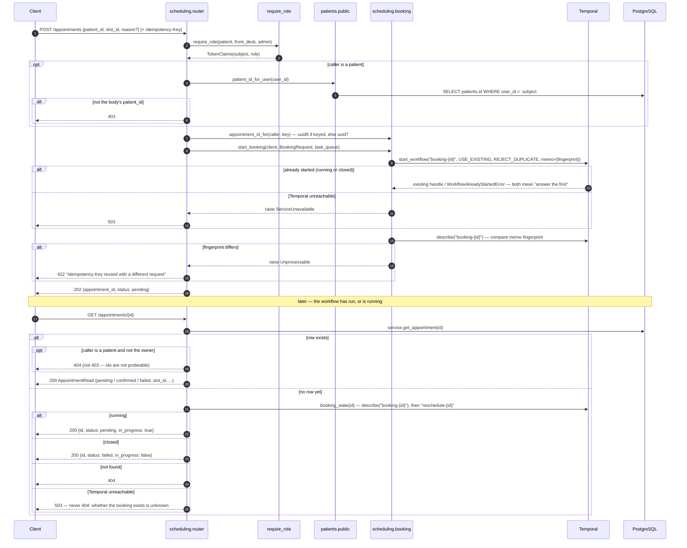

**Why the router writes no row** (PRD D-10). Postgres and Temporal cannot be written
atomically. If the router inserted the `pending` row and then the start failed, the row
would be pending forever with nothing to finish or compensate it. Starting first means a
failed start leaves nothing behind, and a started workflow either confirms or compensates.

**Idempotency** (PRD D-11). With an `Idempotency-Key`, the appointment id is
`uuid5(IDEMPOTENCY_NAMESPACE, f"{caller}:{key}")` (`app/modules/scheduling/booking.py:28-43`),
so the same caller and key always name the same appointment and two callers cannot collide
on one key. Without one it is a `uuid7`, time-ordered like every other key. An empty header
is a 422 (`min_length=1`, `router.py:111-115`): an empty key is still a key, and would collapse
every such request from one caller onto one booking. The start policies
(`booking.py:89-94`) make a repeat land on the first workflow whether it is still running
(`USE_EXISTING`) or has closed (`REJECT_DUPLICATE` — Temporal's default would start a
second booking under a closed id). The fingerprint — `sha256` of the JSON-encoded patient,
slot and reason (`request_fingerprint`, `booking.py:63-69`) — is checked after *every*
start (`booking.py:101-104`), because under `USE_EXISTING` a repeat against a running
workflow returns normally rather than raising. A failed booking stays failed under its key;
retrying it needs a new key.

**Two answers that look surprising, both deliberate.** A 503 from `POST` can follow a
start that *succeeded*, if the fingerprint check's `describe()` then cannot reach Temporal;
a retry with the same key is safe and returns the same booking (PRD R-13). And the no-row
branch of `GET` answers before any ownership check, because there is no row to read the
patient from; it exposes only `id`, `status` and `in_progress` (PRD R-11). The row is
written by the workflow's first activity, so that window is normally milliseconds.

The no-row branch also serves a **reschedule's** new appointment. It is booked by a child,
`booking-<id>`, that its parent `reschedule-<id>` starts only once it runs, so for a moment
after the 202 there is no booking workflow to describe, and `booking_state` then asks
`reschedule-<id>` too (`booking.py:121-144`): running reads as `pending`, closed as `failed`.

`AppointmentRead` (`app/modules/scheduling/schemas.py`) makes every field but `id`,
`status` and `in_progress` optional so the synthetic no-row answers and a real row share
one response model.

### 2.9 POST /appointments/{id}/check-in, and the other visit actions

The first endpoints that write a *human* action. They answer 200, not 202: the work is
finished, in the request's own transaction, before the response (PRD D-12). Temporal is not
in the write path at all — it is told afterwards, as a courtesy.

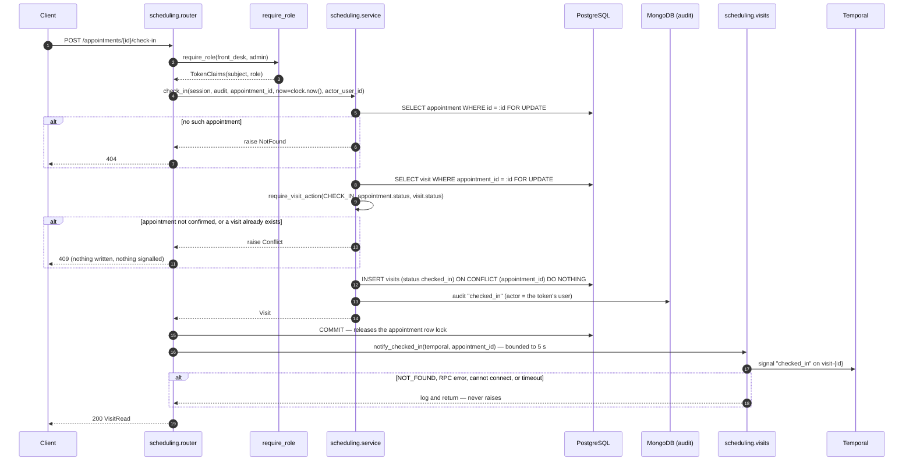

**The write is the check.** `service.check_in` takes the appointment row lock first
(`_require`, `service.py:233`), reads the visit under its own lock, and asks
`require_visit_action` (`state.py:86`) whether the action is legal *now* — so there is no
separate precheck to go stale between the check and the write. The `ON CONFLICT DO NOTHING`
(`service.py:688-695`) is a second gate behind the check: if anything ever inserted a visit
without the lock, the unique `appointment_id` still allows one, and zero rows affected is a
`Conflict` too (`service.py:696-697`). The functions are **strict**: a repeat is a 409, not a
silent success, because nothing retries them — a duplicate is a human mistake worth
reporting, and a no-op would tell staff the second check-in "worked".

**The other three differ only in what they write.** `POST /appointments/{id}/seen`
(`router.py:253`, `service.mark_seen`) sets `seen_at` and the visit `in_progress`;
`POST /appointments/{id}/complete` (`router.py:270`, `service.complete_visit`) sets
`completed_at`, the visit `completed` *and* the appointment `completed` in one transaction,
writes no slot — completion never frees a slot (it is normally already in the past, and stays `booked`; PRD R-2) — and
writes `visits.completed` to the outbox, whose consumer starts the post-visit charge (§3.3). Neither signals
Temporal. Both are gated to `provider` and `admin`, and a provider must be **the appointment's own**
(`_treating`, `router.py:242`: anyone else's is a 404, so ids cannot be probed — PRD R-14, closed in Week 4);
check-in is `front_desk` and `admin`. **Complete also needs a signed clinical note**: the router asks
`clinical.public.has_signed_note` and answers 409 without one, before the service runs — the check sits in the
router because `scheduling/service.py` crosses no module boundary.
`GET /appointments/{id}/visit` (`router.py:391`) reads: the owning patient, any provider and
front desk, and admin; another patient's appointment is a 404, like `GET /appointments/{id}`,
and an appointment with no visit yet is a 404 too.

**Why the signal cannot fail the request.** By the time it is sent the check-in is committed.
Failing the response would tell staff a recorded check-in failed — and their retry would then
be a 409. So `notify_checked_in` (`visits.py:35`) swallows every failure: `NOT_FOUND`
(the visit already closed, or a booking confirmed before slice 3 has no visit workflow) at
INFO, an `RPCError`, a `RuntimeError` from a lazy client that cannot connect, and a timeout
of `NOTIFY_TIMEOUT` (5 s, `visits.py:32`) at WARNING. The bound exists because connecting a
lazy client to a blackholed host takes tens of seconds in the SDK. The contract tier proves a
failing Temporal still answers 200 with one commit
(`test_temporal_failing_after_the_commit_still_answers_200`, `tests/tiers/t1_contract/test_visits_contract.py`); no test exercises the 5-second
bound itself. The audit write precedes the commit, as everywhere (PRD R-1).

---

### 2.10 GET /appointments — a patient's own list, and staff's filtered one

A read only: no Temporal, no Mongo, no commit. The same endpoint serves every role, and
the one thing that differs is who the list is *about*.

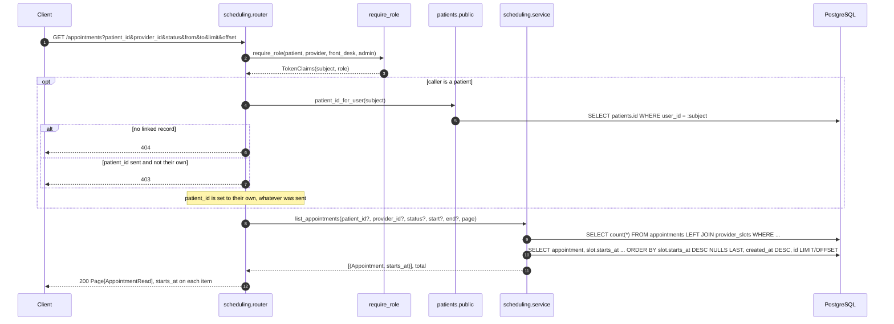

**A patient's list is forced, not filtered** (spec §4.6). For a patient the router
discards whatever `patient_id` was sent and uses the one it looked up from the login
(`list_appointments`, `router.py:153`). Naming someone else's id is a 403 rather than a
silent substitution, so a client that asked for another patient learns it was refused; a
login with no linked patient record is a 404, because an empty list would hide a misissued
account. The 403 depends on no lookup of the named patient, so it says nothing about
whether that patient exists. This differs from `GET /appointments/{id}`, which answers 404
for another patient's appointment so that appointment ids cannot be probed. Staff
(`provider`, `front_desk`, `admin`) are not scoped at all: a provider sees every
appointment, not just their own, and may filter by `provider_id` to see their own. This is
inconsistent with `GET /waitlist`, which excludes providers entirely. When R-14 was closed
in Week 4, provider ownership (`providers.public.provider_id_for_user`) was enforced where a
provider *acts* — marking a visit seen or complete — and where they read clinical content
(the record, through the care relationship); this list, which carries no clinical content,
was left as it was.

**Ordering and the slot join.** The list is an outer join to `provider_slots`, so an
appointment with no slot yet (`pending` before the claim, an early `failed`) still appears.
The order is the slot's `starts_at` descending with `NULLS LAST`, then `created_at`
descending, then `id`. The last two make the order total, so pages never overlap;
`NULLS LAST` keeps slot-less rows from sorting first, which is what PostgreSQL's default
for a descending sort would do. `from` is inclusive and `to` exclusive, both on the slot's
`starts_at`, and both are `AwareDatetime` (a timestamp without an offset is a 422, as for
`GET /slots`). A slot-less appointment matches neither bound, so it drops out when either
is given. The query uses `populate_existing`, like `get_appointment`, so it reads fresh
rows rather than the session's identity map.

**`starts_at`** is not an `appointments` column. The list reads it from the join; the single
read (`_read`, `router.py:99`) asks `service.slot_starts_at`, one extra query, and returns
`None` for an appointment with no slot. Without it a client would need a second call per
row to say *when*.

## 3. Event flows

> **All built.** Six Temporal workflows run on the `worker` service — booking (§3.2), the
> visit reminder and no-show timer (§3.2a), the cancel follow-up, reschedule, post-visit
> charge and provider deactivation (§3.3) — over eighteen activities, with a canary workflow
> as the worker's readiness probe (`app/core/temporal.py`, `app/core/temporal_canary.py`,
> `app/components.py`, `app/worker.py`). Every domain change writes an event to the outbox in
> its own transaction; the relay publishes it to Kafka as Avro under Schema Registry (§3.4);
> five registered consumers react to it (§3.5). Celery over RabbitMQ delivers notifications,
> extracts document text and runs four scheduled sweeps (§3.7). Traces, metrics and
> dashboards cover all of it (§3.8).
>
> Several of these sections were first written as designs before the code existed, because
> the Week 1 schema was shaped by them: the `pending` default, the `failed` status,
> `provider_slots.version`, `rescheduled_from_id` and `waitlist_entries` were all there for
> flows that did not yet run. They have been rewritten to the built behaviour; where the
> built design replaced an earlier one, the section says what changed and why.

### 3.1 The three-way split

The assignment mandates Temporal, Kafka and Celery/RabbitMQ. `CLAUDE.md` states that
"reaching for the wrong one of these three is the most likely architectural mistake in this
project", and PRD **D-7** records the split as a decision. This is the reasoning.

| | **Temporal** | **Kafka (+ Schema Registry)** | **Celery + RabbitMQ** |
| --- | --- | --- | --- |
| **Owns** | Durable multi-step *business* workflows and anything that owns *time*: booking, cancel follow-up, reschedule, the visit reminder and no-show timer, the post-visit charge, provider deactivation | Domain events carried *between* modules: something happened, and other modules may care — the trigger for every follow-up workflow, the source of notifications and of the analytics rollup, and the only channel into Part B | Fire-and-forget commands to one worker: sending a notification, extracting a document's text, and the beat sweeps (stuck notifications, stale pending bookings, the outbox purge, the analytics reconcile) |
| **Guarantees** | Durable execution state, automatic retry per activity, compensation on failure, deterministic replay after a crash, time-skipping in tests | Durable ordered log, replayable from an offset, many independent consumers, schema-enforced payloads | A job runs, eventually, with retry and a dead-letter path |
| **Costs** | A worker process, workflow-determinism constraints on the code, operational surface | Eventual consistency, at-least-once delivery, a schema to version, consumer lag to monitor | No ordering, no cross-job state, no compensation — a failed job is just a failed job |
| **Failure from misusing it** | *Booking as a Celery task:* there is no durable state between steps, so a worker crash after slot reservation and before billing leaves a held slot and a `pending` appointment that nothing will ever finish or compensate. Retrying the task re-runs steps that already succeeded. | *Request-scoped work over Kafka:* the caller must either block on a reply topic or return before the work is done. It adds a network hop, a serialisation round-trip and consumer lag to something that was a function call — latency for no benefit, and the failure is now asynchronous and invisible to the caller. | *A reminder as a Temporal workflow:* a workflow history, a task queue and a worker slot to send one SMS that is allowed to fail and be retried. Correct, and needless overhead at the volume of reminders a clinic network sends. |

The discriminating questions, in order:

1. **Does partial failure need compensating?** If yes, Temporal. Booking either completes or
   must undo the slot it held. Nothing else in the stack can express "undo step 2".
2. **Does anyone other than the caller need to know?** If yes, Kafka. Analytics does not
   want to be called by the booking workflow; it wants to consume `appointments.booked` and
   stay decoupled from it.
3. **Otherwise**, Celery: work that must not hold the request, whose failure is survivable
   and retryable in isolation.

The three compose rather than compete, and the built system shows it on every path. The
booking workflow (Temporal) confirms, and `confirm_booking` writes `appointments.booked` to
the outbox in the same transaction (Kafka); the `notifications.patient-messages` consumer
queues a confirmation email, sent by a Celery task; the `analytics.daily-rollup` consumer
counts it. The reminder 24 hours before the slot is timed by `VisitWorkflow` (Temporal owns
*when*) and delivered by Celery (Celery owns *how*) — spec D-26. A cancel is a synchronous
write that emits `appointments.cancelled`; a consumer turns that into a
`CancelFollowUpWorkflow` (refund, waitlist), and another into an email. Each mechanism does
the one thing it is good at.

### 3.2 The booking workflow

> **Built in Week 2 slice 2; completed in Week 3.** `BookAppointmentWorkflow`
> (`app/modules/scheduling/workflows.py:66-113`) runs on the `worker` service, with seven
> `booking.*` activities in `app/modules/scheduling/activities.py` over the service
> operations in `app/modules/scheduling/service.py`. Week 2 shipped the billing pre-check and
> reminder scheduling as stand-ins so the workflow had its final shape; Week 3 replaced the
> bodies, not the workflow: the pre-check authorises with the payment gateway (slice 4,
> D-27), `appointments.booked` is written to the outbox by `confirm_booking` (slice 3), and
> the reminder moved to the visit workflow (slice 5, D-26), leaving `schedule_reminders` a
> logging no-op that stays in the sequence so recorded histories replay. Starting the visit
> workflow after confirmation was added in Week 2 slice 3 (§3.2a).

The assignment's headline requirement: *"appointment marked confirmed only after successful
processing"*, and *"partial failures must not corrupt the scheduling state"*
(`docs/requirements/part-a-core-platform.md` §2; PRD `PART-A-FR-2`). The HTTP side — id
derivation, the start, and how `GET` reads a booking that has no row yet — is §2.8.

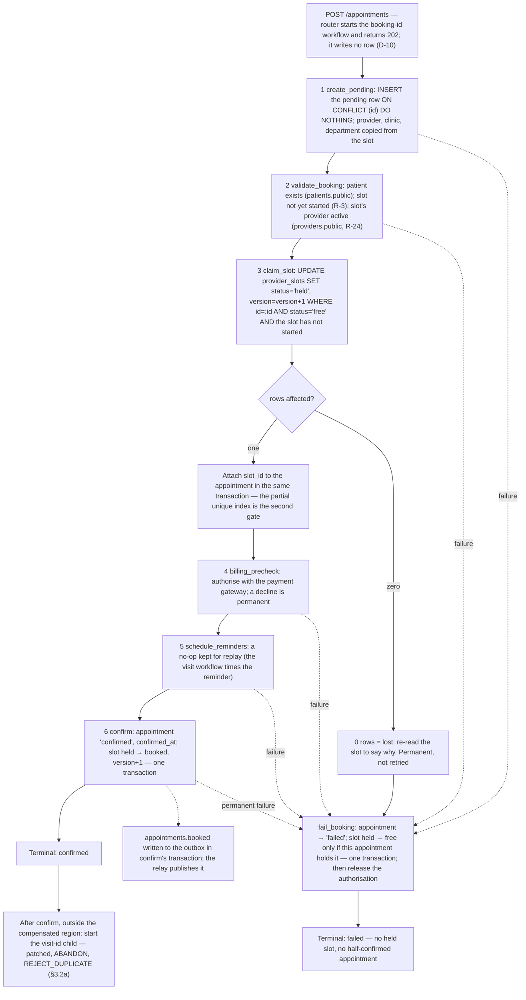

#### The steps, as built

Each activity opens its own session, makes one service call and commits
(`_unit_of_work`, `activities.py:84`), so a retry re-runs exactly one unit of work
against an operation that detects it already ran.

| # | Activity | Service call | Where | Failure |
| --- | --- | --- | --- | --- |
| 1 | `booking.create_pending` | `service.create_pending` — insert-or-nothing; audits `booking_requested` only if it inserted | `activities.py:115-131`, `service.py:307-365` | Unknown slot or patient → `NotFound`; the id already used for a different patient, provider or clinic → `Conflict` |
| 2 | `booking.validate_booking` | `patients.public.ensure_bookable_patient`, then `service.ensure_slot_bookable`, then `service.slot_provider_id` and `providers.public.ensure_bookable_provider` (R-24) | `activities.py:133-147`, `service.py:368-379`, `service.py:454-460`, `app/modules/patients/public.py:21-31`, `app/modules/providers/public.py:28-40` | Unknown patient, slot or provider → `NotFound`; a slot whose `starts_at <= now`, or an inactive provider → `Unprocessable` |
| 3 | `booking.claim_slot` | `service.claim_slot` — the patient-overlap check under a patient advisory lock (`_ensure_patient_is_free`, R-23), then the conditional UPDATE, then `slot_id` attached and flushed; audits `slot_claimed` | `activities.py:149-158`, `service.py:463-528` (overlap check `_ensure_patient_is_free`, `:391-451`; UPDATE at `:491-500`) | The slot overlaps another live (`pending` holding a slot, or `confirmed`) appointment of the same patient, its own reschedule predecessor excepted → `Conflict` ("overlaps"), before any write. Zero rows: re-read the slot and raise `NotFound`, `Unprocessable` (it started) or `Conflict` ("no longer free"). A violation of `ux_appointments_live_slot` or `fk_appointments_slot_provider_clinic` on attach → `Conflict`. An appointment no longer `pending`, or already holding another slot → `Conflict`. Re-claiming its own slot is a no-op |
| 4 | `booking.billing_precheck` | `billing.public.authorize` — one `billing_records` row, `authorized` or `declined`, with the gateway call keyed `authorize-<id>` | `activities.py:160-176`, `app/modules/billing/service.py:45` | A decline is recorded and committed, then raised as non-retryable `PaymentDeclined`, so the booking compensates. A gateway outage (5xx, timeout, open circuit) is `GatewayUnavailable`, retried under `STEP` — five attempts, then the booking fails and compensates |
| 5 | `booking.schedule_reminders` | none — a logging no-op since Week 3 slice 5 | `activities.py:178-187` | Never fails. It stays in the sequence because removing it would change the command history of bookings in flight (see "Replay safety" below) |
| 6 | `booking.confirm` | `service.confirm_booking` — `require_transition(pending → confirmed)`, slot `held → booked` | `activities.py:189-196`, `service.py:531-569` | Already confirmed → no-op. No slot, slot not `held`, or an illegal transition → `Conflict` |
| — | `booking.fail_booking` | `service.fail_booking` — the compensation | `activities.py:198-210`, `service.py:572-615` | No row, or no longer `pending` → no-op |

The loop over steps 1–5 is `workflows.py:75-82`, confirm is `:84-86`, and the compensation
handler is `:87-94`. Every activity has an explicit prefixed name — `booking.` for these, `visit.` for slice 3's
two, and `cancel.`, `reschedule.` and `waitlist.` for slice 4's: Temporal routes activities by name alone, and the bare method names would collide on the
shared task queue. `app/components.py` registers each under that name, so a collision
fails loudly in the registry rather than silently at the worker.

**Error classification is the point of the framework-free service layer** (§1.2, PRD D-6).
`_unit_of_work` turns every `DomainError` into `ApplicationError(non_retryable=True)` named
after the error class: a lost slot race or a past slot will not change on retry, and
retrying only delays compensation. Anything else — a dropped connection — propagates and
Temporal retries it. Malformed ids are checked by `parse_id` (`activities.py:50-63`)
*before* the unit of work opens and fail as `InvalidRequest`, non-retryable: a `ValueError`
is not a `DomainError`, so it would otherwise be retried on every step, and forever under
compensation's unlimited policy.

**Compensation.** Any `ActivityError` from step 1 through confirm runs `fail_booking`, then
ends the workflow with `ApplicationError(type="BookingFailed", non_retryable=True)` carrying
the original cause. `create_pending` is inside the compensated region on purpose: it can
commit and still fail (the reply is lost), and `fail_booking` no-ops when there is no row,
so compensating a create that never committed costs nothing. `fail_booking` sets the
appointment `failed` and returns its slot to `free` in one transaction — but only a slot
that is still `held` and held *by this appointment*, so the loser of a race never frees the
winner's slot. It no-ops on an appointment that is no longer `pending`: something else (a
cancellation, §3.3) owns it. The activity then releases the money in a **second**
transaction (`billing.release`: void the hold, if one was taken), so a gateway outage can
delay the refund of a hold but never keeps the slot held (`activities.py:198-210`).

**Retry policies** (`workflows.py:42-63`), three of them, because the cost of giving up
differs by step:

| Policy | Used by | Retries | Why |
| --- | --- | --- | --- |
| `STEP` | steps 1–5 | 5 attempts, from 1 s, 30 s per attempt | Bounded, so a dead database fails the booking and compensates instead of hanging it |
| `CONFIRM` | confirm | **unlimited**, backoff capped at 1 min | By the time confirm runs, everything before it has passed — and its transaction may have committed before the worker lost the reply. Giving up would end the workflow failed while the row says `confirmed`, and compensation no-ops on a confirmed row. Confirm is idempotent, so retrying until it lands is safe. A non-retryable `Conflict` still ends it and compensates |
| `COMPENSATION` | `fail_booking` | **unlimited**, backoff capped at 1 min | Giving up would leave exactly the held slot and `pending` row the workflow exists to prevent |

Proven in the T2 workflow tier against Temporal's time-skipping server with fake activities
(`tests/tiers/t2_workflow/test_booking_workflow.py`): `test_confirms_only_after_every_step_in_order`
(case `bkg-001`), `test_any_failing_step_compensates_and_never_confirms` (case `bkg-002`,
parametrised over every step after create), `test_a_failed_create_is_compensated_too`,
`test_a_transient_error_is_retried_not_compensated` and
`test_confirm_outlasts_the_step_retry_budget`. End to end — HTTP, a real Temporal server, an
in-process worker, Postgres and Mongo — by
`tests/tiers/t3_integration/test_booking_round_trip.py` (cases `bkg-004`, `bkg-005`).

**Cancel, never terminate — and a sweep for when someone does** (PRD R-9, closed in Week 3
slice 5). Cancelling a workflow raises inside it, so the compensation handler runs.
*Terminating* one runs no workflow code at all: a booking terminated mid-flight strands a
`held` slot and a `pending` row — the one case workflow-first (D-10) does not cover on its
own. The Celery beat task `scheduling.reconcile_stale_pending` (`app/modules/scheduling/tasks.py`,
every five minutes) finds `pending` appointments older than its threshold whose booking
workflow is not running, and compensates them exactly as the workflow would have:
`fail_booking`, then the billing release. It skips any booking whose workflow is still
running, and `fail_booking` acts only on a `pending` row under its lock, so it cannot race a
live booking into a wrong answer (§3.7).

**Replay safety — a rule for every future edit to `workflows.py`.** Temporal recovers a
workflow by replaying its history against the current code, and fails it if the code now
issues different commands. So changing `BookAppointmentWorkflow`'s command sequence — adding,
removing or reordering an activity, or renaming one — breaks every booking in flight when the
new worker deploys. Such a change must be gated with `workflow.patched("<id>")`, so new
executions take the new path and in-flight ones replay the old one, and the patch is retired
with `workflow.deprecate_patch` once no older booking can still be running. Slice 3's
"start the visit workflow after confirm" was exactly such a change, gated by
`workflow.patched("booking-starts-visit")` (`workflows.py:98`, Week 2 spec §8); §3.2a says how
it is proven. The reminder Week 3 added to `VisitWorkflow` is gated the same way, by
`workflow.patched("visit-reminder")` (`workflows.py:176`), and for the same reason the
now-empty `booking.schedule_reminders` step was kept rather than removed.

#### What the database guarantees independently

**`confirmed` is unreachable early, structurally.** Three things in the database enforce
this independently of whether the workflow above is correct:

| Guarantee | Where | What it stops |
| --- | --- | --- |
| `appointments.status` defaults to `'pending'` | `app/modules/scheduling/models.py:172-174`; `0001_baseline.py` | An insert that forgets to set a status cannot create a confirmed appointment |
| `CHECK (status <> 'confirmed' OR slot_id IS NOT NULL)` — `ck_appointments_confirmed_requires_slot` | `models.py:210-213`; `0002_coherence_constraints.py:75-84` | A confirmed appointment that never claimed a slot. Confirmation is only legal *after* reservation succeeded |
| `ux_appointments_live_slot` — `CREATE UNIQUE INDEX ... ON appointments (slot_id) WHERE status IN ('pending','confirmed') AND slot_id IS NOT NULL` | `0001_baseline.py:194-202` | Two live appointments holding one slot, **even if the conditional UPDATE is buggy**. Partial, so a failed or cancelled appointment frees the slot again |

In code, `state.py` backs the same invariant a second time: `confirmed` is reachable only
from `pending` (`APPOINTMENT_TRANSITIONS`, enumerated pair by pair in
`tests/tiers/t0_unit/test_scheduling_state.py`).

Two further constraints make a claim *coherent* rather than merely non-conflicting
(`0002_coherence_constraints.py:45-70`): `fk_appointments_slot_provider_clinic` proves the
slot really belongs to the provider and clinic the appointment names, and
`fk_appointments_department_clinic` proves the department belongs to that clinic. Every
single-column FK can be satisfied while the booking is still nonsense; these catch that. The
composite FK is MATCH SIMPLE, so it is skipped while `slot_id` is NULL (pre-claim) and
enforced the instant a slot is attached (`models.py:190-201`). `claim_slot` translates a
violation of it into `Conflict`.

**At most one live replacement per appointment** (`0004_live_reschedule_unique.py`, PRD D-5).
`ux_appointments_live_reschedule` is a partial unique index on
`appointments (rescheduled_from_id) WHERE status IN ('pending','confirmed') AND
rescheduled_from_id IS NOT NULL`. It forbids a second live appointment replacing an
appointment that already has one. Without it two reschedules of one appointment, accepted
together, each ran their own booking for a different slot, both confirmed, and the patient
held two confirmed appointments for the one they moved — with every other constraint
satisfied, because the two rows held different slots; the router's precheck cannot close
it, since both requests pass it before either workflow writes. With the index the second
booking's `create_pending` fails on insert and `service.create_pending` raises `Conflict`
(`LIVE_RESCHEDULE_INDEX`, `service.py:68`, `:349`), so it never claims a slot and its
compensation is a no-op (§3.3). Partial on status, like `ux_appointments_live_slot`: a
replacement that failed or was cancelled does not block another attempt. Unlike
`ux_appointments_live_slot` it is **declared in the model** (`Index(...,
postgresql_where=...)`, `models.py:214-224`) and so tracked by `alembic check`; the older
index is still excluded through `UNMANAGED_INDEXES` in `migrations/env.py`, whose comment
says why and that it could be declared the same way.

On the supply side, `ck_provider_slots_no_overlap` —
`EXCLUDE USING gist (provider_id WITH =, tstzrange(starts_at, ends_at) WITH &&)`
(`0001_baseline.py:180-189`) — means a buggy slot generator fails loudly at write time
instead of silently producing double-bookable inventory.

**Why zero rows affected is the design.** PRD **D-2**: computing availability from working
hours at request time means two concurrent requests both compute "free" and both book. With
pre-generated rows, the claim is a single atomic conditional UPDATE and there is no window
between checking and acting — zero rows affected *is* the conflict signal, and it is a
**permanent** failure the workflow does not retry. A second claim blocked on the winner's row
lock re-evaluates `status = 'free'` once the winner commits and matches nothing
(`test_a_claim_blocked_behind_a_winner_loses_on_the_update_predicate`, case `bkg-003`).

**The three obligations the schema cannot carry, and how they are met** (PRD R-2, R-3, R-4):

1. **`version = version + 1`** (R-4, closed). Nothing increments `provider_slots.version`
   automatically (`models.py:128-129`). Every slot write in `service.py` — the claim
   (`:416`), confirm (`:464`), compensation (`:501`) and the cancel/reschedule release
   (`_release_slot`, `:703`) — sets it explicitly.
2. **No booking a slot that has started** (R-3, closed). `CHECK (starts_at > now())` is
   impossible — Postgres requires check conditions to be immutable. `ensure_slot_bookable`
   rejects it in step 2, and the claim's own `WHERE` repeats `starts_at > now` (`:414`),
   because a retry or a backlogged worker can reach step 3 after the slot started.
3. **Slot status agrees with appointment status, in one transaction** (R-2, restated;
   closed for every path). Done for booking (`held → booked` with `confirmed`),
   compensation (`held → free` with `failed`), cancel and reschedule (`→ free` with
   `cancelled` / `rescheduled`, §3.3) and the visit paths — completion and no-show write no
   slot, and the slot stays `booked` (§3.2a). Slot
   status is written only in `scheduling/service.py`: `tests/meta/test_slot_writes.py` scans
   the rest of `app/` for every known way to write it — `update(ProviderSlot)` under any
   alias, Core's `__table__.update`, raw SQL, an ORM attribute assignment — and fails on
   any.

**Why the router returns 202, not 201.** The booking is `pending` when the request returns;
confirmation happens when the workflow completes. A 201 would claim a resource in a state it
is not yet in (`app/modules/scheduling/router.py:106`).

### 3.2a The visit lifecycle

> **Built in Week 2 slice 3; extended in Weeks 3 and 4.** Staff actions are synchronous
> endpoints (§2.9); a `VisitWorkflow` (`app/modules/scheduling/workflows.py:124-199`) owns the
> appointment's time — since Week 3 slice 5 the **reminder** (behind
> `workflow.patched("visit-reminder")`, D-26) and, as before, the **no-show** deadline.
> Completing a visit writes `visits.completed` in its transaction (Week 3 slice 3), whose
> consumer starts `PostVisitWorkflow`, the charge (§3.3); a no-show writes
> `appointments.no_show`. Since Week 4 a visit completes only with a signed clinical note,
> and only the appointment's own provider (or admin) may mark it seen or complete (§2.9).

**The principle (PRD D-12): the database records human actions; the workflow owns time.**
Each action is recorded the moment staff are told it was, so a timer can never overrule it,
and a Temporal outage cannot fail one. What Temporal keeps is the thing it is uniquely good
at: a durable per-appointment deadline that survives restarts, with an inspectable history.

**A design correction, and why.** The slice was first built the other way round: the
endpoints answered 202 and signalled a long-running workflow, which wrote each action
through an activity. A review showed that design loses check-ins, three ways. (1) Near the
deadline the timer could fire before the check-in activity ran, so staff were told
"accepted" and the patient was recorded `no_show`. (2) A check-in on an appointment already
past its deadline hit `wait_condition(timeout=0)`, which raises `TimeoutError` even when its
condition holds, so the buffered signal was overridden by a no-show. (3) Visit activities ran
on the booking step policy, so a database outage of a few minutes failed the visit workflow
for good and the appointment never got its no-show. Writing the action in the request closes
(1): the check-in and `mark_no_show` serialise on the appointment row lock, and whichever
commits first wins visibly. Never waiting a zero timeout closes (2). Unlimited retries close
(3). Temporal Updates were considered and not chosen — the write would still sit behind the
workflow, every action would then depend on Temporal being up, and the no-show race would
still have to be settled in the database (D-12 (b)).

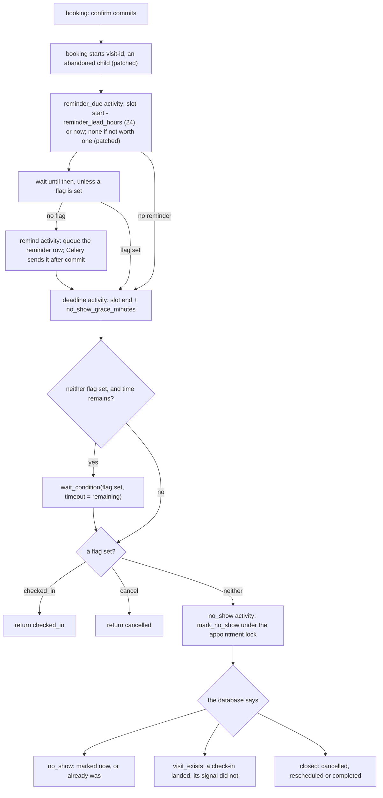

#### The timer, as built

| Step | Where | What |
| --- | --- | --- |
| Reminder | `workflows.py:153-169,176-177`, `activities.py:269-299`, `service.reminder_facts` (`service.py:144`), `notifications.public.queue_reminder` | `visit.reminder_due` returns when to remind — `Settings.reminder_lead_hours` (default 24) before the slot starts, or now if the booking came later — or nothing for a slot already started or an appointment no longer worth one. The workflow waits for that time unless a `checked_in` or `cancel` flag arrives; then `visit.remind` re-checks the appointment and queues one `notifications` row (unique key, so a retried activity queues nothing new), whose Celery send is registered to run after the activity's commit. Temporal owns *when*, Celery *how* (D-26). A cancelled appointment's reminder dies with its timer, with no cancel path of its own |
| Deadline | `workflows.py:178-183`, `activities.py:212-221`, `service.no_show_deadline` (`service.py:655`) | The `visit.deadline` activity returns the slot's end plus `Settings.no_show_grace_minutes` (default 15, `ge=0`, `settings.py:143`) as an ISO string. The worker passes the grace in as a `timedelta` (`app/worker.py:86`); `SchedulingActivities` has no default of its own, so a second default cannot disagree with `Settings` |
| Wait | `workflows.py:184-192` | Only if neither flag is set **and** `deadline - workflow.now()` is positive: `wait_condition(…, timeout=remaining)`, with `TimeoutError` caught. Past the deadline it never waits — a zero-length wait would raise even though the condition holds, which is correction (2) above |
| Flags | `workflows.py:142-148,193-196` | `checked_in` → `"checked_in"`; `cancel` → `"cancelled"`. The handlers only set flags; no I/O happens in one |
| Ask the database | `workflows.py:197-199`, `activities.py:223-233`, `service.mark_no_show` (`service.py:754-811`) | Otherwise the `visit.no_show` activity, under the appointment lock, returns a `NoShowOutcome` (`state.py:51`) — **three** answers, not a yes/no, because the two ways of *not* being a no-show mean different things — and that string is the workflow's result. `no_show`: marked now, or already was (a retried activity). `visit_exists`: a check-in reached the database first, so it is not a no-show whatever the flags say. `closed`: the appointment left `confirmed` |

The `checked_in` signal is a **hint**, not the record. It lets the timer finish early; if it
is lost or late, the timer still fires and `mark_no_show` finds the visit row. Because
`check_in` and `mark_no_show` both take the appointment row lock, a check-in still
uncommitted when the timer fires makes `mark_no_show` wait for it, and its visit read then
sees the committed row (READ COMMITTED reads per statement). Only `no_show` writes, once,
audits once with the actor `system:visit-workflow`, and emits `appointments.no_show` in the
same transaction (which notifications and analytics consume). No slot is written (PRD R-2).

**Retries are unlimited** (`VISIT_STEP`, `workflows.py:121`). The timer has no compensation
to fall back on: a step that gave up would end the workflow failed and leave the appointment
with no timer at all, so a short database outage would permanently cost it its no-show. Both
activities are reads or guarded writes, so retrying until the database is back is safe; a
domain error (`NotFound`) is non-retryable and still ends the workflow.

**Booking starts the visit** (`workflows.py:98-112`) after the `try`/`except` block, so a
failure there can never compensate a confirmed booking. It is gated by
`workflow.patched("booking-starts-visit")`, started as a child with
`ParentClosePolicy.ABANDON` (`:104`) — the visit outlives the booking — and
`WorkflowIDReusePolicy.REJECT_DUPLICATE` (`:107`): a late start must never open a second run
under a closed one and arm a second no-show timer for an appointment already settled.
`WorkflowAlreadyStartedError` (`:109`) is caught and ignored, because nothing but booking
starts a visit and a confirmed booking must not fail on it.

**Replay safety is a test, not a hope.** `tests/fixtures/histories/booking_pre_visit.json` is
a history recorded from the slice-2 booking workflow, before the child start existed
(`tests/tiers/t2_workflow/record_booking_history.py` regenerates it).
`test_a_pre_visit_booking_history_still_replays` (`tests/tiers/t2_workflow/test_replay.py`,
case `vst-003`) replays it against the current code; the `patched` gate is what lets the
new child-start command coexist with that history. `VisitWorkflow` itself needed no `patched` for the redesign — it
had never been released.

**Proof, by tier.** T0 `test_scheduling_state.py` enumerates the visit state table. T1
`test_visits_contract.py` proves the role gates, the 200/404/409 answers and that only
check-in signals. T2 `test_visit_workflow.py` runs the timer on the time-skipping server with
fake activities (cases `vst-002`, `vst-006`, `vst-007`); `test_visit_notifier.py` the signal.
T3 `test_visit_service.py` proves the strictness, the three outcomes and the lock race
against real Postgres (cases `vst-001`, `vst-005`); `test_visit_round_trip.py` runs the whole
flow over HTTP and the no-show on a real Temporal timer (cases `vst-004`, `vst-008`).

**Known gaps** (PRD §9): a booking confirmed before slice 3 has no timer and is never
auto-marked no-show (R-15); and a check-in in the instant between confirm and the visit
workflow's start is recorded but its signal is dropped, so the timer runs to the deadline and
ends `visit_exists` — correct, only later (R-16). R-14 — any provider could mark any visit
seen or complete — was closed in Week 4 (§2.9).

### 3.3 Cancellation, reschedule, the waitlist, and what follows a visit

> **Built in Week 2 slice 4; completed in Week 3.** `POST /appointments/{id}/cancel` (200),
> `POST /appointments/{id}/reschedule` (202), `POST /waitlist` (201) and `GET /waitlist`
> (`app/modules/scheduling/router.py:309,333,439,459`), `CancelFollowUpWorkflow` and
> `RescheduleWorkflow` (`app/modules/scheduling/workflows.py:268-339`), the activities
> `cancel.refund`, `reschedule.complete`, `waitlist.candidates` and `waitlist.fulfil`, and the
> service operations under them. Week 3 changed three things: the cancel follow-up is started
> by a Kafka consumer from the `appointments.cancelled` event instead of by the request (slice
> 4, PRD R-17 closed); the refund is a real void or refund through `app/modules/billing`, and a
> reschedule releases the old appointment's authorisation (D-27); and cancel and reschedule
> emit events that notify the patient (slice 5). Week 3 also added the two workflows that
> follow other events — `PostVisitWorkflow` and `ProviderDeactivationWorkflow` (below). Design:
> Week 2 spec §4.3–§4.5; Weeks 3–5 spec D-21, D-23, D-27.

`CLAUDE.md` and the requirements both treat these as **first-class flows, not the inverse of
booking**: cancelling triggers slot release, waitlist movement, a refund and a message to the
patient — work booking never does. The two flows have different shapes, and the difference is
PRD D-16. A cancel is a **synchronous paired write** that answers 200: the caller needs a
definitive answer, and a 202 followed by an asynchronous write would race the visit timer and
a concurrent booking exactly as visit check-ins did (D-12). A reschedule is **inherently a
workflow** (202), because it must book the new slot before it releases the old one (D-14).

#### Cancel — the paired write, then a follow-up driven by its event

> **Changed in Week 3 slice 4.** Until then the request, after its commit, started
> `CancelFollowUpWorkflow` itself, best-effort: a Temporal failure was logged and swallowed,
> because failing the response would tell the caller a recorded cancellation had failed. The
> cost was PRD R-17 — if that start failed, the follow-up (refund, waitlist, visit-timer stop)
> was lost for good. Now the cancel's own transaction writes `appointments.cancelled` to the
> outbox, so the follow-up is as durable as the cancel; the request never touches Temporal
> (proven by T1 `test_a_cancel_never_touches_temporal_even_when_it_is_down`).

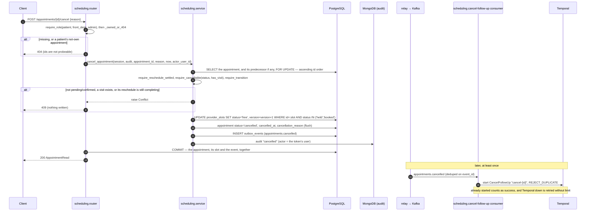

**The write is the check.** `service.cancel_appointment` (`service.py:823-865`) locks the
appointment first (`_lock_with_predecessor`, `:252`), then asks `require_reschedule_settled`
(`:268`), reads the visit, and asks `require_cancellable` (`state.py:40-48`): `pending` or
`confirmed`, and **no visit row** — a checked-in patient is not cancelled, even though
`confirmed → cancelled` is a legal transition on its own. The functions are **strict**, like
the visit actions: a second cancel is a 409, not a silent success, because only the endpoint
(and provider deactivation, below) calls it and nothing retries it. Only then does it release
the slot with `_release_slot` (`:812-820`), move the appointment and `emit` the event; the
caller owns the commit (§2.1), so all three land together or none does. A cancelled
appointment **keeps its `slot_id`** (as a failed one does, PRD R-10) so the follow-up can say
which slot to offer the waitlist; the event carries it, with `initiated_by` and `clinic_id`
(schema v2).

A `pending` appointment that holds a `held` slot is released by the same statement; one that
has claimed nothing yet writes no slot. Either way its booking workflow then finds the
appointment no longer `pending`, fails permanently at its next step, and `fail_booking` — which
acts only on a `pending` appointment — is a no-op. Whoever takes the row lock first wins, and
the loser's work is harmless.

**The follow-up.** The `scheduling.cancel-follow-up` consumer (`consumers.py:67-78`) starts
`cancel-<appointment_id>` with `REJECT_DUPLICATE`, so a redelivered event cannot refund or
promote twice: `WorkflowAlreadyStartedError` is success. Temporal being down is an outage, not
a poison message: the consumer runtime retries it without limit (§3.5).
`CancelFollowUpWorkflow` (`workflows.py:268-285`) then does, in order: `_stop_visit` (signals
`cancel` to `visit-<id>`; "no such workflow" is success, `:209-218`), `cancel.refund`
(`billing.release`: void the hold, or refund a capture; idempotent by the record's state and
the gateway key), and — only if the cancel released a slot — `_promote_waitlist`. It returns
`no-slot`, `released` (nobody to promote) or `promoted:<appointment id>`. Every activity in it
retries without limit (`FOLLOW_UP`, `:206`): each is idempotent, and giving up would lose the
follow-up the workflow exists to deliver. Independently, `notifications.patient-messages`
turns the same event into an "appointment cancelled" email, and the refund's
`billing.status_updated` (`refunded`) into a "refund issued" one.

#### Reschedule — book first, release second

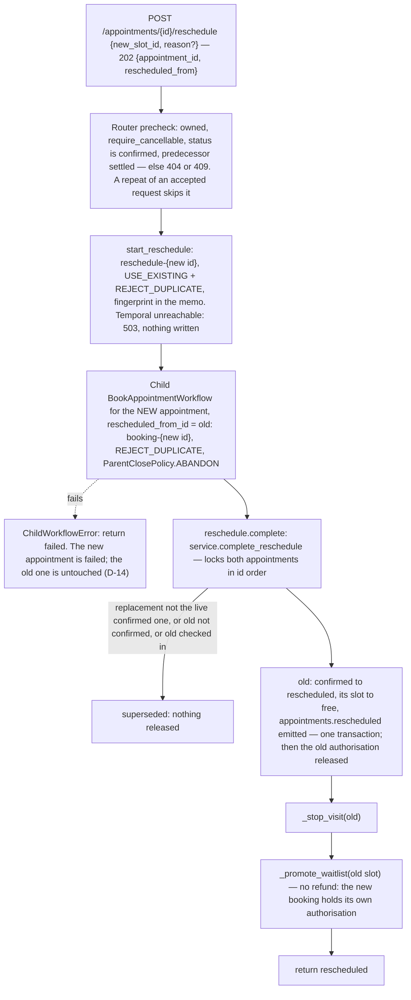

The 202 hands the client the **new** appointment's id to poll (`RescheduleAccepted`,
`schemas.py:64-69`). It is derived like a booking's (PRD D-11) but in its own uuid5 name space,
`reschedule:<caller>:<key>` (`reschedule_appointment_id_for`, `booking.py:46-56`), so one
`Idempotency-Key` used for a booking and then a reschedule names two appointments, never one
`booking-<id>` workflow. A repeat of an accepted request would otherwise trip the precheck once
the first completed (the old appointment is then `rescheduled`), so the router recognises a
repeat by the new row linking back to this appointment, and `start_reschedule` answers with the
workflow already started, or 422 if the key now names a different reschedule
(`reschedule_fingerprint`, `followups.py:41`).

`RescheduleWorkflow.run` (`workflows.py:303-339`) runs the booking as a **child** so it gets
booking's compensation for free: `REJECT_DUPLICATE`, because the new id is derived for this
reschedule alone, so `booking-<id>` can only be this child, and `ParentClosePolicy.ABANDON`,
so terminating the reschedule cannot kill the booking between its claim and its compensation.
If the child fails, the workflow returns `failed` and **the old appointment was never
touched**. If it confirms, `reschedule.complete` runs `service.complete_reschedule`
(`service.py:868-933`), which locks both appointments in ascending id order, so two
reschedules touching the same pair cannot deadlock, and checks the **new** one first: it must
still be `confirmed` and still name the old one in `rescheduled_from_id`. If it was cancelled
in the instant between its booking confirming and this step, releasing the old slot would leave
the patient with nothing, so nothing is written and the answer is `superseded` — the old
appointment stands. Then the old one: already `rescheduled` is a retried activity and answers
the same, writing nothing; not `confirmed`, or a visit exists, is `superseded` too — nothing
released, and what remains depends on why. If the old appointment was **cancelled** while the
new booking ran, the new booking stands as the patient's only appointment. If the patient
**checked in** at the old one, both stay `confirmed`: the old one is being seen and closes with
its visit, and staff cancel the new one if it is no longer wanted — the visit settles the
chain guard below, so that cancel is not refused.
Otherwise the old appointment becomes `rescheduled`, its slot `free` with `version + 1`, and
`appointments.rescheduled` is written to the outbox, in one transaction and audited once; the
activity then releases the old appointment's authorisation in a second transaction (the new
appointment took its own in its booking's pre-check). On `superseded` the workflow stops there; otherwise it signals
the old visit timer to stop and offers the released slot to the waitlist.

**At most one live replacement** (PRD D-5, `0004_live_reschedule_unique.py`). The router's
precheck is only a courtesy — two reschedules of one appointment, accepted together, both pass
it before either workflow writes. The database refuses the second: `ux_appointments_live_reschedule`
(§3.2, "What the database guarantees") makes its `create_pending` raise `Conflict`, a permanent
failure, so that booking compensates (a no-op — it claimed nothing) and its reschedule ends
`failed`. Proven by T3 `test_a_second_live_replacement_of_one_appointment_is_a_conflict` and, end
to end, `test_two_concurrent_reschedules_of_one_appointment_confirm_one` (case `rsc-003`).

**The chain guard.** The index sees one link of a chain at a time, so it cannot stop a
reschedule of an appointment that is itself mid-reschedule: while the new appointment's
predecessor is still `confirmed` with no visit, cancelling or rescheduling the new one could
leave both confirmed. A predecessor with a visit counts as settled even while `confirmed`:
`complete_reschedule` can only answer `superseded` for it and will never move it, so waiting
would block the new appointment until the old visit closed, while the old one cannot be
cancelled either. The visit is read under the predecessor's row lock, which `check_in` also
takes (T3 `test_a_checked_in_predecessor_settles_the_chain_so_the_replacement_can_be_cancelled`,
case `rsc-004`). `require_reschedule_settled` (`service.py:268-290`) refuses it with a 409 ("the
reschedule that created this appointment is still completing") in `cancel_appointment`, in
`create_pending` for a reschedule's new appointment (under the locks, since the router's own
check at `router.py:371-373` cannot see a reschedule that starts after it), and in the router's
precheck. A short window; the client retries (PRD R-21).

#### The waitlist

`POST /waitlist` takes `{patient_id, provider_id?, department_id?, window_start, window_end}`
(`router.py:439-456`) — the same patient-ownership rule as booking, so a patient may join only
for themselves (403) and staff for anyone — and `GET /waitlist` (`:459-476`) lists oldest first
for staff, and for a patient their **own** entries whatever `patient_id` they send (forced, not
filtered; a patient with no record gets an empty page, never "everyone"). Providers have no
access: the list names every waiting patient. Window bounds without a timezone are a 422
(`AwareDatetime`). Entries are `active` until a promotion sets them `fulfilled`; no endpoint
withdraws one and nothing expires one (PRD R-18).

`_promote_waitlist(slot_id)` (`workflows.py:221-265`) is shared workflow code, run by the
cancel follow-up and by reschedule (PRD D-13):

1. `waitlist.candidates` → `service.waitlist_candidates` (`service.py:1003-1043`) returns up to
   **three** `(entry, patient)` pairs, oldest first: `active`, window containing the slot's
   `starts_at` (`window_start <= starts_at < window_end`), and provider/department matching
   the slot wherever the entry names one. It returns **nothing** unless the slot is still
   `free` and has not started — the two conditions `claim_slot` enforces — because a slot
   taken again, or one cancelled after it began (allowed, R-20), would only make each
   candidate's booking fail in turn. It is a plain, unlocked read.
2. Each candidate is tried in turn as a **child booking** with the id `booking-wl-<entry_id>`
   and `ALLOW_DUPLICATE_FAILED_ONLY`, and `ParentClosePolicy.ABANDON`. A failed attempt may be
   retried by a later release; a confirmed one can never run twice and a running one cannot be
   started again, so two releases racing for one entry cannot double-book it. **That id, not a
   row lock, is the guard** — a lock cannot be held across a child workflow. A started or
   failed child moves the loop on to the next candidate.
3. The first child that confirms is followed by `waitlist.fulfil` (`fulfil_waitlist_entry`,
   `service.py:1046-1067`, idempotent, `active → fulfilled`), and the loop stops. If the entry
   was cancelled or expired meanwhile that activity fails, and is ignored: the booking
   stands and the id already prevents a second promotion.

The promoted appointment's id is `workflow.uuid4()` — deterministic on replay, but random
rather than a time-ordered uuid7, an exception to `PART-A-NFR-5` (R-19). A promotion books on
behalf of the patient with the actor `system:waitlist`.

#### Releasing a slot is a PAIRED WRITE — PRD R-2, closed

This was the most dangerous latent bug in the Week 1 schema, and the failure is silent.
`provider_slots.status` and appointment *liveness* are two independently writable facts.
Moving an appointment to `rescheduled` or `cancelled` takes it out of `('pending','confirmed')`
and so frees it from `ux_appointments_live_slot` — a second appointment may immediately claim
that `slot_id` — but the slot's own `status` is untouched and stays `booked`. The consequence
is not a crash: **the slot never reappears in the `status = 'free'` query that booking uses**,
and the inventory silently shrinks, one slot per cancellation, forever. Nothing in the
database detects it, because neither fact is individually wrong.

So **slot status agrees with appointment status, written in one transaction**, on every path
(PRD R-2, as restated in Week 2 — completion and no-show never free a slot: it is normally
already in the past):

| Path | Service function | Slot | Proven by |
| --- | --- | --- | --- |
| Confirm | `confirm_booking` (`service.py:531`) | `held → booked` | T3 `test_confirm_books_the_slot_and_is_idempotent` |
| Compensate | `fail_booking` (`:572`) | `held → free`, only if held by this appointment | T3 `test_fail_booking_releases_its_held_slot` |
| Cancel | `cancel_appointment` (`:823`) via `_release_slot` (`:812`) | `held`/`booked → free`, `version + 1` | T3 `test_cancelling_a_confirmed_appointment_frees_its_slot_in_one_write` (case `cnl-001`), `test_cancelling_a_pending_appointment_that_holds_a_slot_releases_it` |
| Reschedule | `complete_reschedule` (`:868`) via `_release_slot` | the old slot `→ free`, `version + 1`; none when `superseded` | T3 `test_completing_a_reschedule_frees_the_old_slot_and_says_which`, `test_a_reschedule_over_a_cancelled_appointment_is_superseded` |
| Complete, no-show | `complete_visit` (`:720`), `mark_no_show` (`:754`) | none — stays `booked`, `version` unchanged | T3 `test_complete_finishes_visit_and_appointment_and_leaves_the_slot_booked`, `test_no_show_with_no_visit_marks_it_and_leaves_the_slot_booked` |

Two things keep it from regressing. Slot status is written **only** in `scheduling/service.py`,
enforced by `tests/meta/test_slot_writes.py` (§3.2), so there is one file in which to forget
the other half rather than many. And the harness design lists "no reserved slot without a
corresponding non-cancelled appointment" as a post-condition to check after every journey case
(`docs/superpowers/specs/2026-09-01-testing-harness-design.md` §7.5) — designed, not built: the
journey tier has no cases yet. This is also why §2.1's rule matters: the caller owns the
commit, so a status write and the slot write that justifies it land in one transaction.

#### Proof, by tier

T0 `test_scheduling_state.py` enumerates the cancel preconditions
(`test_only_a_live_appointment_with_no_visit_is_cancellable`); `test_booking_ids.py` that the
reschedule id has its own name space; `test_booking_activities.py` that a booking request
recorded before `rescheduled_from_id` existed still decodes. T1 `test_cancel_reschedule_contract.py`
proves the role gates, ownership, the 200/202/404/409/422/503 answers, that a cancel never
calls Temporal even when it is down (`test_a_cancel_never_touches_temporal_even_when_it_is_down`)
and the waitlist's patient scoping. T2 runs both workflows on the time-skipping server against
fake activities: `test_cancel_follow_up.py` (the promotion loop: first candidate, a failing first
candidate, every candidate failing, an entry already promoted, a failed attempt retried) and
`test_reschedule_workflow.py` (cases `rsc-001`, `rsc-002`, and a superseded reschedule releasing
and promoting nothing). T3 proves the service against real Postgres (`test_cancel_service.py`,
`test_waitlist_service.py`, `test_cancel_activities.py`; cases `cnl-001`) and the whole flows
over HTTP with a real Temporal server and, in process, the relay and consumers
(`scheduling_helpers.event_pipeline`), so a round trip waits for workflows that Kafka starts
(`test_cancel_reschedule_round_trip.py`; cases `rsc-003`, `wtl-001`).

**Known gaps** (PRD §9): waitlist head-of-line blocking, with no entry expiry or withdrawal
(R-18); promotion ids that are `uuid4`, not uuid7 (R-19); cancelling after the slot started,
whose slot is then not offered to the waitlist (R-20); a pending replacement that cannot be
cancelled until its reschedule completes (R-21); and a reschedule refused inside the
workflow, visible only by polling the new id (R-22). R-17, the lost cancel follow-up, was
closed by the outbox in Week 3 slice 4.

#### After a visit: the charge

`complete_visit` writes `visits.completed` in the request's transaction. The
`scheduling.post-visit` consumer starts `PostVisitWorkflow` under `post-visit-<visit_id>`
(`workflows.py:342-356`), whose one activity, `post_visit.charge`, captures the booking's
authorisation through `billing.capture` (`activities.py:301-307`). The id refuses a second
start for a redelivered event, and the capture is idempotent besides (the record's state and
the `capture-<id>` gateway key). A gateway outage is retried without limit (`FOLLOW_UP`), so
the charge waits for the gateway rather than being lost; an appointment with no
authorisation ends `nothing-to-charge`. Proven by T2 `test_post_visit_captures_the_charge`,
`test_post_visit_retries_a_gateway_outage_until_it_charges` and
`test_nothing_to_charge_is_an_ending_not_a_failure`
(`tests/tiers/t2_workflow/test_post_visit_and_deactivation.py`).

#### Provider deactivation — cancel and notify (PRD R-25, closed)

Deactivating a provider (`PATCH /providers/{id}` with `is_active=false`) writes
`providers.state` through the outbox, like every provider write; providers imports nothing
from scheduling (D-8). The `scheduling.provider-deactivation` consumer starts
`ProviderDeactivationWorkflow` for a state with `is_active = false`, under
`provider-deactivation-<provider_id>-<event_id>` — one run per deactivation *event*, so a
provider deactivated, reactivated and deactivated again gets a run each time while a
redelivery is refused. The workflow (`workflows.py:359-381`) lists the provider's future live
appointments (`provider.future_appointments`) and cancels each with its own
`provider.cancel_appointment` activity — the ordinary paired write, reason
`provider_unavailable`, actor `system:provider-deactivation` — so the history shows each one,
and a crash resumes after the last. An appointment no longer cancellable (checked in,
cancelled meanwhile) is `skipped`, not a failure. Each cancel emits `appointments.cancelled`,
so the follow-up above refunds and tells the patient, with no deactivation-specific code
(policy D-23). It also offers the freed slot to the waitlist, but `waitlist_candidates` does not
look at the provider's status, so any matching candidate's booking is then refused by
`validate_booking` (R-24) and the slot stays free — wasted work, not a wrong booking. The workflow returns `cancelled:<n>,skipped:<m>`.
Proven by T2 `test_deactivation_cancels_each_future_appointment_once` (case `prv-001`) and T3
`test_deactivating_a_provider_cancels_their_future_appointments` (case `prv-002`).

### 3.4 Domain event catalogue, the outbox and the relay

> **Built in Week 3 slice 3**, with consumers from slice 4 on. This section replaces the
> Week 2 sketch it started as: that sketch proposed `providers.schedule_changed` and
> `notifications.reminder_due` topics, left the outbox undesigned, and deferred
> `billing_records`. As built, provider state travels on the compacted `providers.state`;
> reminders are timed by the visit workflow and need no topic (D-26); and the outbox and
> billing records both exist (migrations `0005`, `0006`). The Weeks 3–5 spec §3.2 has the
> derivation.

**How an event is written: the outbox (D-21).** A business change and a Kafka publish cannot
be made atomic — publishing after the commit loses the event on a crash, exactly PRD R-17 —
but a business change and an INSERT into the same database can. So every producer calls
`app/events/outbox.py:emit(session, topic, key=, payload=)` inside its own transaction: it
validates the payload against the topic's Avro schema (an event nobody can serialise rolls
the business change back with it), captures the current trace context into the row's
`headers`, and adds one `outbox_events` row. It never commits; the caller does. No other code
path publishes a domain event.

**How it reaches Kafka: the relay.** `python -m app.relay` (`app/events/relay.py`, the
`relay` compose service) loops: in one transaction it locks the oldest unpublished rows in
`seq` order (`FOR UPDATE SKIP LOCKED`, so a second replica takes different rows), produces
each to `Settings.topic(<name>)` keyed by its subject, Avro-encoded under its Schema Registry
subject and carrying the stored trace context in the headers, waits for delivery reports,
marks the delivered rows `published_at` and records the error on the rest. A crash between
produce and mark sends those rows again: **at least once**, and every consumer dedupes on
`event_id`. Order holds **per key**, because rows go in `seq` order and a key maps to one
partition. The relay exports `smarthealth_outbox_published`, `smarthealth_outbox_failed` and
`smarthealth_outbox_oldest_unpublished_age` — the backlog age is the event system's health
signal and has an alert (§3.8). Broker auto-creation is off: `python -m app.relay --setup`
creates the topics (configuration from `catalog.topic_config`) and registers every schema with
compatibility `BACKWARD_TRANSITIVE`. Published rows are purged after seven days by the
`events.purge_published` beat task, matching the event topics' retention.

**Every event shares one envelope** — `event_id` (uuid7), `event_type`, `schema_version`,
`occurred_at`, `producer`, `subject_id`, `payload` — and the payload never carries clinical
content (`tests/meta/test_event_catalog.py:test_no_event_carries_clinical_content`; D-31).
Schemas live in `contracts/events/*.avsc`; the meta-test keeps them in step with
`app/events/catalog.py`, requires a default on every optional field, and checks that state
topics are compacted and event topics are not.

| Topic | Kind | Producer (all through `emit`) | Consumers |
| --- | --- | --- | --- |
| `appointments.booked` | event | `scheduling.service.confirm_booking` | `notifications.patient-messages` (confirmation), `analytics.daily-rollup`; Part B `assistant` (conversions, by `origin` and `conversation_ref`) |
| `appointments.cancelled` (v2: `clinic_id`) | event | `cancel_appointment` (the endpoint, and provider deactivation) | `scheduling.cancel-follow-up` → `CancelFollowUpWorkflow`; notifications; analytics |
| `appointments.rescheduled` | event | `complete_reschedule` | notifications |
| `appointments.no_show` (v2: `clinic_id`) | event | `mark_no_show` | notifications; analytics |
| `visits.completed` | event | `complete_visit` | `scheduling.post-visit` → `PostVisitWorkflow`; analytics (Completed Visits, Average Wait Time) |
| `billing.status_updated` | event | `billing.service` on every status change | notifications (refunds only) |
| `identity.sessions_revoked` | event | `identity.service.deactivate_user` | Part B `assistant` (its deny-list) |
| `clinical.note_signed`, `clinical.test_ordered` | event | `clinical.service` (signing a note) | notifications ("visit summary ready", "test ordered") |
| `documents.uploaded` | event | `clinical.service` (upload) | none yet |
| `providers.state` | state (compacted) | every provider write; `republish_all` | `scheduling.provider-deactivation` → `ProviderDeactivationWorkflow`; Part B `knowledge` (its provider directory) |
| `clinics.state`, `departments.state` | state (compacted) | the seed and `republish_all` | none yet — published so a downstream copy can be built from offset 0 |

Every topic has a `<topic>.dlt` dead-letter twin. Schema evolution has happened once:
`appointments.cancelled` and `appointments.no_show` gained an optional `clinic_id` (v2) for
analytics, a backward-compatible change Schema Registry accepted.

The five analytics metrics (`PART-A-FR-5`) all come from this catalogue or the register:
Appointments Booked Over Time from `appointments.booked`; Completed Visits and Average Wait
Time from `visits.completed` (`avg(seen_at - checked_in_at)`, which is exactly why a visit is
a separate entity — PRD D-3); Cancellation Rate from `appointments.cancelled` against
`appointments.booked`; Total Patients is read from the register through `patients.public`.

### 3.5 Consumers and idempotency

**Every consumer assumes at-least-once delivery and takes an explicit idempotency key.**
This is harness requirement 4 (`CLAUDE.md`; `2026-09-01-testing-harness-design.md` §6.4) and
PRD **PART-A-NFR-3**. The word *explicit* is the whole point. Inferring uniqueness ad hoc —
"we will dedupe on appointment_id and timestamp" — works until two legitimate events for one
appointment collide, at which point the consumer silently drops a real event. A dedicated
`event_id` carried on the envelope, and checked before the side effect, has one meaning and
one failure mode.

**What goes wrong without it.** Kafka, RabbitMQ and Temporal all deliver at least once;
redelivery after a crash between the side effect and the acknowledgement is normal
operation. A duplicated `visits.completed` would double-count Completed Visits and corrupt
Average Wait Time — analytics is the one surface where nobody notices a wrong number until
someone acts on it; a duplicated `appointments.cancelled` would refund twice; a duplicated
`appointments.booked` would send the same confirmation twice.

**The runtime gives every consumer the same guarantees** (`app/events/consumer.py`), so no
handler re-implements them. A consumer is a `ConsumerSpec` — a name, its topics, an async
handler `(session, event, context)` and the kind of effect — registered in `CONSUMERS` by
`app/components.py`; `python -m app.consumers` runs one `ConsumerRunner` per spec.

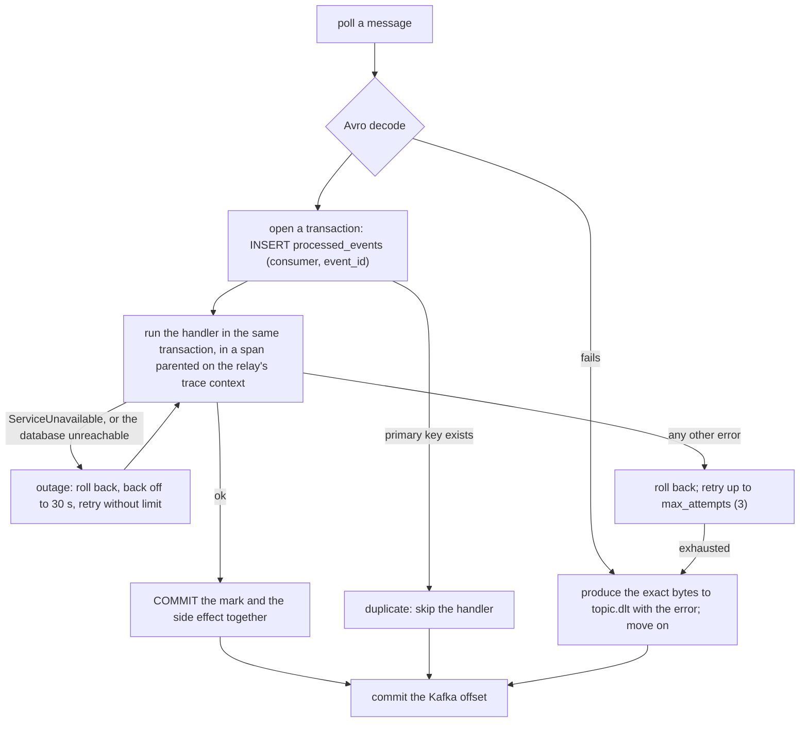

- **At most one application per event.** The `(consumer, event_id)` mark is inserted in the
  handler's own transaction, so a redelivered event hits the primary key and is skipped, and
  a handler that fails rolls the mark back with its side effect.
- **Offsets after the commit**, so a crash in between redelivers rather than skips.
- **A poison message cannot stall a partition**: after three attempts it goes to
  `<topic>.dlt`, and `python -m app.cli dlt-replay --topic …` re-publishes dead letters once
  the cause is fixed. An alert fires on any dead-lettered event (§3.8).
- **An outage is not poison.** Temporal down (a consumer that starts a workflow raises
  `ServiceUnavailable`) or the database unreachable is retried without limit: dead-lettering
  every cancel during a Temporal restart would turn a blip into a pile of manual replays.

The five registered consumers, and the second guard each has behind `processed_events`:

| Consumer | Topics | Effect | Second guard |
| --- | --- | --- | --- |
| `scheduling.cancel-follow-up` | `appointments.cancelled` | start `CancelFollowUpWorkflow` | workflow id `cancel-<id>`, `REJECT_DUPLICATE` |
| `scheduling.provider-deactivation` | `providers.state` (acts only on `is_active=false`) | start `ProviderDeactivationWorkflow` | workflow id per provider and event |
| `scheduling.post-visit` | `visits.completed` | start `PostVisitWorkflow` | workflow id `post-visit-<visit_id>`; the capture's gateway key |
| `notifications.patient-messages` | `appointments.booked`, `.cancelled`, `.rescheduled`, `.no_show`, `billing.status_updated`, `clinical.note_signed`, `clinical.test_ordered` | queue one `notifications` row | the row's unique key `<topic>:<event_id>`; the send task's claim |
| `analytics.daily-rollup` | `appointments.booked`, `.cancelled`, `.no_show`, `visits.completed` | increment `analytics_daily` | none in the write; the nightly reconcile reports drift (§3.7) |

A workflow-starting consumer's transaction commits only after the start succeeded or was
refused as already started, so the mark and the effect agree even though the workflow lives
in Temporal, outside the transaction.

**Enforced, not intended.** `tests/meta/test_consumers_idempotent.py` enumerates `CONSUMERS`,
requires a fixture event per topic, and delivers each fixture **twice**, asserting one
effect. `tests/meta/test_celery_tasks.py` does the Celery half: every task in `TASKS` is
registered, `acks_late`, and routed to a named queue (a Celery task's idempotency is its own:
the send task claims its row first, §1.4). `tests/meta/test_temporal_registry.py` discovers
every `@workflow.defn` / `@activity.defn` in `app/` and fails on one that is unregistered. The
registry raising on a duplicate name (`app/core/registry.py:28-32`) closes the other half of
the same hole: two handlers silently claiming one name is itself a way to process an event
twice. T3 `test_consumer_runtime.py` proves the runtime against a real broker.

Temporal is a partial exception worth naming: activities are retried by the engine and must
be idempotent for the same reason, but workflow *execution* is deduplicated by workflow id,
so starting the same booking or follow-up twice under a deterministic id is safe by
construction. That is a property to use, not a reason to skip idempotent activities.

### 3.6 Open inconsistencies

Recorded rather than quietly resolved:

1. ~~**`pending_failed` vs `failed`.**~~ **Resolved 2026-09-13.** The harness design's
   failure-sibling case expected `appointments.status == pending_failed`
   (`2026-09-01-testing-harness-design.md` §7.1), but `AppointmentStatus` has no such member
   — it has `failed` (`app/modules/scheduling/models.py:46`), and that is the only value the
   CHECK constraint accepts. **The code was authoritative and the spec has been corrected**;
   the sketch now reads `failed`. Left recorded rather than deleted, because a Week 2 test
   written from an older copy of that spec would still fail confusingly.
2. **Slot generation cadence is undecided, and no generator is built** — a Celery beat job
   versus a Temporal cron workflow (foundation spec §10). Slots are seeded by `python -m
   app.cli seed` (PRD `PART-A-FR-2.1`, deferred by decision). Deferred deliberately: the
   table shape is unaffected either way. It is the one place where §3.1's decision procedure does not yet give an
   obvious answer, because slot generation is both periodic (Celery-shaped) and multi-step
   across a provider's availability rules (Temporal-shaped).

### 3.7 Celery jobs and the beat sweeps

Celery carries *commands* — "send this message", "sweep stuck rows" — to exactly one worker
(`app/celery_app.py`; spec section 5). Facts go over Kafka; multi-step processes and timers
are Temporal's. RabbitMQ runs on its own vhost (`part-a`), and every queue name goes through
`Settings.queue()` (harness requirement 1):

| Queue | Tasks | Notes |
| --- | --- | --- |
| `notifications` | `notifications.send` | Dead-lettered to `notifications.dlq` (declared by the worker at start, since nothing consumes it) when a message is undeliverable for good |
| `maintenance` | the four beat sweeps below | |
| `documents` | `clinical.extract_document` | Text extraction from uploaded reports (Week 4) |

Reliability settings, each for a reason: `task_acks_late` with `task_reject_on_worker_lost`
(a worker killed mid-task leaves the message to be redelivered, not lost — safe because the
send task claims its row first), `worker_prefetch_multiplier = 1` (a slow SMTP server does
not strand a batch behind it), and no result backend (nothing reads results). Each task runs
one `asyncio.run` over a short-lived `NullPool` engine, so no connection outlives the loop
that opened it. `TASKS` is the registry the meta-test enumerates.

**Sending a notification, end to end.** A consumer (or the visit workflow's `visit.remind`
activity) calls `notifications.service.queue` inside its own transaction: one row, unique on
its key, and the Celery enqueue registered to run **after** that transaction commits —
enqueueing first would let a worker look for a row that is not there yet, or that a rollback
removed. `notifications.send` then claims the row (`queued → sending`; only one transaction
can, so a twice-delivered task sends once), applies a per-patient throttle in Redis (a
throttled send is re-scheduled without using a retry), renders the template and sends by
email (SMTP to Mailpit in compose) or SMS (a logging fake), retrying with backoff on a
channel error and rejecting to the dead-letter queue when retries run out.

**The beat schedule** (`celery-beat`, `app/celery_app.py:configure`):

| Job | Every | Task | Why |
| --- | --- | --- | --- |
| Requeue stuck notifications | 1 minute | `notifications.requeue_stuck` | A row still `queued` a minute after it was written — the process died between commit and enqueue, or the enqueue was lost — or `sending` for five minutes under a worker that never finished, is enqueued again; `claim` keeps that safe |
| Reconcile stale pending bookings | 5 minutes | `scheduling.reconcile_stale_pending` | Closes PRD R-9: a *terminated* booking workflow runs no compensation, so this sweep compensates `pending` appointments whose workflow is not running, exactly as the workflow would have (§3.2) |
| Purge published outbox rows | 24 hours | `events.purge_published` | Rows published more than seven days ago — Kafka keeps event topics that long, so an older row has no use |
| Reconcile analytics | 24 hours | `analytics.reconcile` | Recomputes the last seven days from `scheduling.public.daily_counts` and reports every (day, clinic, provider) cell where the rollup disagrees; reports, never overwrites |

### 3.8 Observability

Every Part A process — API, worker, relay, consumers, Celery worker — installs one tracer and
meter provider (`app/core/telemetry.py`, spec D-28) and exports OTLP/HTTP to the
`otel-collector`, which sends traces to `jaeger` and exposes metrics for `prometheus`; the
Part B services export to the same collector under their own `service.name`. Export is off
unless `SMARTHEALTH_OTEL_ENDPOINT_HTTP` (and, for the worker's Temporal SDK metrics,
`SMARTHEALTH_OTEL_ENDPOINT_GRPC`) is set, which is how the test suite runs with in-memory
providers instead.

**One trace per user action, across processes.** FastAPI is instrumented (probes excluded).
Every Temporal client carries the SDK's `TracingInterceptor`, so a workflow's run and its
activities join the trace of the request that started it. `emit` stores the trace context on
the outbox row; the relay's produce span and the consumer's handler span are parented on it,
so a cancel's trace continues through Kafka into the follow-up workflow it starts. On the Part
B side the assistant's calls to Part A are client spans named `Part A <METHOD>` that inject
`traceparent` (commit `5f91d39`), so a booking made in a chat runs as one trace from the
assistant through Part A's API into the booking workflow; each model call is an `llm chat`
span with `gen_ai.*` attributes, token counts included. JSON log lines carry `trace_id` and
`span_id`.

**Metrics and dashboards.** Prometheus scrapes the collector, RabbitMQ's own exporter and
`kafka-exporter`. Grafana is provisioned (`ops/grafana/`) with four dashboards — *Service
overview* (API rate, status, p95, 5xx ratio; Temporal workflows, activity failures and
schedule-to-start latency), *Async backbone* (outbox backlog age and publish/refuse rates,
events by consumer and outcome, consumer lag, RabbitMQ ready and unacknowledged messages),
*Platform analytics* (the five metrics, through the read-only `analytics_reader` Postgres
datasource) and *Assistant* (§6.5) — and eight alert rules: outbox backlog older than a
minute, an event dead-lettered, notifications in the dead-letter queue, a consumer falling
behind, API 5xx above 5%, booking workflows failing, assistant turns failing, and the
assistant slow to start answering.

**Known limits, stated plainly.**

- **SQL spans do not reach Jaeger.** `instrument_engine` attaches SQLAlchemy instrumentation
  to every process's engine, but no database spans appear under the request and workflow
  spans in Jaeger. The cause has not been established; traces still show every HTTP, Temporal,
  Kafka, gRPC and LLM hop.
- **The analytics drift counter is not surfaced.** `analytics.reconcile` records
  `smarthealth_analytics_drift` and logs each disagreeing cell, but no Grafana panel shows it
  and no alert fires on it; today drift is found in the Celery worker's logs.
- **gRPC health probes are not traced.** Deliberately: compose polls them every few seconds.
  The Part B services filter them with their own `TRACED` predicate, because the library's
  `filters.health_check()` splits the method name with `os.path` and never matches on Windows.

---

## 4. Key design decisions

Thirty-six decisions are recorded with their rejected alternatives and rationale in
**[PRD §8](PRD.md#8-key-design-decisions)** (D-1 … D-36), with full derivations in
[`2026-09-02-week1-foundation-design.md`](superpowers/specs/2026-09-02-week1-foundation-design.md)
§3,
[`2026-09-03-week1-management-apis-design.md`](superpowers/specs/2026-09-03-week1-management-apis-design.md),
[`2026-10-28-week2-scheduling-workflows-design.md`](superpowers/specs/2026-10-28-week2-scheduling-workflows-design.md)
§2 (D-9 … D-16) and
[`2026-11-10-weeks3-5-architecture-design.md`](superpowers/specs/2026-11-10-weeks3-5-architecture-design.md)
(D-17 … D-36).

**Weeks 1-2, Part A's core.** A user account is distinct from a patient/provider record
(D-1); bookable time is a pre-generated row rather than a computation (D-2); an appointment
is separate from a visit (D-3); PostgreSQL is the system of record and MongoDB owns only the
audit trail (D-4); reliability invariants live in database constraints rather than
application code (D-5); services never import FastAPI and routers own the transaction
boundary (D-6); Temporal, Kafka and Celery each own one kind of asynchronous work (D-7); the
system is a modular monolith whose boundaries are meta-tested (D-8); slots belong to
`scheduling` (D-9); the booking workflow, not the router, creates the appointment row
(D-10); duplicate bookings are prevented by deterministic workflow ids (D-11); the database
records human actions synchronously while the visit workflow owns time (D-12); waitlist
promotion is shared workflow code over two activities, not a Kafka consumer (D-13); a
reschedule books the new slot before it releases the old one (D-14); each module publishes
one interface file for other modules (D-15); and cancel is a synchronous paired write whose
follow-up runs in a workflow — started best-effort after the commit in Week 2, by the
consumer of its event since Week 3 (D-16).

**Week 3, the asynchronous backbone.** Part B is two services split by data ownership and
workload (D-17), and Part A stays one (D-18); services share channels — Kafka, Envoy, the
observability stack — never a store (D-19); Kafka *starts* Temporal workflows and never
steers a running one (D-20); events leave the database only through a transactional outbox
(D-21), as Avro under Schema Registry with `BACKWARD_TRANSITIVE` (D-22); a deactivated
provider's future appointments are cancelled and the patients told (D-23); Redis state and
Redis cache are separate instances (D-24); access tokens are short EdDSA tokens bound to a
server-side session, with rotating refresh tokens (D-25); reminder timing lives in Temporal
and Celery only delivers (D-26); billing is one state-machine record per appointment over a
fake gateway behind a circuit breaker (D-27); every process exports to one OpenTelemetry
Collector (D-28).

**Weeks 4-5, knowledge and the assistant.** The vector index holds shared knowledge only —
guides and provider profiles; live and per-patient facts come from Part A's API (D-29); the
assistant's client API is gRPC server-streaming, reached by gRPC-Web through Envoy (D-30);
clinical records are a Part A module whose content never travels on Kafka (D-31); the model
never writes — it answers from the guides and hands every action to a guided flow that waits
for a human confirmation (D-32); Groq behind provider-neutral settings, with an offline brain
as the fallback (D-33); conversation checkpoints in the assistant's own Postgres (D-34);
per-user usage named in the admin's browser, not copied into Part B (D-35); and reports as
in-process tasks streamed through Redis (D-36).

This document shows where each lands in the code — D-5, D-6, D-8 and D-15 in §1 and §2; D-2,
D-3, D-7, D-9, D-10 and D-11 in §2.8 and §3.2; D-12 and D-26 in §2.9 and §3.2a; D-13, D-14,
D-16, D-20, D-23 and D-27 in §3.3; D-21 and D-22 in §3.4; D-25 in §1.4 and §2.2; D-28 in §3.8;
D-17, D-19, D-29, D-30 and D-32 … D-36 in §6.

## 5. Assumptions and tradeoffs

Known gaps and accepted risks are recorded, each with a status, in
**[PRD §9](PRD.md#9-known-gaps-and-accepted-risks)** (R-1 … R-26).

**Closed since they were recorded:** the slot/appointment paired write (R-2, every path);
bookable past slots (R-3); the non-self-incrementing `version` column (R-4); patient
self-access (R-5); the 401/403 error contract (R-6); a terminated booking skipping
compensation (R-9, the stale-pending reconciler, §3.2); any provider marking any visit seen
or complete (R-14, §2.9); a lost cancel follow-up (R-17, the outbox, §3.3); a patient holding
two overlapping appointments (R-23); a deactivated provider staying bookable (R-24) and
keeping their existing appointments (R-25, §3.3); and a deactivated login keeping access until
its token expired (R-26, sessions). Redis is no longer unused (R-7, partly closed: it holds
state, and no cache has been built).

**Accepted, and still true:** the non-atomic audit/commit pair (R-1, and its
booking-activity form, R-12); the monolith's blast radius (R-8); failed bookings pinning their
slot against deletion (R-10); the unchecked no-row `GET` (R-11); a 503 that can follow a
successful start (R-13); bookings confirmed before slice 3 never being auto-marked no-show
(R-15); a check-in racing the visit workflow's start leaving the timer to run to its deadline
(R-16); waitlist head-of-line blocking (R-18); `uuid4` promotion ids (R-19); cancelling after
the slot started (R-20); the pending-replacement window (R-21); and a reschedule refused inside
its workflow being visible only by polling (R-22). R-1 is explained in situ at §2.3, R-2 at
§3.3, R-3/R-4/R-9 at §3.2, R-11/R-13 at §2.8, R-15/R-16 at §3.2a, and R-17 … R-22 at §3.3.

**Operational limits stated in this document:** SQL spans missing from Jaeger and the
analytics drift counter having no panel or alert (§3.8); assistant reports running as
in-process asyncio tasks, so a restart fails a report in progress (§6.4); clinic and
department management, and slot generation, having no endpoints (§1.4, §3.6).

Further deferrals that are decisions rather than oversights — `list_providers` having no
`is_active` filter, specialty filtering being a sequential scan, entrypoint migrations racing
under multiple replicas, the healthcheck polling `/health` rather than `/ready`, and the
absence of a dependency lock file — are each written up with their reasoning in
[`2026-09-03-week1-management-apis-design.md`](superpowers/specs/2026-09-03-week1-management-apis-design.md)
§11.

---

## 6. Part B — `knowledge` and `assistant`, as built

Two services beside the monolith, each with its own process, image, dependencies and stores
(D-17, D-19); `tests/meta/test_service_independence.py` fails on any import, setting or
compose variable that crosses between them or into Part A. They reach Part A only through
its HTTP API with **the user's own token**, and through Kafka; the browser reaches them only
through Envoy. Contracts are files: `contracts/proto/` (`smarthealth.knowledge.v1`,
`smarthealth.assistant.v1`), generated per service by `python scripts/gen_proto.py` into
`services/<name>/gen` and for the browser by `npm run gen:proto`. Both run under the compose
profile `partb`.

```
browser ──gRPC-Web──▶ envoy :8088 ──gRPC──▶ assistant :50051 ──gRPC──▶ knowledge :50052
        └──/api/*───▶ envoy ──HTTP──▶ Part A :8000          │                 │
                                                             ├─HTTP, user's token─▶ Part A
   Part A ──Kafka──▶ assistant (identity.sessions_revoked, appointments.booked)    │
   Part A ──Kafka──▶ knowledge (providers.state) ◀──────────────────────────────────┘
   stores:  assistant → assistant-db (Postgres), assistant-redis
            knowledge → knowledge-db (Postgres), qdrant
```

**Envoy** (`ops/envoy/envoy.yaml`, D-30) is the single front door: gRPC-Web to native gRPC for
`/smarthealth.assistant.v1.Assistant/` (no route timeout, since answers stream) and
`/smarthealth.knowledge.v1.Knowledge/`, and `/api/*` to Part A with the prefix stripped.
Between services (assistant → knowledge) calls are native gRPC with no Envoy in between.

**Authentication is Part A's.** Both services verify the caller's EdDSA access token against
Part A's `GET /.well-known/jwks.json` (each has its own copy of the verifier, `auth.py`). The
assistant additionally refuses a token issued before its user's sessions were revoked: it
consumes `identity.sessions_revoked` into a deny-list in `assistant-redis`, so it never reads
Part A's session store.

### 6.1 `knowledge` (`services/knowledge/knowledge_service`)

| Module | Does |
| --- | --- |
| `documents.py`, `chunking.py` | The corpus (`services/knowledge/corpus/`, fictional MediNova guides in Markdown and one PDF, each with an `audience`) split by heading, then by size (1,200 characters, 150 overlap); a PDF by size alone; one provider profile is one chunk. Chunk ids are uuid5 of document, version and position, and each chunk carries a hash of its text |
| `embeddings.py` | Two local embeddings per text with fastembed — dense `BAAI/bge-small-en-v1.5` (384 dimensions) and sparse BM25 (`Qdrant/bm25`) — from a factory keyed on `KNOWLEDGE_EMBEDDING_MODE`: `live`, `record`, or `fixture` (replays `eval/fixtures/embeddings.jsonl` and fails loudly on an unseen text; what tests use) |
| `index.py` | One Qdrant collection, two named vectors per point, payload indexes on `audience` and `document_id`. Writes are idempotent (point id = chunk id) and versioned: a new version is upserted *before* the old version's points are deleted, so a search during re-ingestion never finds a gap. Search prefetches 20 by each vector, fuses by **reciprocal rank (RRF)**, filters by audience, and returns nothing unless the best dense similarity reaches **0.55** (`MIN_SIMILARITY`), so an off-topic question gets "nothing" rather than the least-bad passage |
| `ingest.py` | Corpus ingestion: unchanged chunks keep their hash and are not embedded again, so it runs on every start |
| `store.py`, `consumer.py` | The service's own provider directory in `knowledge-db`, built from the compacted `providers.state` read from offset 0 (event-carried state transfer). Each value replaces the entry, so a replay is idempotent; an active provider is also one chunk in the index, an inactive one or a tombstone is removed from both |
| `server.py` | gRPC `Search(query, limit)`: verifies the token, takes the **audience from the token, never the request** (a patient searches the patient corpus; every staff role the staff corpus too), default limit 5, at most 20; gRPC health service |
| `eval.py` | The golden set (`eval/golden.yaml`): recall@5, MRR, and empty-for-off-topic; `KNOWLEDGE_EMBEDDING_MODE=record python -m knowledge_service.eval` re-records the fixture |
| `telemetry.py` | Tracing to the shared collector as `service.name=knowledge` |

On start (`main.py`) the service waits for Qdrant, ingests the corpus, then
`reindex_providers()` brings the index up to the directory (commit `5f91d39`): the consumer
acts only on events it has not committed, so providers whose events were read before
indexing existed were in the directory and not in search — on 2026-11-16 the directory held
six providers and the index none. Then the gRPC server reports SERVING.

The index holds **shared knowledge only** (D-29): guides and provider profiles. Live facts —
free slots, *my* appointments, a patient's record — come from Part A's API at the moment
they are asked, through the assistant's flows.

### 6.2 `assistant` (`services/assistant/assistant_service`)

| Module | Does |
| --- | --- |
| `server.py` | The gRPC service: `Chat` and `Confirm` (server-streaming), `Cancel` (stop generating), `Starters`, `ListConversations` / `GetConversation` / `DeleteConversation`, `Usage`, `StartReport` / `WatchReport` (streaming) / `ListReports`. Every event of a turn is appended to the turn's Redis Stream before it is sent |
| `agent.py` | The LangGraph graph per conversation: `begin → chat → flow ⇄ ask`, checkpointed in `assistant-db` by `AsyncPostgresSaver` (D-34), thread key = user *and* conversation, so one user can never resume another's |
| `flows/` | Seventeen guided flows, registered in `FLOWS` with the roles that may start them: scheduling (`book`, `cancel`, `reschedule`, `waitlist`, `my_appointments`), the record (`prepare`, `prescriptions`, `last_visit`, `reports` for patients; `brief`, `results_review` for providers), operations (`my_day` for providers; `capacity`, `no_shows` for front desk and admin; `snapshot` for admin) and two drafting flows (`notify_patients` for front desk and admin, `patient_instructions` for providers). `staged.py` is the stage machine they share. Each is deterministic over Part A's REST API with the user's token |
| `guard.py` | Red-flag patterns (chest pain, stroke signs, breathing, bleeding, collapse, self-harm) answered deterministically with urgent-care guidance from the clinic's own guide, before any model, and never with a booking |
| `llm.py` | The model factory (`ASSISTANT_LLM_MODE` = `auto` \| `off` \| `fixture` \| `record` \| `live`; provider, model and key from `ASSISTANT_LLM_PROVIDER` / `_MODEL` / `_API_KEY`; Groq `openai/gpt-oss-120b` in use, D-33). Each model call is an `llm chat` client span with `gen_ai.*` attributes and token counts |
| `offline.py` | The no-model brain: a message that names a use case starts that flow; anything else is searched in knowledge and the best passages quoted with their sources, never paraphrased |
| `parta.py` | Part A's API, always with the user's token: a timeout on every call (5 s), a circuit breaker, `Idempotency-Key` and `X-Conversation-Ref` on writes, and a `Part A <METHOD>` client span that injects `traceparent`, so Part A's request — and the booking workflow it starts — joins the assistant's trace |
| `stores.py` | `assistant-redis`: turn streams (`turn:<id>`, one-hour TTL), cancel flags, and the revoked-session deny-list |
| `conversations.py` | Threads and transcripts (`conversations`, `conversation_turns`) |
| `usage.py` | `turn_usage` per finished turn, `drafts`, and `bookings` (from `appointments.booked`, by `origin` and `conversation_ref`, for the conversion share) |
| `reports.py` | Background reports (§6.4), kept in `reports` |
| `metrics.py`, `telemetry.py` | OTel metrics (`assistant.turns`, `.turn.duration`, `.first_token`, `.llm.calls`, `.llm.tokens`, `.drafts`, `.bookings`, `.reports`) with low-cardinality labels, and traces; gRPC is instrumented on both sides, with health probes filtered out by `TRACED` |
| `main.py` | Wiring: the checkpointer, stores, the two Kafka consumers (`identity.sessions_revoked`, `appointments.booked`; at least once, offsets committed after an idempotent apply), the gRPC server and its health |

**The model never writes** (D-32). In `chat` the model has exactly two tools:
`search_knowledge` (calls `knowledge.Search` with the user's token) and `start_flow` (hands a
request to a guided flow). Every change — a booking, a cancel, a message to patients,
instructions saved into a note — is a flow step that pauses on a confirmation the user
answers through `Confirm`. A prompt that talks the model into wanting someone else's record
meets the same 403/404 from Part A the user would, because the assistant holds no authority
of its own.

**Citations are only what the answer used.** `sources_used` (`agent.py:309`) keeps a
retrieved passage only if it shares at least two distinctive words with the answer and — when
it has a section the title does not carry — the answer names that section. Citing everything
retrieved showed sources the answer never used; the offline judge caught that (case
`ai-001`), and a live run on 2026-11-16 caught sibling sections of one guide being cited
together, which the section-name rule fixed (commit `5f91d39`).

### 6.3 One chat turn

```
browser ──gRPC-Web──▶ envoy ──gRPC──▶ assistant.Chat(conversation, turn, message | choice | starter)
                                        │ verify JWT (JWKS) · refuse a revoked session (deny-list from Kafka)
                                        │ turn already recorded? replay it from its Redis Stream (resume)
                                        ▼
                     LangGraph, thread = user:conversation (checkpoint in assistant-db)
   begin ── starter ──▶ flow ⇄ ask (interrupt: Options | ConfirmationRequired | a typed answer)
     │                    ▲
     └── text ──▶ chat ───┘ start_flow (the model hands over; it never writes)
                   │ red flag? urgent-care guidance, done
                   │ model: search_knowledge (knowledge.Search with the user's token) → answer + sources
                   │ no model / failure: offline brain
                   ▼
   every event → Redis Stream → the client: token · tool · citation · options · confirmation · card · suggestions · error · done
   on done: transcript row (conversations) · usage row (usage) · metrics
```

**A write** — a booking, a cancel, a message to patients, instructions saved into a note —
happens only in a flow, after an `AskConfirm` the user answers through `Confirm`. Writes carry
`Idempotency-Key`s minted when the confirmation is asked, so a retried or replayed "yes"
changes nothing twice; Part A's authorisation decides whether the user may do it at all. A
booking made this way carries `X-Conversation-Ref`, so Part A records its origin as
`assistant` and the conversion is counted from `appointments.booked`. A message to patients
reaches them through Part A's `POST /notifications` once staff approve the draft, so Part B
never holds an SMTP client.

**A paused flow resumes anywhere**: the question is a LangGraph interrupt and the flow's
memory is in the checkpoint, so the answer may come in a later request, a reopened thread,
or after a restart. Typed text that does not answer the question drops the flow and is
handled as a new request.

**A dropped connection resumes, never regenerates**: the client reconnects with the same
turn id and the last sequence number it saw (`resume_from`), and the server replays the turn's
stream after it. `Cancel` sets the turn's cancel flag to stop generating.

### 6.4 Reports

`StartReport` (admin) creates a record and starts a task, returning a job id at once; four
kinds exist — weekly and monthly operations reports, a department utilisation report, and an
engagement summary (`reports.py:KINDS`). The task fetches **every figure from Part A** (this
period, the one before, daily series; `/analytics/utilisation` for utilisation), emits them as
cards, then streams the model's narrative of those figures only — with no model the narrative
is a plain statement of the same figures — appending each event to `report-<id>` in Redis.
`WatchReport` replays that stream and follows it until done, from any tab and after a dropped
connection; a finished report is served from its row in `assistant-db`.

**As built, a report is an asyncio task in the assistant process** (D-36), not a separate
worker as spec 9.1 named: at start-up the service marks any report still `running` as
`failed`, so a restart mid-report loses that report and it must be started again. The
job/stream split is what a worker would need, so it can be split out unchanged when load
asks for it.

### 6.5 Usage and observability

Each finished turn writes `turn_usage` (subject, role, model, calls, tokens from the
provider's own count, first-token and total time, outcome); drafts write `drafts`; bookings
seen on `appointments.booked` write `bookings`. `Usage` totals them per user for admin; the
AI usage page joins names and emails from Part A's `GET /users` in the browser (D-35), so
Part B stores no personal details. The same numbers feed OTel metrics with low-cardinality
labels only, scraped as `job="smarthealth/assistant"` into the **SmartHealth — Assistant**
dashboard (turns, model share, tokens, estimated cost, outcomes by role, time to first token
and whole-turn latency, drafts, reports, error share, and the share of bookings made with the
assistant), with alerts on error share and first-token latency (§3.8).

Traces run end to end: browser → Envoy → `assistant` (gRPC server span) → `knowledge`
(gRPC client and server spans) and → Part A (`Part A <METHOD>` client spans with
`traceparent`, then Part A's own request and workflow spans), with an `llm chat` span per
model call carrying `gen_ai.request.model` and input and output token counts. gRPC health
probes are excluded.

### 6.6 Degradation

| What fails | What the user gets |
| --- | --- |
| the model (no key, timeout, error, no recording) | the offline brain: a flow if the message names one, else the clinic's documents quoted with sources |
| `knowledge` | "I can't reach the clinic's guides"; flows still work |
| Part A | "I can't reach the booking system"; questions are still answered; the breaker fails fast after repeated failures |
| the connection, mid-answer | the client resumes from the last event seen; the server replays, never regenerates |
| the access token expires | the client refreshes once and replays the call |
| the assistant restarts mid-report | the report is marked failed and must be started again (§6.4) |

### 6.7 How Part B is tested

**No test calls a live model.** Agent tests script one (`Scripted` in
`tests/tiers/t1_contract/test_assistant_agent.py`) against a fake Part A
(`tests/harness/fake_part_a.py`); the golden set (`test_assistant_golden.py`) replays Groq's
recorded answers from `services/assistant/eval/fixtures/llm.jsonl`; knowledge tests replay
recorded embeddings. Declarative `ai` cases (`tests/cases/ai-*.yaml`) are run by
`tests/runner/ai.py`, and `python -m tests.judge.run_judge` judges the recorded run with a
different model — report only, never gating. The real key lives only in the git-ignored
`.env`; the test stack runs with none.

## 7. Deployment (Kubernetes)

Compose stays the development environment. The same system also installs on one 8 GB
Kubernetes node with one `helm upgrade --install`, proven on a k3d cluster capped at 8 GB
(`scripts/k3d_up.sh`, `scripts/k3d_smoke.py`). Design and rejected alternatives:
`docs/superpowers/specs/2026-11-17-helm-charts-k3d-design.md`; decisions D-37 ... D-41.

### 7.1 Charts

`deploy/helm/smarthealth` is the umbrella and depends on every chart by `file://`;
`deploy/helm/sh-lib` is a library chart (deployment, PVC, service, config map, secret
references, probes, resources, the wait-for init container) that **only the umbrella
declares** as a dependency: Helm named templates are global across a chart and its subcharts,
so the components use them without one, and Argo CD's single `helm dependency build` of the
umbrella is enough (D-43; a meta-test fails if a component chart declares a dependency); `deploy/helm/charts/` holds 21
component charts. `core` is Part A's six processes from one image (`core-api`, whose Service
keeps the compose name `app`, `core-worker`, `core-relay`, `core-consumers`,
`core-celery-worker`, `core-celery-beat`). `postgres` is installed three times
(`postgres`, `knowledge-db`, `assistant-db`) and `redis` twice (`redis`,
`assistant-redis`) by alias. That makes 29 pods, one per compose service, and every Service
carries its compose name so no setting that names a host changes. We write our own charts
(D-37) because community charts are sized for real clusters or have left free images, and
overriding them to fit 8 GB would be more than our charts.

### 7.2 Routing and the tool login

One host, one Traefik ingress (bundled with k3s), routes by path (D-38): `/` is the
frontend, `/api/*` the API with the prefix stripped (FastAPI `root_path=/api` keeps
Swagger working), the two gRPC-Web service paths go to Envoy with no buffering and no
response timeout, and `/grafana`, `/jaeger`, `/temporal`, `/mailpit`, `/rabbitmq`,
`/prometheus` are the tool UIs, each configured for its sub-path. The tool paths sit behind
one Traefik basic-auth middleware (D-39), which reads the one-key Secret `smarthealth-tools-auth`
(key `users`; Traefik 2.x refuses a Secret with more keys, so it cannot share
`smarthealth-secrets`; no `lookup`, so `helm template` renders it for Argo CD); a request without
the login gets 401. The Temporal UI is read-only (`TEMPORAL_DISABLE_WRITE_ACTIONS`). Qdrant's
dashboard does not serve under a sub-path and stays internal (`kubectl port-forward`).

### 7.3 Secrets

Every chart reads credentials from one Secret, `smarthealth-secrets` (D-41). With
`secrets.create: true` (k3d) the umbrella renders it from `values-local.yaml`, whose values
are the public development defaults; with `false` it is expected to exist already. The tool
login is the one exception, a second one-key Secret `smarthealth-tools-auth` (§7.2), rendered
or expected on the same terms. No non-development secret is in git. Images are built and imported or pushed from the laptop,
tagged with the git SHA (D-40, `scripts/push_images.sh`).

### 7.4 Startup order and jobs

A wait-for init container (busybox, polls host:port) holds back workloads that cannot start
without a dependency; the rest restart with backoff. Migrations stay in the API container's
entrypoint (one replica, so nothing races). `core-relay` runs `python -m app.relay --setup`
as an init container before relaying. Workloads that must never overlap during an upgrade
(`singleton: true`: Schema Registry, Celery beat) use `Recreate`. Demo data is two
suspended CronJobs, `demo-seed` and `demo-refresh` (`templates/demo-cronjobs.yaml`), never
scheduled and started on demand with `kubectl create job --from=cronjob/<name>`; each waits
for and runs the CLI against `http://app:8000`. They are not Argo CD hooks, so a sync never
re-runs them. A config change rolls the pods that
read it: the pod template carries a checksum of the chart's ConfigMaps.

### 7.5 Storage and the budget

k3s's `local-path` provisioner backs standalone PVCs annotated
`helm.sh/resource-policy: keep` and `argocd.argoproj.io/sync-options: Delete=false,Prune=false`
(so neither `helm uninstall` nor Argo CD deletion deletes data), mounted by
one-replica Deployments with `strategy: Recreate` rather than StatefulSets: with one replica
a StatefulSet adds nothing. Persistent: the three Postgres, Mongo, Kafka, Qdrant, the
knowledge model cache and Part A's documents. Part A's documents are shared by `core-api` and
`core-celery-worker`, which works only because there is **one node** (local-path volumes are
node-local). Redis, RabbitMQ, Prometheus and Jaeger are not persisted, as in compose.

Every container has memory requests and limits, kept in the umbrella's `values.yaml` with
the measurements as comments. Measured on k3d (k3s 1.30.6, cluster capped at 8 GB) after the
demo seed: limits total 6.36 GiB, requests 3.2 GiB; `core-celery-worker` needed 448Mi (two
forks extracting documents). `tests/meta/test_helm_charts.py` renders the umbrella and fails
if a compose service has no workload, a container has no limit, or the limits exceed 6.5 GiB.
Running k3d needs the compose stacks stopped.

## 8. Deployment on AWS

The same umbrella chart on one k3s server in AWS, for a reviewer to open from anywhere.
Terraform in `deploy/terraform/` creates everything; Argo CD keeps the cluster equal to git.
**Deployed and verified on 2026-11-17** at `https://d2xy34d2kn7e5f.cloudfront.net/` (section 8.8); it runs only while the owner has started it. Design and
rejected alternatives: `docs/superpowers/specs/2026-11-17-aws-deploy-design.md`; decisions
D-42 ... D-54; the missing backups are R-34.

### 8.1 Network

One VPC (`10.20.0.0/16`) in one availability zone of `ap-southeast-2`, with two subnets
(`network.tf`):

- **public**: the NAT instance (`t4g.micro`, Amazon Linux 2023), with a public IPv4, source/dest
  check off, and an `nftables` masquerade rule from the private subnet; its security group admits
  only the private subnet;
- **private**: the k3s server (`m7i-flex.large`, Ubuntu 24.04, 40 GB encrypted gp3). It has no
  public IP and no key pair. Its security group admits TCP 80 from the AWS-managed
  **CloudFront origin-facing prefix list** and nothing else. The private subnet's default
  route goes to the NAT instance.

Every EC2 instance requires IMDSv2. The server's instance profile carries
`AmazonSSMManagedInstanceCore` (Session Manager and Run Command, the way in) and read access
to `/smarthealth/*` in SSM Parameter Store.

**Why a VPC origin and a NAT instance (D-42).** CloudFront speaks plain HTTP to its origin
here (a certificate needs a domain). With a public server that hop crosses the internet and
carries passwords and bearer tokens in clear text. A CloudFront **VPC origin** reaches a
private instance over AWS's own network, so the server needs no public address at all. The
server still needs the internet to pull images from GHCR and charts from GitHub, and to call
Groq; a managed NAT gateway costs about $35 a month even idle, while a `t4g.micro` that starts
and stops with the server costs cents.

### 8.2 CloudFront

`cloudfront.tf`: one distribution, `PriceClass_All`, the default `*.cloudfront.net`
certificate, viewers redirected to HTTPS. The origin is the VPC origin for the server (HTTP 80,
read timeout 60 s). The default behaviour allows every method (POST for the API and gRPC-Web),
uses the `CachingDisabled` cache policy and the `AllViewer` origin-request policy (so the tool
login's `Authorization` header and bearer tokens reach Traefik). `/assets/*` uses
`CachingOptimized`: the frontend's assets are content-hashed. Managed policies are looked up by
name, never by id. Standard logs go to an S3 bucket kept 14 days.

### 8.3 The boot sequence

`templates/server-user-data.sh.tftpl` runs once, on first boot: it installs `apache2-utils`
and the AWS CLI, writes `/etc/smarthealth/boot.env`, writes a k3s `HelmChart` manifest for
Argo CD (chart pinned; served under `/argocd`, TLS ending at CloudFront, anonymous users
read-only) and `/etc/smarthealth/argocd-extra.yaml` (the Argo CD `Application`, the `/argocd`
Ingress and its basic-auth Middleware), installs k3s pinned to `v1.30.6+k3s1` (keeping Traefik
and local-path), and installs `smarthealth-boot.service`. That oneshot unit runs
`templates/smarthealth-boot.sh` **on every boot, after k3s**:

1. schedule the auto-stop (`shutdown -h +180`);
2. wait for the Kubernetes API;
3. read `/smarthealth/*` from SSM, retrying until it answers, and write `smarthealth-secrets`
   and `smarthealth-tools-auth` into the `smarthealth` namespace, the latter also into
   `argocd` (D-41);
4. wait for Argo CD's CRDs, set its admin password (bcrypt) and apply `argocd-extra.yaml`.

Pods whose Secret does not exist yet wait instead of starting with empty passwords. The server ignores later changes to its `user_data` (`lifecycle.ignore_changes` in
`server.tf`, so an apply never replaces a running server): **an edit to either template reaches
only a newly created server** — on the running one, copy the script over through Session
Manager, or replace the server deliberately. Rotating
a password is a change in SSM and a reboot. The NAT instance's user-data enables forwarding
and masquerade and its own timer, 15 minutes after the server's.

### 8.4 GitOps flow

`scripts/release.sh` builds and pushes the five images to `ghcr.io/sadainiqrar`, tagged with
the git SHA (public packages, no pull secret: D-44), writes the tag and the CloudFront URL into
`deploy/helm/smarthealth/values-aws.yaml` (`scripts/set_release.py`) and commits
`release: <sha>`. The owner fast-forwards and pushes `main`. The Argo CD Application tracks
`main`, path `deploy/helm/smarthealth`, value files `values.yaml` then `values-aws.yaml`, with
automated sync, prune and self-heal; it polls every 3 minutes, and reads the chart straight
from git (the reason `sh-lib` belongs to the umbrella only). `values-aws.yaml` sets
`secrets.create: false`, the GHCR registry, the tag and `global.publicUrl`; no secret is in it.
Argo CD's own UI is at `/argocd` behind the same tool login (D-45).

### 8.5 Secrets

Terraform generates each password with `random_password` (the three Postgres, RabbitMQ,
Grafana, the tool login, the demo logins, Argo CD admin) and writes them to SSM as
SecureString (`ssm.tf`); they are therefore in Terraform state, which is why the state bucket
is private, encrypted and versioned (D-48). Two secrets never enter state:
`scripts/aws_secrets.sh` puts a freshly generated JWT signing key and the Groq key from the
git-ignored `.env` into SSM directly. The owner reads the tool, demo and Argo CD passwords
with `scripts/tf.sh output -raw ...`. The instance profile can read `/smarthealth/*` only.

### 8.6 Auto-stop and what survives it

A review lasts hours, not weeks, and an idle server is the main cost. The server's boot unit
schedules `shutdown -h`; because `instance_initiated_shutdown_behavior = "stop"`, the instance
stops rather than terminates (D-46: no Lambda, no EventBridge). The timer is 3 hours after
each boot; `scripts/aws_extend.sh` re-arms both timers through Run Command, and
`scripts/aws_stop.sh` stops the instances at once.

**A stop keeps** the encrypted root disk, which holds every `local-path` volume (the three
Postgres, Mongo, Kafka, Qdrant, the knowledge model cache and Part A's documents); on the
next start k3s restarts, the Secrets are rewritten and Argo CD syncs whatever git says. **A
stop loses** only what is in memory, as on any restart (Redis, RabbitMQ, Prometheus and
Jaeger are not persisted). **A terminate keeps the root disk too**
(`delete_on_termination = false`), so `terraform destroy` leaves a volume to delete by hand.
**Nothing backs the disk up**: lose the volume and the demo is gone (R-34);
`scripts/aws_seed.sh` rebuilds the demo data.

### 8.7 Operating it

`scripts/aws_start.sh [--refresh]`, `aws_stop.sh`, `aws_extend.sh`, `aws_seed.sh`,
`aws_shell.sh`, `release.sh` and `scripts/tf.sh` (Terraform with the `smarthealth` profile's
credentials exported as environment variables, because the provider may not read the
`aws login` cache), each documented in the README's "Deploying to AWS". `python
scripts/aws_smoke.py` checks the deployment over HTTP through CloudFront: ready, a demo
login, a gRPC-Web stream, every tool path and `/argocd` answering 401 without the login and
200 with it, hashed assets cached and the API not. `scripts/aws_check.sh` is the inside view,
over Run Command through Traefik on `localhost` (so it works before CloudFront exists, and splits
a failure into "behind CloudFront" or "CloudFront itself"): Argo CD Synced/Healthy, every pod
running, a demo login, a real booking confirmed and cancelled with both emails in Mailpit, traces
from the API and the worker in Jaeger, Prometheus targets up, the seven tool paths, the assistant
over gRPC-Web from inside its pod, disk and memory headroom.

### 8.8 The first deploy (2026-11-17)

The plan above was applied once, step by step, with every `terraform plan` read before its
`apply`. What happened, and what it changed:

| Step | Result |
| --- | --- |
| Bootstrap | 4 resources: the state bucket, its versioning, encryption and public-access block |
| Stack | 41 of 42 resources. **CloudFront refused**: *"Your account must be verified before you can add new CloudFront resources"* — a hold on new accounts, lifted only by AWS Support (R-35). Verified the same day; the same plan then showed one resource to add, created in 3 minutes |
| Secrets | `aws_secrets.sh` failed at first: Git Bash rewrote `/smarthealth/...` into a Windows path before `aws.exe` saw it. `scripts/aws_lib.sh` now turns that rewriting off for `aws` calls only (`MSYS_NO_PATHCONV`) |
| Release | `release.sh` refused a dirty tree: the saved plan files were untracked. They can hold secret values and are now git-ignored. The first push of a new GHCR package answered `denied` once, after its layers uploaded; a retry succeeded. New packages are private until made public (D-44) |
| Argo CD | Synced but **Degraded**: the tag `3244061` is all digits, YAML read it as a number and Helm rendered `smarthealth-core:3.244061e+06` (`InvalidImageName`). `scripts/set_release.py` now writes the tag quoted (`tests/meta/test_release.py`); three minutes after the push, Synced and Healthy, 39 pods |
| Seed | `aws_seed.sh`: 800 patients, 130 days of history (3,139 appointments) and live bookings through the API, none failed |
| Checks | From inside the server (`aws_check.sh`): pods, a demo login, a booking confirmed in 2 s and cancelled with both emails in Mailpit, traces from eight services in Jaeger, the tool paths, the assistant over gRPC-Web. Then through CloudFront (`aws_smoke.py`): ready, login, the assistant's streamed answer with citations, the tool paths, assets cached and the API not. Both OK |
| Release with the URL | `release.sh`'s new pre-commit chart run caught a test that pinned the placeholder URL; fixed, then `release: 2dfb81f` recorded the address and Argo CD rolled it out in about 4 minutes |

Until CloudFront exists, `scripts/aws_start.sh` waits for `/api/ready` from inside the server
instead (Run Command, through Traefik), and `scripts/aws_check.sh` runs the full check from there.
Testing before CloudFront found four more script faults, all fixed with a meta-test
(`tests/meta/test_aws_scripts.py`): `aws_start.sh` stopped at the missing CloudFront URL;
`ssm_run` used the CLI's waiter, which gives up after about 100 seconds; `aws_shell.sh` `exec`ed
the `aws` wrapper function, which `exec` cannot run; and `aws_smoke.py` called a bare `bash`,
which Windows resolves to WSL's before Git Bash.
