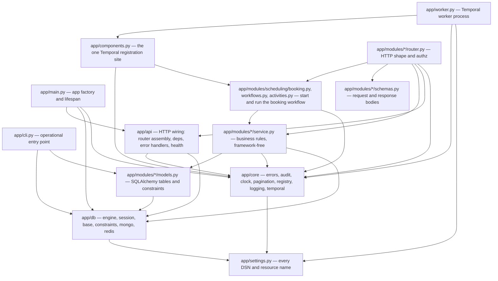
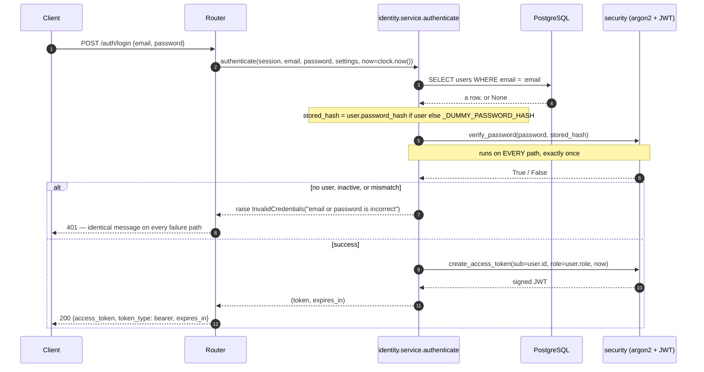
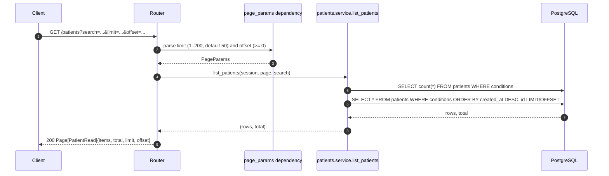
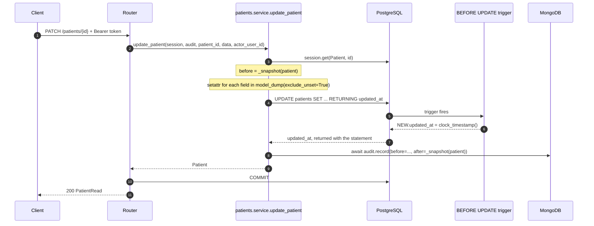
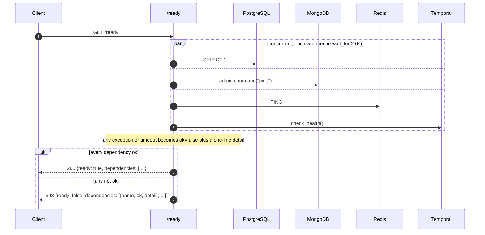
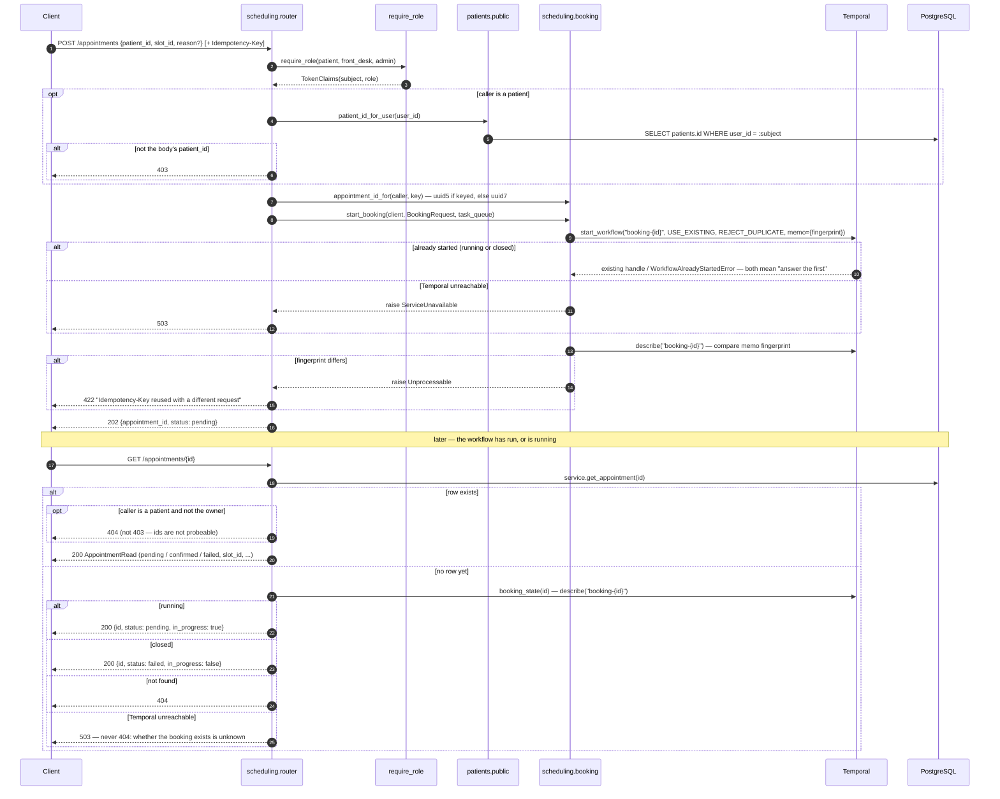
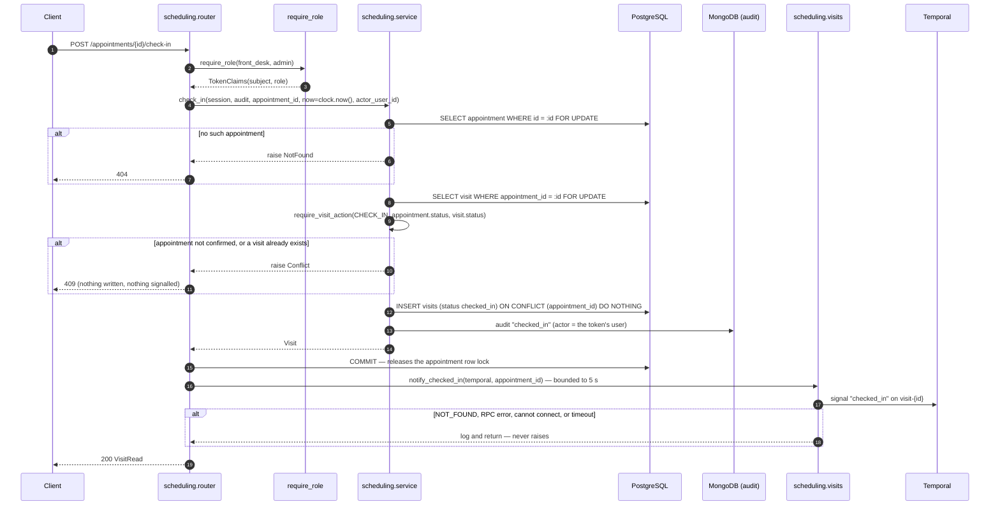
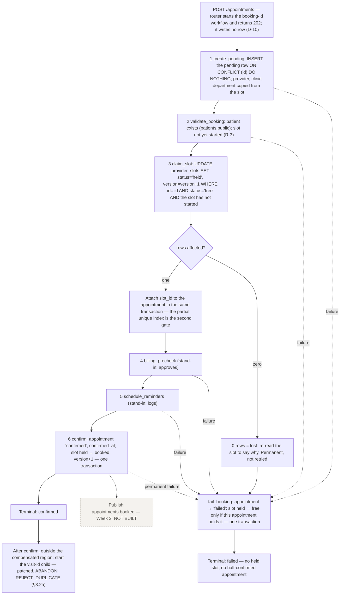
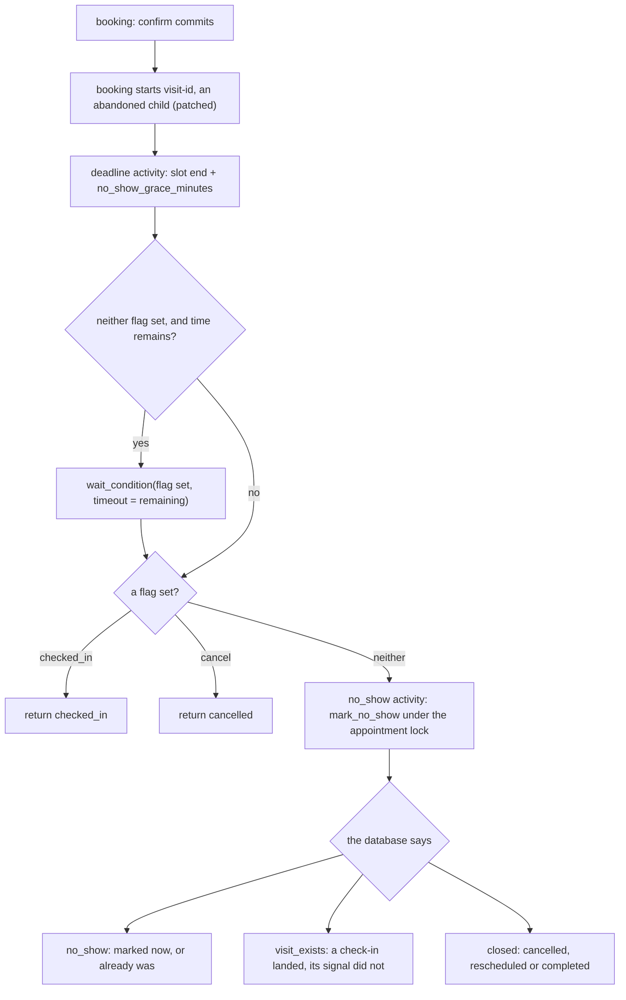
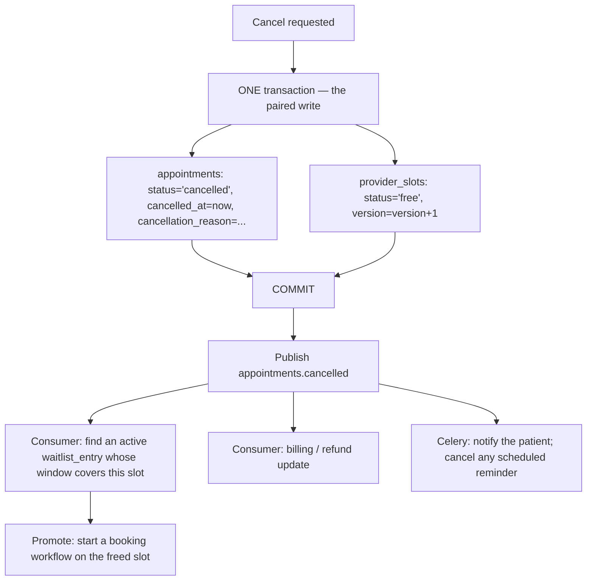

# SmartHealth — Technical Documentation

**Scope:** the submission deliverable named in
[`docs/requirements/execution-guidelines.md`](requirements/execution-guidelines.md) §3 —
service/module breakdown, data flows, event flows, key design decisions, assumptions and
tradeoffs.

**Companion documents.** [`docs/PRD.md`](PRD.md) owns requirements and traceability;
[`README.md`](../README.md) owns the orientation diagrams and how to run the thing. This
document owns the internals: what each module is for, what happens inside a request, and
how the asynchronous half of Part A is designed to work before any of it is written.

---

## Status and scope

**Week 1 of 5 is complete; Week 2 is in progress**, and three of its five slices have landed:
the Temporal worker (slice 1), the booking workflow (slice 2) and the visit lifecycle
(slice 3). Cancel/reschedule with the waitlist, and patient self-service (slices 4–5) are
not built.
Everything in §1 and §2 describes code that exists and is exercised by tests, with one
exception: the worker's signal handling depends on POSIX signals and is not exercised by
tests (verified manually with `docker stop`). In §3, the Temporal plumbing, the booking
workflow (§3.2) and the visit lifecycle (§3.2a) are **built**; everything else in §3 is
**design, not code** — each subsection is labelled at its top.

What is *not* built, stated plainly so a reviewer does not have to discover it:

| Thing | Container in compose? | Client library in `pyproject.toml`? | Code in `app/`? |
| --- | --- | --- | --- |
| PostgreSQL | yes | yes (`sqlalchemy`, `asyncpg`) | **yes** |
| MongoDB | yes | yes (`pymongo`) | **yes** — audit trail only |
| Redis | yes | yes (`redis`) | client constructed and health-checked, **used by no feature** (PRD R-7) |
| Temporal | yes (`temporal`), plus a `worker` service under `--profile app` | yes (`temporalio`) | **yes** — client, worker process, registries, a canary workflow, and two business workflows: booking (§3.2) and the visit no-show timer (§3.2a) |
| Kafka + Schema Registry | yes (`kafka`, `schema-registry`) | **no** | **no** |
| Celery + RabbitMQ | `rabbitmq` only | **no** | **no** |
| Prometheus / Grafana / Jaeger / OpenTelemetry | **no container at all** | **no** | **no** |

Verified by `grep -rni --include="*.py" "kafka\|rabbitmq\|celery\|opentelemetry" app/` — the only occurrences are in
prose comments and docstrings, plus `Settings.topic()` / `queue()` (`app/settings.py:99-105`),
the naming helpers Kafka and RabbitMQ will use when they arrive. Temporal code lives in
`app/core/temporal.py`, `app/core/temporal_canary.py`, `app/components.py`,
`app/worker.py` and, for booking and visits,
`app/modules/scheduling/{booking,visits,workflows,activities}.py`;
`Settings.task_queue()` (`app/settings.py:107`) is called from `app/worker.py` and
`app/modules/scheduling/router.py`.

Of the four scheduling tables, slices 2 and 3 read and write three: `appointments` (created
`pending`, then `confirmed` or `failed`; a confirmed one moves to `completed` or `no_show`
through the visit), `provider_slots` (`free → held → booked`, or back to `free` on
compensation — no visit path writes it) and `visits` (inserted at check-in, then
`in_progress` and `completed`). `waitlist_entries` exists with its constraints and
migration and nothing reads or writes it yet — it waits for slice 4.

---

## Contents

- [1. Service / module breakdown](#1-service--module-breakdown)
  - [1.1 Dependency direction](#11-dependency-direction)
  - [1.2 The framework-free rule](#12-the-framework-free-rule)
  - [1.3 The module-boundary rule](#13-the-module-boundary-rule)
  - [1.4 Module by module](#14-module-by-module)
- [2. Data flows](#2-data-flows)
  - [2.1 The transaction boundary rule](#21-the-transaction-boundary-rule)
  - [2.2 POST /auth/login](#22-post-authlogin)
  - [2.3 POST /patients](#23-post-patients)
  - [2.4 GET /patients — search and pagination](#24-get-patients--search-and-pagination)
  - [2.5 PATCH /patients/{id}](#25-patch-patientsid)
  - [2.6 GET /ready](#26-get-ready)
  - [2.7 Error translation](#27-error-translation)
  - [2.8 POST /appointments and GET /appointments/{id}](#28-post-appointments-and-get-appointmentsid)
  - [2.9 POST /appointments/{id}/check-in, and the other visit actions](#29-post-appointmentsidcheck-in-and-the-other-visit-actions)
- [3. Event flows — booking and visits built, the rest design](#3-event-flows--booking-and-visits-built-the-rest-design)
  - [3.1 The three-way split](#31-the-three-way-split)
  - [3.2 The booking workflow — BUILT](#32-the-booking-workflow--built)
  - [3.2a The visit lifecycle — BUILT](#32a-the-visit-lifecycle--built)
  - [3.3 Cancellation and reschedule](#33-cancellation-and-reschedule)
  - [3.4 Domain event catalogue](#34-domain-event-catalogue)
  - [3.5 Idempotency](#35-idempotency)
  - [3.6 Open inconsistencies](#36-open-inconsistencies)
- [4. Key design decisions](#4-key-design-decisions)
- [5. Assumptions and tradeoffs](#5-assumptions-and-tradeoffs)

---

## 1. Service / module breakdown

SmartHealth is one codebase and one image, run as two processes today: the FastAPI
application (`app/main.py:50`) and the Temporal worker (`app/worker.py`, the `worker`
compose service, which runs the scheduling workflows and their activities), plus an operational CLI
(`app/cli.py`) that is deliberately not part of the request path. Week 3 adds a Celery
worker. Under `--profile app` compose also runs a third service, `frontend`, the demo client
in its own nginx image (§1.4), which is not part of that codebase. Several processes sharing one codebase is the
reason the internal layering is stricter than a single-process application would need.

Inside the deployable, modules are grouped **by domain, not by technical layer**
(`identity`, `patients`, `providers`, `scheduling`), so a feature's router, schemas,
service and models change together and live together
(`docs/superpowers/specs/2026-09-02-week1-foundation-design.md` §4).

### 1.1 Dependency direction

Dependencies point inward. Nothing in `app/core` imports anything else in `app`, except
`app/core/audit.py` importing `app/core/clock.py`, and `app/core/temporal.py` importing
`app/core/registry.py`, `app/core/temporal_canary.py` and `app/settings.py`.



Read the arrows as "may import". The rule that matters is the absence of the reverse
arrows: `app/core` never imports `app/modules` or `app/api`, and `app/modules/*/service.py`
never imports `app/api` or `fastapi`.

### 1.2 The framework-free rule

**`app/core/**`, `app/db/*`, `app/modules/*/models.py`, every `app/modules/*/service.py`,
and the Temporal code (`app/modules/scheduling/workflows.py`, `activities.py`, `booking.py`)
must not import FastAPI or Starlette.** Verified — the complete set of FastAPI imports in
the application is:

```
app/api/deps.py, app/api/error_handlers.py, app/api/health.py, app/api/router.py,
app/main.py,
app/modules/identity/deps.py, app/modules/identity/router.py,
app/modules/patients/router.py, app/modules/providers/router.py,
app/modules/scheduling/router.py
```

`app/db` has no exception. `get_session`, a FastAPI dependency because it takes a
`Request`, lives in `app/api/deps.py` (`:54`) beside `get_audit_log`; the session
*factory* (`create_session_factory`, `app/db/session.py:20`) is framework-free and is what
the CLI and the worker use. `tests/meta/test_import_boundaries.py` lists the framework-bound
modules (`FRAMEWORK_BOUND`) and fails if anything else reaches FastAPI, directly or
transitively.

**Why the rule exists.** Week 2's Temporal activities call the same service functions from
a worker process that has no ASGI stack, no `Request`, and no exception handlers. An
activity that caught `HTTPException` would be nonsense — and worse, a status code cannot
express the distinction the workflow engine actually needs: *permanent* failure ("this slot
is already taken, stop retrying") versus *retryable* failure ("the connection dropped, try
again"). Both are 409-or-500-shaped over HTTP. So services raise `DomainError` subclasses
(`app/core/errors.py:17-62`), which carry business meaning, and `app/api/error_handlers.py`
— and nothing else — maps them onto status codes. The module docstrings at
`app/core/errors.py:8-11`, `app/core/audit.py:9-17`, `app/core/pagination.py:3-11` and
`app/db/constraints.py:3-6` each record this obligation in place; PRD D-6 records the
decision.

`app/api/deps.py` exists for the same reason: it is the seam where a FastAPI `Request`
becomes a plain object. `get_audit_log` (`app/api/deps.py:31`) builds an `AuditLog` from
`request.app.state.mongo`; a Temporal activity constructs the identical `AuditLog` from a
collection and a clock with no request involved. `page_params` (`app/api/deps.py:46`) does
the same for `limit`/`offset`, so a service takes a `PageParams` value, never a
`Query`-bound parameter.

### 1.3 The module-boundary rule

**`app/modules/<x>` must not import `app/modules/<y>`.** §1.2 is the *vertical* rule —
nothing outside the HTTP layer reaches a web framework. This is the *horizontal* one, and
it is the property the phrase "modular monolith" actually names.

SmartHealth is one deployable, one codebase, one schema and one migration history. So is a
plain monolith: the two are indistinguishable on every externally visible axis. The single
difference is whether the import graph has a deliberate shape. Verified — the complete set
of cross-module edges in the application is:

```
app/modules/patients/router.py      → identity.deps, identity.models, identity.security
app/modules/providers/router.py     → identity.deps, identity.models, identity.security
app/modules/scheduling/router.py    → identity.deps, identity.models, identity.security,
                                      patients.public
app/modules/scheduling/activities.py → patients.public
```

Eleven edges, every one declared as an explicit `(importer, imported)` pair in
`CROSS_MODULE_ALLOWED` (`tests/meta/test_import_boundaries.py`). Nine are auth at the router
layer: `require_role`, `UserRole`, `TokenClaims`. The other two are scheduling's reach into
`patients`, and both go through one file, the published interface
`app/modules/patients/public.py` (PRD D-15), which returns ids and raises domain errors —
never a `Patient` ORM object:

- `scheduling.activities` → `ensure_bookable_patient` — the `validate_booking` activity
  checks the patient exists (`app/modules/scheduling/activities.py:108`).
- `scheduling.router` → `patient_id_for_user` — a `patient` caller may book and read only
  their own appointments (`app/modules/scheduling/router.py:54-55`).

Every `service.py` imports only `app/core`, `app/db` and its own module — no exceptions,
`scheduling/service.py` included. Week 1 expected that file to be the first with a real
reason to cross the boundary; it was not, because the cross-module work was pushed up a
layer. The activity performs the patient check and then calls the service with ids only, so
`service.py` never needs to know a patient table exists. That was not optional: rule 4
(`NEVER_CROSS`) forbids `service.py`, `models.py` and `schemas.py` any cross-module import,
allowlist or not.

**Two rules, not one, and they are asymmetric.**
`test_modules_do_not_import_each_other` takes an allowlist (`CROSS_MODULE_ALLOWED`, the
eleven pairs above) because a router or an activity is a composition point and a declared
exception there is legitimate. `test_the_service_layer_never_crosses_a_module_boundary` takes none: a
`service.py`, `models.py` or `schemas.py` edge is always a bug, because the service layer
is the unit of extraction and the models are what it owns. An allowlist entry for a service
would grant precisely the coupling the boundary exists to prevent. Both lists are checked
for staleness, so an exemption cannot outlive its reason.

**What the rule deliberately does not touch: the database.** `appointments` carries foreign
keys into two other modules' tables — `patients`, and `providers`/`clinics`/`departments`
(all owned by `providers`) — plus scheduling's own `provider_slots` (moved into scheduling
by D-9), and `app/modules/scheduling/models.py` imports none of the foreign ones — they are
declared as table-name strings (`ForeignKey("patients.id")`). Scheduling is therefore fully
coupled in the database and not coupled at all in Python. That is not a loophole; a shared
schema is what a modular monolith *is*. The modularity lives in the import graph, which is
why extracting scheduling later would mean moving its four tables (`appointments`, `visits`,
`waitlist_entries`, `provider_slots`) and turning the foreign keys onto
`patients`/`providers`/`clinics`/`departments` into API calls or event payloads — bounded, well-understood work — whereas if
`scheduling/service.py` imported `patients/service.py` there would be no list of call sites
to work from.

**Why it existed before Week 2.** Until it did, the property was true but unguarded:
`patients/service.py` could import `providers/service.py` and the whole suite stayed green.
Week 2's booking needs patient, provider, slot and clinic data; a direct import is the path
of least resistance and looks entirely reasonable in a diff. The three ways to get that data
are a direct import (the modular monolith silently becomes a monolith), a published
interface on the owning module, or a domain event once Week 3's Kafka exists. Booking used
the second for patients, and needed nothing for the rest: slots moved into `scheduling`
(PRD D-9), and provider, clinic and department ids are copied from the slot row by
`create_pending`, so no Python edge onto `providers` exists.

### 1.4 Module by module

#### `app/api` — HTTP wiring

**Responsibility:** everything that is true because this is an HTTP server, and would be
false in a worker process.

| File | Public surface | Notes |
| --- | --- | --- |
| `router.py:13-19` | `api_router` | The only place a module's router is mounted. |
| `deps.py:31,46,54,77` | `get_audit_log`, `page_params`, `get_session`, `get_temporal` | The framework / framework-free seam (§1.2). `get_audit_log` declares `clock` as a `Depends` rather than calling `get_clock()` inline, because only a declared dependency can be replaced through `app.dependency_overrides` (`app/api/deps.py:32-40`). `get_temporal` hands routers the app's lazy Temporal client, and is what contract tests override so they never reach a real server. |
| `error_handlers.py:33` | `register_error_handlers` | One handler on `DomainError` covers every subclass via Starlette's MRO walk; a second on `Exception` keeps `{"error", "detail"}` as the shape of *every* failure, including unanticipated ones. |
| `health.py:37,89` | `GET /health`, `GET /ready` | See §2.6. |

May import: `fastapi`, `app.core`, `app.db`, `app.settings`. Must not import: any
`app/modules/*/service.py` (routers do that).
**Status: implemented.**

#### `app/core` — framework-free utilities

**Responsibility:** the vocabulary every other module shares — errors, audit, time,
pagination, registries, logging — with no dependency on how the process was started.

| File | Public surface | Notes |
| --- | --- | --- |
| `errors.py:17-62` | `DomainError`, `NotFound` (404), `Conflict` (409), `PermissionDenied` (403), `InvalidCredentials` (401), `Unprocessable` (422), `ServiceUnavailable` (503) | The status code is a class attribute, read only by the HTTP layer. A booking activity turns any `DomainError` into a non-retryable Temporal failure (§3.2). |
| `audit.py:70-124` | `AuditEvent`, `AuditLog.record()` | Takes a `_Collection` **protocol** (`audit.py:82`), not a pymongo type, so it does not even import `app.db.mongo`. `_normalise` (`audit.py:31`) converts exactly the types BSON cannot encode and passes everything else through, so an unsupported type fails loudly rather than being silently stringified. |
| `clock.py:13-35` | `Clock`, `FixedClock`, `get_clock` | Harness requirement 6: no `datetime.utcnow()` inline anywhere. |
| `pagination.py:23-38` | `PageParams`, `Page[T]`, `MAX_LIMIT=200`, `DEFAULT_LIMIT=50` | The maximum exists so one request cannot ask for every row. |
| `registry.py:17-54` | `Registry[T]` | Harness requirement 3. Duplicate names raise, because two handlers silently claiming one name is exactly how an event gets processed twice (`registry.py:20-22`). Two instances exist in `temporal.py`: `WORKFLOWS` holds the canary, `BookAppointmentWorkflow` and `VisitWorkflow`, `ACTIVITIES` the nine scheduling activities (seven `booking.*`, two `visit.*`). Kafka consumers and Celery tasks get registries when they land in Week 3. |
| `temporal.py` | `WORKFLOWS`, `ACTIVITIES`, `TASK_QUEUE`, `connect_client`, `build_worker`, `check_worker`, `bind_activities` | `bind_activities` binds each registered activity method to the instance of its class built at worker start, which holds the session factory, audit log and clock. The client is lazy by default so the API boots with Temporal down. `build_worker` always includes the canary. `check_worker` is true only if a worker on the queue executed the canary within `CANARY_TIMEOUT` (5 s). `tests/meta/test_temporal_registry.py` discovers every `@workflow.defn` / `@activity.defn` in `app/` by `ast` and fails if one is unregistered or a registered workflow fails sandbox validation. |
| `temporal_canary.py` | `CanaryWorkflow` (type name `Canary`) | A workflow with no activities, used only as the worker's readiness probe. Free of import-time side effects because Temporal re-imports it inside the sandbox. |
| `logging.py:19-55` | `JsonFormatter`, `configure_logging` | JSON lines. `configure_logging` removes only handlers it previously installed, never pytest's `caplog` handler (`logging.py:41-45`). OpenTelemetry trace/span ids join the record in Week 3. |

Must not import: `fastapi`, `starlette`, `app.api`, `app.modules`, `app.db`.
**Status: implemented.**

#### `app/db` — persistence plumbing

**Responsibility:** constructing and shaping connections; not deciding anything about the
domain.

| File | Public surface | Notes |
| --- | --- | --- |
| `base.py:25-59` | `Base`, `UUIDPrimaryKeyMixin`, `TimestampMixin`, `NAMING_CONVENTION` | The naming convention is load-bearing: without it Postgres generates constraint names and Alembic diffs become unstable. `__mapper_args__ = {"eager_defaults": True}` (`base.py:41`) is the fix for the `MissingGreenlet` PATCH failure — see §2.5. |
| `engine.py:15` | `create_engine(settings)` | Lazy: builds a pool without connecting, which is what lets the contract-test lane run the real lifespan with no database present. |
| `session.py:20` | `create_session_factory` | `expire_on_commit=False`. Framework-free: the request-scoped `get_session` lives in `app/api/deps.py`, so the CLI and the worker can build sessions without importing FastAPI. |
| `constraints.py:17` | `violated_constraint(IntegrityError) -> str \| None` | Reads the constraint name off a failed write. Non-obvious and empirically verified: the asyncpg error carrying `constraint_name` hangs off `exc.orig.__cause__`, not `exc.orig` — matching on `exc.orig` alone turned a duplicate MRN into a 500. |
| `mongo.py:21-43` | `create_mongo_client`, `get_audit_collection`, `ensure_audit_indexes`, `AUDIT_COLLECTION` | PyMongo's async driver, not Motor (deprecated May 2026). Indexes are created by explicit tooling, not at startup, so boot needs no database. |
| `redis.py:10-26` | `create_redis_client`, `namespaced_key` | Constructed, health-checked, and **used by no feature** (PRD R-7). |
| `all_models.py:14-22` | `ALL_TABLES`, `Base` | The single import site that makes `Base.metadata` complete; without it Alembic autogenerate silently drops tables. |

Must not import: `app.modules` (except `all_models.py`, whose whole job is to import them),
`app.api`, `fastapi`.
**Status: implemented.**

#### `app/modules/identity` — authentication and authorisation

**Responsibility:** who is calling, and may they do this. A `User` is a login, not a person
(`models.py:1-6`).

| File | Public surface | Status |
| --- | --- | --- |
| `models.py:18-45` | `UserRole` (`patient`/`provider`/`front_desk`/`admin`), `User`, `role_column` | implemented |
| `security.py:34-102` | `hash_password`, `verify_password`, `create_access_token`, `decode_access_token`, `TokenClaims`, `InvalidToken` | implemented — pure functions over explicit inputs, no global settings and no implicit clock |
| `service.py:29` | `authenticate(session, *, email, password, settings, now)` | implemented — see §2.2 |
| `router.py:16` | `POST /auth/login` | implemented |
| `deps.py:36` | `require_role(*allowed)` | implemented — a dependency factory, so enforcement happens before the handler body runs |

`require_role` is the one place that deliberately raises `HTTPException` rather than a
domain error: it is HTTP-layer machinery and 401 has no domain meaning
(`docs/superpowers/specs/2026-09-03-week1-management-apis-design.md` §3.1). The cost is
PRD R-6, now closed — 401/403 bodies carry the same `{error, detail}` envelope as every
other failure, because `require_role` raises `DomainError` subclasses rather than
`HTTPException`, which Starlette would have handled itself.

#### `app/modules/patients` — patient records

**Responsibility:** the patient as a person receiving care, whose existence does not depend
on having credentials (`models.py:1-5`).

| File | Public surface | Status |
| --- | --- | --- |
| `models.py:19-33` | `Patient` — `mrn` unique, names, DOB, contact, nullable-unique `user_id` | implemented |
| `schemas.py` | `PatientCreate`, `PatientUpdate`, `PatientRead` | implemented. `PatientUpdate` rejects an explicit `null` on NOT NULL columns (`app/modules/patients/schemas.py:33-46`) — without it `{"first_name": null}` becomes a client-triggerable 500 instead of a 422 — and requires at least one field (`app/modules/patients/schemas.py:48-52`). |
| `service.py:54,82,98,132` | `register_patient`, `get_patient`, `list_patients`, `update_patient` | implemented |
| `router.py:30,54,64,80` | `POST /patients`, `GET /patients/{id}`, `GET /patients`, `PATCH /patients/{id}` | implemented |
| `router.py:43`, `service.py:170` | `GET /patients/me` → `service.get_patient_for_user` | implemented — `patient` only; 404 when no record is linked to the login. Declared before `/{patient_id}` (`router.py:43-51`), or FastAPI parses `me` as a UUID and answers 422 |

Writers are `front_desk` and `admin`; readers add `provider` (`router.py:25-26`). A patient
reads their own record through `GET /patients/me` only, never `/patients/{id}`: the role
gate stays per-role, and the per-object part is the lookup by `user_id` (PRD R-5, read half
closed; the appointment list is slice 5).

#### `app/modules/providers` — clinics, departments, providers

**Responsibility:** the supply side — who can be seen, and where. *When* (`ProviderSlot`)
moved to `scheduling` in Week 2 (PRD D-9).

| File | Public surface | Status |
| --- | --- | --- |
| `models.py:26-86` | `Clinic`, `Department`, `Provider`, `provider_departments` | **models implemented; only `Provider` has a service and endpoints** |
| `service.py:54,87,103,151` | `register_provider`, `get_provider`, `list_providers`, `update_provider` | implemented |
| `router.py:35,49,59,78` | `POST /providers`, `GET /providers/{id}`, `GET /providers`, `PATCH /providers/{id}` | implemented — writes admin-only, reads open to any authenticated role |

**Clinic and department management is schema-only** (PRD `PART-A-FR-1.5`): the tables and
their constraints exist, no endpoint touches them, and they are seeded directly for now.

`ProviderUpdate` deliberately omits `license_number`
(`app/modules/providers/schemas.py:21-26`): it identifies the clinician to a regulator, and
changing it
silently would break the audit trail's link to a real person.

#### `app/modules/scheduling` — appointments, visits, waitlist

**Responsibility:** bookable time (`ProviderSlot`), the booking (`Appointment`), what
actually happened (`Visit`), and who to promote when a slot frees up (`WaitlistEntry`).

**Status: booking and the visit lifecycle implemented** (Week 2 slices 2 and 3).
`WaitlistEntry` is still schema only — cancel/reschedule and the waitlist are slice 4.

| File | Responsibility |
| --- | --- |
| `models.py` | `ProviderSlot` and `SlotStatus` (moved here from `providers`, PRD D-9), `Appointment`, `Visit`, `WaitlistEntry` and their status enums |
| `state.py` | `APPOINTMENT_TRANSITIONS` as data, `can_transition`, `require_transition` (raises `Conflict`); and for visits `VisitAction`, `VISIT_PRECONDITIONS` / `VISIT_RESULT` as data, `require_visit_action` (`state.py:75`) and `NoShowOutcome` (`state.py:40`). Pure; every status write asks it first |
| `service.py` | The idempotent booking operations — `create_pending`, `ensure_slot_bookable`, `claim_slot`, `confirm_booking`, `fail_booking`, `get_appointment` — the visit operations (`service.py:288` on): the **strict** staff actions `check_in`, `mark_seen`, `complete_visit` (called only by the endpoints), the **idempotent** timer operations `no_show_deadline` and `mark_no_show` (called only by activities), and the read `get_visit` — and the read `list_free_slots` (`service.py:457`): a provider's free slots that have not started, earliest first, the same two conditions `claim_slot` enforces. `GET /slots` takes a required `provider_id` and optional `from`/`to`, which must carry a timezone (`AwareDatetime`) or the answer is a 422; any authenticated role may call it. Framework-free and Temporal-free; flushes, never commits. **The only file in `app/` that writes slot status** (`tests/meta/test_slot_writes.py`) |
| `contracts.py` | `BookingRequest` and `VisitRequest`, frozen dataclasses of strings passed between a workflow and its activities, and `visit_workflow_id` (`visit-<appointment_id>`). Pure, so the workflow sandbox imports it directly |
| `activities.py` | `SchedulingActivities`: seven `booking.*` and two `visit.*` activities (`deadline`, `no_show`), each one service call in its own session and transaction; domain errors become non-retryable `ApplicationError`s. Built with the no-show grace, which has no default here — `Settings` is its only source. `billing_precheck` and `schedule_reminders` are stand-ins until Week 3 |
| `workflows.py` | `BookAppointmentWorkflow` (type name `BookAppointment`): the step sequence, the retry policies, compensation, and the patched start of the visit child; and `VisitWorkflow` (type name `Visit`), the no-show timer (§3.2a). No I/O, no clock |
| `visits.py` | `notify_checked_in`: the best-effort, 5-second-bounded `checked_in` signal the check-in endpoint sends after its commit, which never raises. Framework-free |
| `booking.py` | Starting a booking from the API: `appointment_id_for` (id derivation), `start_booking` (start policy and fingerprint check), `booking_state` (what Temporal knows when no row exists). Framework-free |
| `schemas.py` | `BookingCreate`, `BookingAccepted`, `AppointmentRead`, `VisitRead` |
| `router.py` | `POST /appointments` (202) and `GET /appointments/{id}` — role gate, patient ownership, and nothing else — the visit endpoints `POST /appointments/{id}/check-in`, `/seen`, `/complete` (200) and `GET /appointments/{id}/visit` (`router.py:124-192`), plus `GET /slots` on a second router, `slots_router` (`router.py:46,195`, mounted at `app/api/router.py:19`) |

| Class | Notes |
| --- | --- |
| `AppointmentStatus` (`models.py:34-46`) | `pending` is the only legal initial state; `confirmed` is "reachable only after slot reservation, billing pre-check and notification scheduling have all succeeded"; `failed` records "the booking workflow failed and its compensation ran" |
| `ProviderSlot` (`models.py:96-146`) | `status` (`free`/`held`/`booked`/`blocked`) and `version`, which nothing increments automatically — every write in `service.py` says `version + 1` (PRD R-4) |
| `Appointment` (`models.py:149-214`) | Carries the three constraints §3.2 depends on: the composite FK proving the slot belongs to the named provider and clinic, the composite FK proving the department belongs to the named clinic, and `CHECK (status <> 'confirmed' OR slot_id IS NOT NULL)` |
| `Visit` (`models.py:217-235`) | 1:1 with an appointment via a unique FK. Average Wait Time is `avg(seen_at - checked_in_at)` |
| `WaitlistEntry` (`models.py:238-258`) | Patient plus an optional provider/department and a time window |

#### `frontend/` — a client outside the monolith

**Responsibility:** a demo web client (React + TypeScript), not a module and not a
requirement (PRD §2). It is outside the modular monolith and imports nothing from `app/`:
it talks only to the HTTP API, through a same-origin `/api` prefix that Vite (dev,
`frontend/vite.config.ts`) and nginx (compose, `frontend/nginx.conf`: `/api/` to
`http://app:8000/`) both strip and forward, so the backend needs no CORS. In compose it is
the `frontend` service under `--profile app`, which waits for `app` to be healthy. Design:
`docs/superpowers/specs/2026-10-28-frontend-demo-client-design.md`.

#### Supporting files

| File | Responsibility | Status |
| --- | --- | --- |
| `app/settings.py:40-146` | Every DSN and every externally-visible resource name. `topic()`, `queue()`, `task_queue()` (`:99-109`) namespace Kafka/RabbitMQ/Temporal names through one prefix — harness requirement 1, so a test run can isolate itself on a shared stack. No call site may hardcode a name. | implemented; `task_queue()` is called by `app/worker.py` and `app/modules/scheduling/router.py`, `topic()` and `queue()` have **no callers yet** |
| `app/main.py:27-57` | App factory and lifespan. Every client is lazy, so the application boots with no infrastructure running and the contract lane exercises the real startup path without Docker. | implemented |
| `app/worker.py` | The Temporal worker process. `python -m app.worker` registers every component, builds the activities' resources (a Postgres session factory, the Mongo audit log, a `Clock`, and `Settings.no_show_grace_minutes` as a `timedelta`), imports `app/db/all_models.py` so every foreign key resolves in a process that never loads the routers, and polls `Settings.task_queue("scheduling")`; SIGTERM and SIGINT call `worker.shutdown()`, which gives in-flight activities `GRACEFUL_SHUTDOWN` (8 s, `app/core/temporal.py`) to finish before cancelling them, so `docker stop` neither waits out its grace period nor cuts activities off; the compose `stop_grace_period` (15 s) sits above it. `python -m app.worker --check` executes the canary and exits 0/1 — it is the `worker` service's compose healthcheck, connect and canary bounded to 8 s overall (`CHECK_TIMEOUT`) so it fails by exit code inside compose's 12 s timeout. | implemented |
| `app/components.py` | `register_all()`, the one place Temporal workflows and activities are registered — not in the workflow modules, because the sandbox re-imports those. Idempotent. Registers the canary, `BookAppointmentWorkflow`, `VisitWorkflow` and the nine scheduling activities (seven `booking.*`, two `visit.*`), each under its Temporal name; `build_activities()` binds them to a `SchedulingActivities` instance at worker start. | implemented |
| `app/cli.py:46-128` | `create-user` (the way to put a chosen login into the system outside a test fixture) and `seed` (which also creates one login per role). Must never import `app.main` or a router (`cli.py:5-6`). | implemented |
| `migrations/versions/` | `0001_baseline` (ten tables, `btree_gist`, the GiST exclusion constraint, `ux_appointments_live_slot`, the `updated_at` trigger on nine tables), `0002_coherence_constraints` (composite FKs and `confirmed_requires_slot`), `0003_updated_at_clock_timestamp` | implemented |

---

## 2. Data flows

Everything in this section is built and running.

### 2.1 The transaction boundary rule

**The router owns the transaction; services only flush.** Every mutating handler ends with
an explicit `await session.commit()` — `app/modules/patients/router.py:39,91` and
`app/modules/providers/router.py:44,89` — and no service function commits. Outside HTTP the
same rule holds with a different owner: each booking activity opens a session, makes one
service call and commits (`SchedulingActivities._unit_of_work`,
`app/modules/scheduling/activities.py:67-89`).

This is not ceremony. It is what lets the caller decide the transaction's extent, which the
booking workflow requires: claiming a slot and attaching it to the appointment must either
both happen or neither, and `claim_slot` does both inside the activity's one transaction. A
service that committed on its own would make that impossible without unpicking it later.

The corollary, recorded in both service docstrings (`app/modules/patients/service.py:6-11`):
a `Conflict` raised from inside a failed `flush()` leaves the session in "pending rollback",
where any further statement raises `PendingRollbackError`. The HTTP path is covered because
`get_session` (`app/api/deps.py:70-74`) rolls back on any exception leaving the request. A
Temporal activity or Celery task owns its own session and must roll back itself — which
`_unit_of_work` does, logging rather than raising a failed rollback so the original error
is the one Temporal sees.

### 2.2 POST /auth/login



**The constant-time path.** `_DUMMY_PASSWORD_HASH` (`app/modules/identity/service.py:26`) is
a real argon2 hash of a throwaway string, verified against whenever no user matches.

The timing oracle it defeats is specific. An identical error message is not sufficient,
because `or` short-circuits: written the obvious way —
`if user is None or not verify_password(...)` — an unknown address returns *before*
`verify_password` runs, while a known address pays argon2's deliberate ~55 ms. That gap is
trivially readable over a network, so response time alone would enumerate which email
addresses are registered, defeating the identical message entirely. Instead
`verify_password` runs exactly once on every path and its result is consulted afterwards
(`app/modules/identity/service.py:59-63`). The rationale is written out at
`service.py:39-48`.

Two supporting details:

- `verify_password` treats an unparseable stored hash as a failed login rather than raising
  (`app/modules/identity/security.py:38-50`), so a corrupted column cannot turn into a 500
  that leaks a stack trace and signals that *this* account differs from the others.
- `decode_access_token` disables `verify_iat` (`security.py:78-88`) because PyJWT checks
  `iat` against the wall clock with zero leeway, and a few seconds of clock skew between
  issuer and validator would reject a good token. `exp` is still fully enforced.

`is_active` is read once, at login (`service.py:62`). A deactivated user therefore keeps
access until their token expires — up to `jwt_expiry_minutes`, currently 60. That is a
deliberate deferral, recorded in the management-APIs spec §11: closing it means a database
lookup on every request, which trades away exactly the statelessness the JWT was chosen for.

### 2.3 POST /patients

```mermaid
sequenceDiagram
    autonumber
    participant C as Client
    participant R as Router
    participant A as require_role
    participant S as patients.service
    participant P as PostgreSQL
    participant M as MongoDB

    C->>R: POST /patients + Bearer token
    R->>A: require_role(front_desk, admin)
    A-->>R: TokenClaims(subject, role)
    R->>S: register_patient(session, audit, data, actor_user_id=claims.subject)
    S->>P: INSERT patients; FLUSH
    alt IntegrityError on ix_patients_mrn
        S-->>R: raise Conflict("a patient with MRN ... already exists")
        R-->>C: 409
    else flush succeeds
        S->>M: await audit.record(AuditEvent(action="registered", after=snapshot))
        M-->>S: ack
        S-->>R: Patient
        R->>P: COMMIT
        R-->>C: 201 Created
    end
```

**Why flush, then audit, then commit — in that order.**

*Flush before audit* is what makes the audit entry truthful. The flush is where the database
gets to reject the write, so `patient.id` exists and the constraints have already fired; a
duplicate MRN becomes a 409 (`app/modules/patients/service.py:63-68`) rather than an audit
entry for a patient that was never created. The constraint name is read through
`violated_constraint` (`app/db/constraints.py:17`) and compared against `ix_patients_mrn`
(`service.py:35`) — a unique *index*, not a named constraint, because `Patient.mrn` is
declared `unique=True, index=True`. Providers are genuinely asymmetric here:
`Provider.license_number` has no index, so Postgres enforces it with a named UNIQUE
constraint, `uq_providers_license_number` (`app/modules/providers/service.py:31-36`).
Anything *other* than the expected constraint is re-raised (`providers/service.py:70-73`),
so an unrelated violation surfaces as a 500 that gets investigated rather than a misleading
409.

*Awaited, not fire-and-forget.* `await audit.record(...)` (`patients/service.py:70`) means a
Mongo outage fails the request. The reasoning, at `app/core/audit.py:88-107`: a dropped
audit entry is invisible and unrecoverable, a failed request is neither.

*Audit before commit.* The two stores are not transactional with each other, so one of two
failures is unavoidable. Written this way, a failed audit write propagates, `get_session`
rolls back, and **nothing happened in either store** — the detectable failure. Reversed —
commit first, audit second — a failed audit write would leave a real mutation with nobody
recorded as having made it, which is both worse and undetectable. The residual risk (a
commit that fails *after* a successful audit write, leaving Mongo recording a change that
never took effect) is PRD **R-1**, accepted for Week 1 with the mitigation of keeping the
flush-to-commit distance minimal.

`_snapshot` (`patients/service.py:38-51`) defines the audited shape and includes `user_id`,
so a future account-linking flow reusing the function gets that field in the trail. It is
also the single place to redact from if a field ever must be excluded.

`POST /providers` is the identical flow with `admin`-only writers and the licence-number
constraint.

### 2.4 GET /patients — search and pagination



Three details, each a corrected mistake rather than a preference:

**`icontains(..., autoescape=True)`** (`app/modules/patients/service.py:113-119`). `%` and
`_` are LIKE metacharacters. Without `autoescape=True` a search for `a_b` also matches
`axb`, and a search for `%` matches every patient in the system — the same
unescaped-wildcard problem that makes `specialty` filtering use case-insensitive *equality*
rather than ILIKE on the providers side (`app/modules/providers/service.py:117-119`).
`autoescape=True` escapes `%`, `_` and the escape character itself before wrapping the term
in wildcards.

**`icontains`, not `contains`.** `contains` compiles to a plain `LIKE`, which is
case-sensitive, so "bloggs" would silently stop matching "Bloggs". `icontains` compiles to
`lower(col) LIKE lower(term) ESCAPE '/'`, giving escaping and case-insensitivity together.
The comment says "do not simplify this back to `contains`" for a reason — it was.

**The same `conditions` go to both statements**, and the sort key is `created_at DESC, id`
(`patients/service.py:121-127`). Filtering one and not the other makes `total` describe a
different result set than `items`; `created_at` alone is not unique, and offset pagination
over a non-unique sort key skips and repeats rows across pages
(`providers/service.py:136-144` spells both out).

`MAX_LIMIT = 200` (`app/core/pagination.py:23`) is enforced by the
`Query(..., le=MAX_LIMIT)` bound in `page_params` (`app/api/deps.py:42-47`), so an
out-of-range limit is a 422 before any handler runs.

### 2.5 PATCH /patients/{id}



**`eager_defaults` and the `MissingGreenlet` bug.** `updated_at` carries
`onupdate=func.now()` (`app/db/base.py:54-59`), a SQL expression, so after an UPDATE
SQLAlchemy cannot know the resulting value and expires the attribute. Reading it afterwards
— which serialising the PATCH response does — emits a lazy SELECT outside a greenlet
context and raises `MissingGreenlet`. **Every PATCH endpoint returned 500.** The fix is
`__mapper_args__ = {"eager_defaults": True}` on `Base` (`app/db/base.py:41`), which makes
SQLAlchemy append `RETURNING updated_at` to the UPDATE it already issues: no second round
trip, and no per-service `session.refresh()` for every future model to remember. It is set
on `Base` rather than on `TimestampMixin` so it also covers a future model with a server
default that does not use the mixin.

**The trigger, and why `clock_timestamp()`.** `onupdate=func.now()` is a SQLAlchemy-level
construct: verified against the live database, it fires for an ORM flush but **not** for a
raw `text("UPDATE ...")`. Week 2's slot writes are Core `update(ProviderSlot)` statements,
and those *do* apply `onupdate` -- compiled, the claim reads `SET status=..., updated_at=now()`
(checked 2026-10-28) -- but `now()` is the transaction's start time, not the moment the row
changed. So `migrations/versions/0001_baseline.py:207-227` installs a `BEFORE UPDATE` trigger
on all nine timestamped tables that overwrites `updated_at` itself; as first written its body
was `now()`. A trigger also covers raw statements, hand-written SQL and data migrations,
which a coding convention cannot.

`migrations/versions/0003_updated_at_clock_timestamp.py:32-41` then changes the trigger body
from `now()` to `clock_timestamp()`, which is what the paragraph above needs. `now()` is `transaction_timestamp()` — frozen for the
whole transaction — so an update inside a long transaction was backdated to when that
transaction *began*. `updated_at` exists to record when a row actually changed, so it needs
the wall-clock instant. `created_at` deliberately keeps `now()`: creation belongs to the
logical operation, and rows inserted together sharing a timestamp is correct.

So the value returned to the client is the one the trigger wrote, not the one the ORM
guessed (`app/modules/patients/service.py:151-155`).

**Why there is no `IntegrityError` handling here**, unlike `register_patient`:
`PatientUpdate` cannot set `mrn` or `user_id`, the only uniquely-constrained columns, and
`email` has none. The comment at `service.py:143-148` states the obligation if that ever
changes — add the same translation, or the violation surfaces as a 500 instead of a 409.

### 2.6 GET /ready



The four checks run concurrently under `asyncio.gather` (`app/api/health.py:100-107`), each
individually bounded by `asyncio.wait_for(..., CHECK_TIMEOUT_SECONDS)` where the timeout is
2.0 s (`health.py:23,94`). Total latency is therefore the slowest dependency, not their sum,
and a hung dependency cannot hang the probe.

The Temporal check (`health.py:79-86`) asks whether the *server* is reachable, because the
API needs it to start workflows. Whether a worker is executing them is a different question,
answered by the `worker` service's own healthcheck (`python -m app.worker --check`).

Each dependency is reported **separately** (`health.py:26-34`), because "something is down"
is far less actionable than "Mongo is down" — which matters given §2.3's decision to make
every mutation depend on Mongo. Failures are summarised to one line capped at 200 characters
(`health.py:48-51`); full tracebacks belong in logs, not in a probe response.

`/health` (`health.py:37`) stays a flat `dict[str, str]`. FastAPI enforces the return
annotation as a response model, so a nested or boolean field raises at runtime — this is why
readiness is a separate endpoint with its own Pydantic model rather than a richer `/health`.

**Known gap:** the compose healthcheck polls `/health`, not `/ready`
(`docker-compose.infra.yml`, the `app` service's `healthcheck`), so the container keeps
reporting healthy while every request fails on a downed Postgres. Deliberate — `--wait` uses
the healthcheck as a startup gate, and a readiness-based gate would make startup depend on
dependencies `depends_on: service_healthy` has already gated (management-APIs spec §11).

### 2.7 Error translation

Two handlers, registered in `app/api/error_handlers.py:33-77`:

| Raised | Response |
| --- | --- |
| any `DomainError` subclass | `exc.status_code` with `{"error": "<ClassName>", "detail": "<message>"}` |
| any other `Exception` | 500 with `{"error": "InternalError", "detail": "an unexpected error occurred"}` |

One registration on the base class covers every subclass, because Starlette resolves
handlers by walking the raised exception's MRO (`error_handlers.py:34-38`).

The `Exception` handler exists so the `{"error", "detail"}` shape survives the failures
nobody anticipated — without it, an unhandled exception falls through to Starlette's own
500, which answers `{"detail": "Internal Server Error"}` and no `error` key, breaking a
client's uniform error parsing on precisely the failure that is hardest to reproduce. The
body says nothing deliberately: `str(exc)` on an unexpected failure routinely carries a DSN
with credentials or the row data that broke a constraint (`error_handlers.py:27-30`). The
text goes to the log with a traceback instead.

Two documented limits: `HTTPException` is handled separately by Starlette, so FastAPI's 404s
and 422s keep their own shapes — this is why `require_role` raises `DomainError` subclasses
rather than `HTTPException`, which is what closed PRD R-6; and a `DomainError` raised inside
a `StreamingResponse` body runs after the response has started and is not caught, which
Part B's streaming responses will have to handle themselves (`error_handlers.py:9-13`).

### 2.8 POST /appointments and GET /appointments/{id}

The first endpoint whose work does not finish inside the request. The router writes
nothing: it derives an id, starts a workflow, and answers 202. The workflow (§3.2) creates
the row and drives it to `confirmed` or `failed`; the client polls `GET` to find out which.



**Why the router writes no row** (PRD D-10). Postgres and Temporal cannot be written
atomically. If the router inserted the `pending` row and then the start failed, the row
would be pending forever with nothing to finish or compensate it. Starting first means a
failed start leaves nothing behind, and a started workflow either confirms or compensates.

**Idempotency** (PRD D-11). With an `Idempotency-Key`, the appointment id is
`uuid5(IDEMPOTENCY_NAMESPACE, f"{caller}:{key}")` (`app/modules/scheduling/booking.py:29-39`),
so the same caller and key always name the same appointment and two callers cannot collide
on one key. Without one it is a `uuid7`, time-ordered like every other key. An empty header
is a 422 (`min_length=1`, `router.py:64-66`): an empty key is still a key, and would collapse
every such request from one caller onto one booking. The start policies
(`booking.py:76-81`) make a repeat land on the first workflow whether it is still running
(`USE_EXISTING`) or has closed (`REJECT_DUPLICATE` — Temporal's default would start a
second booking under a closed id). The fingerprint — `sha256` of the JSON-encoded patient,
slot and reason (`request_fingerprint`, `booking.py:50-56`) — is checked after *every*
start (`booking.py:90-91`), because under `USE_EXISTING` a repeat against a running
workflow returns normally rather than raising. A failed booking stays failed under its key;
retrying it needs a new key.

**Two answers that look surprising, both deliberate.** A 503 from `POST` can follow a
start that *succeeded*, if the fingerprint check's `describe()` then cannot reach Temporal;
a retry with the same key is safe and returns the same booking (PRD R-13). And the no-row
branch of `GET` answers before any ownership check, because there is no row to read the
patient from; it exposes only `id`, `status` and `in_progress` (PRD R-11). The row is
written by the workflow's first activity, so that window is normally milliseconds.

`AppointmentRead` (`app/modules/scheduling/schemas.py`) makes every field but `id`,
`status` and `in_progress` optional so the synthetic no-row answers and a real row share
one response model.

### 2.9 POST /appointments/{id}/check-in, and the other visit actions

The first endpoints that write a *human* action. They answer 200, not 202: the work is
finished, in the request's own transaction, before the response (PRD D-12). Temporal is not
in the write path at all — it is told afterwards, as a courtesy.



**The write is the check.** `service.check_in` takes the appointment row lock first
(`_require`, `service.py:91`), reads the visit under its own lock, and asks
`require_visit_action` (`state.py:75`) whether the action is legal *now* — so there is no
separate precheck to go stale between the check and the write. The `ON CONFLICT DO NOTHING`
(`service.py:370-377`) is a second gate behind the check: if anything ever inserted a visit
without the lock, the unique `appointment_id` still allows one, and zero rows affected is a
`Conflict` too (`service.py:378-379`). The functions are **strict**: a repeat is a 409, not a
silent success, because nothing retries them — a duplicate is a human mistake worth
reporting, and a no-op would tell staff the second check-in "worked".

**The other three differ only in what they write.** `POST /appointments/{id}/seen`
(`router.py:144`, `service.mark_seen`) sets `seen_at` and the visit `in_progress`;
`POST /appointments/{id}/complete` (`router.py:160`, `service.complete_visit`) sets
`completed_at`, the visit `completed` *and* the appointment `completed` in one transaction,
and writes no slot — completion never frees a slot (it is normally already in the past, and stays `booked`; PRD R-2). Neither signals
Temporal. Both are gated to `provider` and `admin`; check-in to `front_desk` and `admin`.
`GET /appointments/{id}/visit` (`router.py:176`) reads: the owning patient, any provider and
front desk, and admin; another patient's appointment is a 404, like `GET /appointments/{id}`,
and an appointment with no visit yet is a 404 too.

**Why the signal cannot fail the request.** By the time it is sent the check-in is committed.
Failing the response would tell staff a recorded check-in failed — and their retry would then
be a 409. So `notify_checked_in` (`visits.py:35`) swallows every failure: `NOT_FOUND`
(the visit already closed, or a booking confirmed before slice 3 has no visit workflow) at
INFO, an `RPCError`, a `RuntimeError` from a lazy client that cannot connect, and a timeout
of `NOTIFY_TIMEOUT` (5 s, `visits.py:32`) at WARNING. The bound exists because connecting a
lazy client to a blackholed host takes tens of seconds in the SDK. The contract tier proves a
failing Temporal still answers 200 with one commit
(`test_temporal_failing_after_the_commit_still_answers_200`); no test exercises the 5-second
bound itself. The audit write precedes the commit, as everywhere (PRD R-1).

---

## 3. Event flows — booking and visits built, the rest design

> **Built: the Temporal plumbing and two business workflows, booking (§3.2) and the visit
> no-show timer (§3.2a).** The client, the worker process, the `WORKFLOWS` / `ACTIVITIES`
> registries and a canary workflow used as the worker's readiness probe
> (`app/core/temporal.py`, `app/core/temporal_canary.py`, `app/components.py`,
> `app/worker.py`), `BookAppointmentWorkflow` with its seven activities, and `VisitWorkflow`
> with its two (`app/modules/scheduling/`). **Nothing else in this section runs**:
> §3.3–§3.5 are design. There is no Kafka producer or consumer, no Celery task, and no Kafka or Celery
> client library in `pyproject.toml`. `Settings.task_queue()` is called by the worker and the
> scheduling router; `Settings.topic()` and `Settings.queue()` have zero callers.
>
> The design sections describe the rationale and the constraints already in the database
> that will police them. They were written before the code because the Week 1 schema was
> shaped by them: the `pending` default, the `failed` status, `provider_slots.version`,
> `rescheduled_from_id` and `waitlist_entries` are all here for flows that do not yet run
> (or, for the first three, now do).
>
> **Scheduled:** cancel/reschedule and the waitlist (slice 4) and patient self-service
> (slice 5) in Week 2; Kafka, Celery and observability in Week 3
> (PRD §10).

### 3.1 The three-way split

The assignment mandates Temporal, Kafka and Celery/RabbitMQ. `CLAUDE.md` states that
"reaching for the wrong one of these three is the most likely architectural mistake in this
project", and PRD **D-7** records the split as a decision. This is the reasoning.

| | **Temporal** | **Kafka (+ Schema Registry)** | **Celery + RabbitMQ** |
| --- | --- | --- | --- |
| **Owns** | Durable multi-step *business* workflows: booking, cancel/reschedule, the visit no-show timer, provider deactivation | Domain events carried *between* modules: something happened, and other modules may care | Fire-and-forget background jobs: notification delivery, analytics rollups, slot generation |
| **Guarantees** | Durable execution state, automatic retry per activity, compensation on failure, deterministic replay after a crash, time-skipping in tests | Durable ordered log, replayable from an offset, many independent consumers, schema-enforced payloads | A job runs, eventually, with retry and a dead-letter path |
| **Costs** | A worker process, workflow-determinism constraints on the code, operational surface | Eventual consistency, at-least-once delivery, a schema to version, consumer lag to monitor | No ordering, no cross-job state, no compensation — a failed job is just a failed job |
| **Failure from misusing it** | *Booking as a Celery task:* there is no durable state between steps, so a worker crash after slot reservation and before billing leaves a held slot and a `pending` appointment that nothing will ever finish or compensate. Retrying the task re-runs steps that already succeeded. | *Request-scoped work over Kafka:* the caller must either block on a reply topic or return before the work is done. It adds a network hop, a serialisation round-trip and consumer lag to something that was a function call — latency for no benefit, and the failure is now asynchronous and invisible to the caller. | *A reminder as a Temporal workflow:* a workflow history, a task queue and a worker slot to send one SMS that is allowed to fail and be retried. Correct, and needless overhead at the volume of reminders a clinic network sends. |

The discriminating questions, in order:

1. **Does partial failure need compensating?** If yes, Temporal. Booking either completes or
   must undo the slot it held. Nothing else in the stack can express "undo step 2".
2. **Does anyone other than the caller need to know?** If yes, Kafka. Analytics does not
   want to be called by the booking workflow; it wants to consume `appointments.booked` and
   stay decoupled from it.
3. **Otherwise**, Celery: work that must not hold the request, whose failure is survivable
   and retryable in isolation.

The three compose rather than compete. The booking workflow (Temporal) publishes
`appointments.booked` (Kafka) as its last step; a consumer of that event enqueues reminder
delivery (Celery). Each mechanism does the one thing it is good at. (As built in Week 2 the
booking workflow ends at confirm: the Kafka step and the Celery delivery are Week 3, and
reminder scheduling is a stand-in activity until then.)

### 3.2 The booking workflow — BUILT

> **Built in Week 2 slice 2.** `BookAppointmentWorkflow` (`app/modules/scheduling/workflows.py:52-99`)
> runs on the `worker` service, with seven `booking.*` activities in
> `app/modules/scheduling/activities.py` over the service operations in
> `app/modules/scheduling/service.py`. One part of the diagram below is **not built**:
> publishing `appointments.booked` needs Week 3's Kafka. Starting the visit workflow after
> confirmation was added in slice 3 and is built (§3.2a). The billing pre-check and
> reminder scheduling are **stand-ins** — the first always approves, the second logs — so the workflow has its final
> shape now and Week 3 replaces their bodies, not the workflow.

The assignment's headline requirement: *"appointment marked confirmed only after successful
processing"*, and *"partial failures must not corrupt the scheduling state"*
(`docs/requirements/part-a-core-platform.md` §2; PRD `PART-A-FR-2`). The HTTP side — id
derivation, the start, and how `GET` reads a booking that has no row yet — is §2.8.



#### The steps, as built

Each activity opens its own session, makes one service call and commits
(`_unit_of_work`, `activities.py:67-89`), so a retry re-runs exactly one unit of work
against an operation that detects it already ran.

| # | Activity | Service call | Where | Failure |
| --- | --- | --- | --- | --- |
| 1 | `booking.create_pending` | `service.create_pending` — insert-or-nothing; audits `booking_requested` only if it inserted | `activities.py:91-101`, `service.py:110-149` | Unknown slot or patient → `NotFound`; the id already used for a different patient, provider or clinic → `Conflict` |
| 2 | `booking.validate_booking` | `patients.public.ensure_bookable_patient`, then `service.ensure_slot_bookable` | `activities.py:103-109`, `service.py:152-161`, `app/modules/patients/public.py:20-29` | Unknown patient or slot → `NotFound`; a slot whose `starts_at <= now` → `Unprocessable` |
| 3 | `booking.claim_slot` | `service.claim_slot` — the conditional UPDATE, then `slot_id` attached and flushed; audits `slot_claimed` | `activities.py:111-120`, `service.py:164-224` (UPDATE at `:188-197`) | Zero rows: re-read the slot and raise `NotFound`, `Unprocessable` (it started) or `Conflict` ("no longer free"). A violation of `ux_appointments_live_slot` or `fk_appointments_slot_provider_clinic` on attach → `Conflict`. An appointment no longer `pending`, or already holding another slot → `Conflict`. Re-claiming its own slot is a no-op |
| 4 | `booking.billing_precheck` | none — stand-in | `activities.py:122-129` | Never fails today. Week 3: a decline must raise a non-retryable `ApplicationError` |
| 5 | `booking.schedule_reminders` | none — stand-in | `activities.py:131-137` | Never fails today |
| 6 | `booking.confirm` | `service.confirm_booking` — `require_transition(pending → confirmed)`, slot `held → booked` | `activities.py:139-146`, `service.py:227-251` | Already confirmed → no-op. No slot, slot not `held`, or an illegal transition → `Conflict` |
| — | `booking.fail_booking` | `service.fail_booking` — the compensation | `activities.py:148-155`, `service.py:254-285` | No row, or no longer `pending` → no-op |

The loop over steps 1–5 is `workflows.py:61-68`, confirm is `:70-72`, and the compensation
handler is `:73-80`. Every activity has an explicit prefixed name — `booking.` for these, `visit.` for slice 3's
two: Temporal routes activities by name alone, and the bare method names would collide on the
shared task queue. `app/components.py` registers each under that name, so a collision
fails loudly in the registry rather than silently at the worker.

**Error classification is the point of the framework-free service layer** (§1.2, PRD D-6).
`_unit_of_work` turns every `DomainError` into `ApplicationError(non_retryable=True)` named
after the error class: a lost slot race or a past slot will not change on retry, and
retrying only delays compensation. Anything else — a dropped connection — propagates and
Temporal retries it. Malformed ids are checked by `parse_id` (`activities.py:39-52`)
*before* the unit of work opens and fail as `InvalidRequest`, non-retryable: a `ValueError`
is not a `DomainError`, so it would otherwise be retried on every step, and forever under
compensation's unlimited policy.

**Compensation.** Any `ActivityError` from step 1 through confirm runs `fail_booking`, then
ends the workflow with `ApplicationError(type="BookingFailed", non_retryable=True)` carrying
the original cause. `create_pending` is inside the compensated region on purpose: it can
commit and still fail (the reply is lost), and `fail_booking` no-ops when there is no row,
so compensating a create that never committed costs nothing. `fail_booking` sets the
appointment `failed` and returns its slot to `free` in one transaction — but only a slot
that is still `held` and held *by this appointment*, so the loser of a race never frees the
winner's slot. It no-ops on an appointment that is no longer `pending`: something else (in
slice 4, a cancellation) owns it.

**Retry policies** (`workflows.py:28-49`), three of them, because the cost of giving up
differs by step:

| Policy | Used by | Retries | Why |
| --- | --- | --- | --- |
| `STEP` | steps 1–5 | 5 attempts, from 1 s, 30 s per attempt | Bounded, so a dead database fails the booking and compensates instead of hanging it |
| `CONFIRM` | confirm | **unlimited**, backoff capped at 1 min | By the time confirm runs, everything before it has passed — and its transaction may have committed before the worker lost the reply. Giving up would end the workflow failed while the row says `confirmed`, and compensation no-ops on a confirmed row. Confirm is idempotent, so retrying until it lands is safe. A non-retryable `Conflict` still ends it and compensates |
| `COMPENSATION` | `fail_booking` | **unlimited**, backoff capped at 1 min | Giving up would leave exactly the held slot and `pending` row the workflow exists to prevent |

Proven in the T2 workflow tier against Temporal's time-skipping server with fake activities
(`tests/tiers/t2_workflow/test_booking_workflow.py`): `test_confirms_only_after_every_step_in_order`
(case `bkg-001`), `test_any_failing_step_compensates_and_never_confirms` (case `bkg-002`,
parametrised over every step after create), `test_a_failed_create_is_compensated_too`,
`test_a_transient_error_is_retried_not_compensated` and
`test_confirm_outlasts_the_step_retry_budget`. End to end — HTTP, a real Temporal server, an
in-process worker, Postgres and Mongo — by
`tests/tiers/t3_integration/test_booking_round_trip.py` (cases `bkg-004`, `bkg-005`).

**Cancel, never terminate** (PRD R-9). Cancelling a workflow raises inside it, so the
compensation handler runs. *Terminating* one runs no workflow code at all: a booking
terminated mid-flight strands a `held` slot and a `pending` row. That is the one case
workflow-first (D-10) does not cover, and the reconciler that would clean it up is deferred.

**Replay safety — a rule for every future edit to `workflows.py`.** Temporal recovers a
workflow by replaying its history against the current code, and fails it if the code now
issues different commands. So changing `BookAppointmentWorkflow`'s command sequence — adding,
removing or reordering an activity, or renaming one — breaks every booking in flight when the
new worker deploys. Such a change must be gated with `workflow.patched("<id>")`, so new
executions take the new path and in-flight ones replay the old one, and the patch is retired
with `workflow.deprecate_patch` once no older booking can still be running. Slice 3's
"start the visit workflow after confirm" was exactly such a change, gated by
`workflow.patched("booking-starts-visit")` (`workflows.py:84`, Week 2 spec §8); §3.2a says how
it is proven.

#### What the database guarantees independently

**`confirmed` is unreachable early, structurally.** Three things in the database enforce
this independently of whether the workflow above is correct:

| Guarantee | Where | What it stops |
| --- | --- | --- |
| `appointments.status` defaults to `'pending'` | `app/modules/scheduling/models.py:172-174`; `0001_baseline.py` | An insert that forgets to set a status cannot create a confirmed appointment |
| `CHECK (status <> 'confirmed' OR slot_id IS NOT NULL)` — `ck_appointments_confirmed_requires_slot` | `models.py:210-213`; `0002_coherence_constraints.py:75-84` | A confirmed appointment that never claimed a slot. Confirmation is only legal *after* reservation succeeded |
| `ux_appointments_live_slot` — `CREATE UNIQUE INDEX ... ON appointments (slot_id) WHERE status IN ('pending','confirmed') AND slot_id IS NOT NULL` | `0001_baseline.py:194-202` | Two live appointments holding one slot, **even if the conditional UPDATE is buggy**. Partial, so a failed or cancelled appointment frees the slot again |

In code, `state.py` backs the same invariant a second time: `confirmed` is reachable only
from `pending` (`APPOINTMENT_TRANSITIONS`, enumerated pair by pair in
`tests/tiers/t0_unit/test_scheduling_state.py`).

Two further constraints make a claim *coherent* rather than merely non-conflicting
(`0002_coherence_constraints.py:45-70`): `fk_appointments_slot_provider_clinic` proves the
slot really belongs to the provider and clinic the appointment names, and
`fk_appointments_department_clinic` proves the department belongs to that clinic. Every
single-column FK can be satisfied while the booking is still nonsense; these catch that. The
composite FK is MATCH SIMPLE, so it is skipped while `slot_id` is NULL (pre-claim) and
enforced the instant a slot is attached (`models.py:190-201`). `claim_slot` translates a
violation of it into `Conflict`.

On the supply side, `ck_provider_slots_no_overlap` —
`EXCLUDE USING gist (provider_id WITH =, tstzrange(starts_at, ends_at) WITH &&)`
(`0001_baseline.py:180-189`) — means a buggy slot generator fails loudly at write time
instead of silently producing double-bookable inventory.

**Why zero rows affected is the design.** PRD **D-2**: computing availability from working
hours at request time means two concurrent requests both compute "free" and both book. With
pre-generated rows, the claim is a single atomic conditional UPDATE and there is no window
between checking and acting — zero rows affected *is* the conflict signal, and it is a
**permanent** failure the workflow does not retry. A second claim blocked on the winner's row
lock re-evaluates `status = 'free'` once the winner commits and matches nothing
(`test_a_claim_blocked_behind_a_winner_loses_on_the_update_predicate`, case `bkg-003`).

**The three obligations the schema cannot carry, and how they are met** (PRD R-2, R-3, R-4):

1. **`version = version + 1`** (R-4, closed). Nothing increments `provider_slots.version`
   automatically (`models.py:128-129`). Every slot write in `service.py` — the claim
   (`:195`), confirm (`:243`) and compensation (`:280`) — sets it explicitly.
2. **No booking a slot that has started** (R-3, closed). `CHECK (starts_at > now())` is
   impossible — Postgres requires check conditions to be immutable. `ensure_slot_bookable`
   rejects it in step 2, and the claim's own `WHERE` repeats `starts_at > now` (`:193`),
   because a retry or a backlogged worker can reach step 3 after the slot started.
3. **Slot status agrees with appointment status, in one transaction** (R-2, restated). Done
   for booking (`held → booked` with `confirmed`), compensation (`held → free` with
   `failed`) and the visit paths — completion and no-show write no slot, and the slot stays
   `booked` (§3.2a); the cancel and reschedule paths follow in slice 4 (§3.3). Slot
   status is written only in `scheduling/service.py`: `tests/meta/test_slot_writes.py` scans
   the rest of `app/` for every known way to write it — `update(ProviderSlot)` under any
   alias, Core's `__table__.update`, raw SQL, an ORM attribute assignment — and fails on
   any.

**Why the router returns 202, not 201.** The booking is `pending` when the request returns;
confirmation happens when the workflow completes. A 201 would claim a resource in a state it
is not yet in (`app/modules/scheduling/router.py:58`).

### 3.2a The visit lifecycle — BUILT

> **Built in Week 2 slice 3.** Staff actions are synchronous endpoints (§2.9); a
> `VisitWorkflow` (`app/modules/scheduling/workflows.py:110-162`) is only the durable no-show
> timer. **Not built:** billing and follow-up on completion, and the `visits.completed` event
> (Week 3) — completing a visit changes the visit and appointment rows and nothing else.

**The principle (PRD D-12): the database records human actions; the workflow owns time.**
Each action is recorded the moment staff are told it was, so a timer can never overrule it,
and a Temporal outage cannot fail one. What Temporal keeps is the thing it is uniquely good
at: a durable per-appointment deadline that survives restarts, with an inspectable history.

**A design correction, and why.** The slice was first built the other way round: the
endpoints answered 202 and signalled a long-running workflow, which wrote each action
through an activity. A review showed that design loses check-ins, three ways. (1) Near the
deadline the timer could fire before the check-in activity ran, so staff were told
"accepted" and the patient was recorded `no_show`. (2) A check-in on an appointment already
past its deadline hit `wait_condition(timeout=0)`, which raises `TimeoutError` even when its
condition holds, so the buffered signal was overridden by a no-show. (3) Visit activities ran
on the booking step policy, so a database outage of a few minutes failed the visit workflow
for good and the appointment never got its no-show. Writing the action in the request closes
(1): the check-in and `mark_no_show` serialise on the appointment row lock, and whichever
commits first wins visibly. Never waiting a zero timeout closes (2). Unlimited retries close
(3). Temporal Updates were considered and not chosen — the write would still sit behind the
workflow, every action would then depend on Temporal being up, and the no-show race would
still have to be settled in the database (D-12 (b)).



#### The timer, as built

| Step | Where | What |
| --- | --- | --- |
| Deadline | `workflows.py:141-146`, `activities.py:157-166`, `service.no_show_deadline` (`service.py:337`) | The `visit.deadline` activity returns the slot's end plus `Settings.no_show_grace_minutes` (default 15, `ge=0`, `settings.py:88`) as an ISO string. The worker passes the grace in as a `timedelta` (`app/worker.py:82`); `SchedulingActivities` has no default of its own, so a second default cannot disagree with `Settings` |
| Wait | `workflows.py:147-155` | Only if neither flag is set **and** `deadline - workflow.now()` is positive: `wait_condition(…, timeout=remaining)`, with `TimeoutError` caught. Past the deadline it never waits — a zero-length wait would raise even though the condition holds, which is correction (2) above |
| Flags | `workflows.py:128-134,156-159` | `checked_in` → `"checked_in"`; `cancel` → `"cancelled"`. The handlers only set flags; no I/O happens in one |
| Ask the database | `workflows.py:160-162`, `activities.py:168-178`, `service.mark_no_show` (`service.py:425-454`) | Otherwise the `visit.no_show` activity, under the appointment lock, returns a `NoShowOutcome` (`state.py:40`) — **three** answers, not a yes/no, because the two ways of *not* being a no-show mean different things — and that string is the workflow's result. `no_show`: marked now, or already was (a retried activity). `visit_exists`: a check-in reached the database first, so it is not a no-show whatever the flags say. `closed`: the appointment left `confirmed` |

The `checked_in` signal is a **hint**, not the record. It lets the timer finish early; if it
is lost or late, the timer still fires and `mark_no_show` finds the visit row. Because
`check_in` and `mark_no_show` both take the appointment row lock, a check-in still
uncommitted when the timer fires makes `mark_no_show` wait for it, and its visit read then
sees the committed row (READ COMMITTED reads per statement). Only `no_show` writes, once,
and audits once with the actor `system:visit-workflow`. No slot is written (PRD R-2).

**Retries are unlimited** (`VISIT_STEP`, `workflows.py:107`). The timer has no compensation
to fall back on: a step that gave up would end the workflow failed and leave the appointment
with no timer at all, so a short database outage would permanently cost it its no-show. Both
activities are reads or guarded writes, so retrying until the database is back is safe; a
domain error (`NotFound`) is non-retryable and still ends the workflow.

**Booking starts the visit** (`workflows.py:84-98`) after the `try`/`except` block, so a
failure there can never compensate a confirmed booking. It is gated by
`workflow.patched("booking-starts-visit")`, started as a child with
`ParentClosePolicy.ABANDON` (`:90`) — the visit outlives the booking — and
`WorkflowIDReusePolicy.REJECT_DUPLICATE` (`:93`): a late start must never open a second run
under a closed one and arm a second no-show timer for an appointment already settled.
`WorkflowAlreadyStartedError` (`:95`) is caught and ignored, because nothing but booking
starts a visit and a confirmed booking must not fail on it.

**Replay safety is a test, not a hope.** `tests/fixtures/histories/booking_pre_visit.json` is
a history recorded from the slice-2 booking workflow, before the child start existed
(`tests/tiers/t2_workflow/record_booking_history.py` regenerates it).
`test_a_pre_visit_booking_history_still_replays` (`tests/tiers/t2_workflow/test_replay.py`,
case `vst-003`) replays it against the current code; the `patched` gate is what lets the
new child-start command coexist with that history. `VisitWorkflow` itself needed no `patched` for the redesign — it
had never been released.

**Proof, by tier.** T0 `test_scheduling_state.py` enumerates the visit state table. T1
`test_visits_contract.py` proves the role gates, the 200/404/409 answers and that only
check-in signals. T2 `test_visit_workflow.py` runs the timer on the time-skipping server with
fake activities (cases `vst-002`, `vst-006`, `vst-007`); `test_visit_notifier.py` the signal.
T3 `test_visit_service.py` proves the strictness, the three outcomes and the lock race
against real Postgres (cases `vst-001`, `vst-005`); `test_visit_round_trip.py` runs the whole
flow over HTTP and the no-show on a real Temporal timer (cases `vst-004`, `vst-008`).

**Known gaps** (PRD §9): any provider may mark any visit seen or complete — role-gating only
(R-14); a booking confirmed before slice 3 has no timer and is never auto-marked no-show
(R-15); and a check-in in the instant between confirm and the visit workflow's start is
recorded but its signal is dropped, so the timer runs to the deadline and ends
`visit_exists` — correct, only later (R-16).

### 3.3 Cancellation and reschedule

> **Design. Not implemented.**

`CLAUDE.md` and the requirements both treat these as **first-class flows, not the inverse of
booking**: cancelling triggers slot release, waitlist movement, refund/billing updates and
notifications — work booking never does.



Reschedule is the same shape plus an insert: a **new** appointment row with
`rescheduled_from_id` pointing at the old one, which moves to `rescheduled`
(`app/modules/scheduling/models.py:41-42,176-179`). History is preserved, because the audit
trail and analytics both need it.

#### Releasing a slot is a PAIRED WRITE — PRD R-2

This is the single most dangerous latent bug in the current schema, and it is worth stating
precisely because the failure is silent.

`provider_slots.status` and appointment *liveness* are two independently writable facts.
Verified during the foundation slice (foundation spec §5.3): moving an appointment to
`rescheduled` or `cancelled` takes it out of `('pending','confirmed')` and therefore frees
it from `ux_appointments_live_slot` — a second appointment may immediately claim that
`slot_id`. But the slot's own `status` is untouched and stays `booked`.

The consequence is not a crash. It is that **the slot never reappears in the
`status = 'free'` query that booking actually uses**. The inventory silently shrinks, one
slot per cancellation, forever. Nothing in the database detects it, because neither fact is
individually wrong.

Therefore: **slot status must agree with appointment status, written in one transaction**
— PRD R-2 as restated in Week 2 (spec §2). Cancel and reschedule return the slot to `free`;
completion and no-show leave it `booked`: the slot is normally already in the past, and
neither path ever frees a slot. (The Week 1 wording, "all four paths must release the slot", was wrong for
those two.) Booking's half is built — `confirm_booking` (`held → booked`) and the
compensating `fail_booking` (`held → free`) in `app/modules/scheduling/service.py` — and the
cancel and reschedule paths join them there in slice 4. The visit paths needed no slot write
at all (§3.2a).

Two things keep it from regressing. Slot status is written **only** in
`scheduling/service.py`, enforced by `tests/meta/test_slot_writes.py` (§3.2), so there is
one file in which to forget the other half rather than many. And the harness design lists
"no reserved slot without a corresponding non-cancelled appointment" as a post-condition to
check after every journey case (`docs/superpowers/specs/2026-09-01-testing-harness-design.md`
§7.5) — designed, not built: the journey tier has no cases yet.

This is also why §2.1's rule matters: the caller owns the commit, so a status write and the
slot write that justifies it land in one transaction.

### 3.4 Domain event catalogue

> **Design. No topic exists and no producer or consumer is written.**

`docs/requirements/part-a-core-platform.md` §4 names seven event categories. The table below
maps each to a producer, consumers, and a payload sketch.

**Naming caveat:** the only topic name written down anywhere in the repository is
`appointments.booked`, in the harness design's example case
(`2026-09-01-testing-harness-design.md` §7.1). The rest follow its `<entity>.<past-tense>`
convention but are proposed here, not previously decided. Every one of them must be
constructed through `Settings.topic()` (`app/settings.py:99-101`) — harness requirement 1
namespaces a shared stack through that prefix, so a literal at the call site breaks test
isolation.

| Topic | Producer | Consumers | Payload sketch |
| --- | --- | --- | --- |
| `appointments.booked` | Booking workflow (Temporal), final step | analytics rollup; notification scheduler; (Part B) ingestion | `{event_id, appointment_id, patient_id, provider_id, clinic_id, department_id, slot_id, starts_at, booked_at}` |
| `appointments.cancelled` | Cancellation flow | waitlist promoter; billing/refund; notifications; analytics (cancellation rate) | `{event_id, appointment_id, slot_id, patient_id, provider_id, cancelled_at, reason, initiated_by}` |
| `appointments.rescheduled` | Reschedule flow | waitlist promoter; notifications; analytics | `{event_id, old_appointment_id, new_appointment_id, old_slot_id, new_slot_id, patient_id, rescheduled_at}` |
| `providers.schedule_changed` | Slot generation / provider availability edit | availability cache invalidation (Redis, PRD R-7); waitlist promoter; notifications for affected bookings | `{event_id, provider_id, clinic_id, affected_window: {from, to}, slots_added, slots_removed, changed_at}` |
| `notifications.reminder_due` | Scheduler — Celery beat or a Temporal cron workflow, undecided (foundation spec §10) | notification dispatcher (Celery) | `{event_id, appointment_id, patient_id, channel, send_at, template}` |
| `billing.status_updated` | Billing pre-check / refund activities | appointment status projection; notifications; analytics | `{event_id, appointment_id, patient_id, billing_status, amount, updated_at}` |
| `visits.completed` | Visit completion — `service.complete_visit`, written in the request (§3.2a, D-12); the publish is Week 3 | analytics (Completed Visits, Average Wait Time); follow-up scheduler; billing | `{event_id, visit_id, appointment_id, patient_id, provider_id, checked_in_at, seen_at, completed_at}` |
| analytics processing | — | Analytics is modelled as a **consumer** of the above, not a producer of its own events | — |

Every payload carries `event_id`. See §3.5.

The five analytics metrics (`PART-A-FR-5`) are all derivable from this catalogue against the
existing schema: Total Patients from `patients`; Appointments Booked Over Time from
`appointments.booked`; Completed Visits and Average Wait Time from `visits.completed`
(`avg(seen_at - checked_in_at)`, which is exactly why a visit is a separate entity — PRD
D-3); Cancellation Rate from `appointments.cancelled` against `appointments.booked`.

**Two things deliberately not designed yet**, because guessing would guarantee a rewrite:

- **The outbox.** Publishing to Kafka inside the same transaction as the business write is
  not atomic, which is the same class of problem as PRD R-1. The standard answer is a
  transactional outbox table, and the foundation spec §2 explicitly defers it: *"No Kafka
  `outbox` table. It lands with the producer in Week 3."* The harness already lists "no
  outbox row left unpublished" among its post-condition invariants (§7.5), so the shape is
  anticipated; the table is not designed.
- **`billing_records`.** Deferred for the same reason (foundation spec §2): its shape
  follows the billing pre-check activity, and inventing columns now guarantees a rewrite.
  Billing is a pre-check and a status, not a payment gateway (PRD §2, non-goals).

### 3.5 Idempotency

> **Design. No consumer exists to be idempotent.**

**Every consumer assumes at-least-once delivery and takes an explicit idempotency key.**
This is harness requirement 4 (`CLAUDE.md`; `2026-09-01-testing-harness-design.md` §6.4):
*"Consumers accept an explicit idempotency key surface (event id / dedupe key), rather than
inferring uniqueness ad hoc."* PRD **PART-A-NFR-3** states it as a requirement.

The word *explicit* is the whole point. Inferring uniqueness ad hoc — "we will dedupe on
appointment_id and timestamp" — works until two legitimate events for one appointment
collide, at which point the consumer silently drops a real event. A dedicated `event_id`
carried on the envelope, and checked against a store before the side effect, has one meaning
and one failure mode.

**What goes wrong without it.** Kafka, RabbitMQ and Temporal all deliver at least once;
redelivery after a consumer crash between the side effect and the acknowledgement is normal
operation, not an edge case.

- A duplicated `visits.completed` double-counts **Completed Visits** and corrupts **Average
  Wait Time** — and analytics is the one surface where nobody notices a wrong number until
  someone acts on it.
- A duplicated `billing.status_updated` double-bills a patient.
- A duplicated `notifications.reminder_due` sends the same patient the same reminder twice.

Only the third is merely embarrassing.

**How it will be enforced, not merely intended.** Registration in `app/core/registry.py` is
what will make the property testable in bulk: every Kafka consumer, Temporal workflow and
Celery task will register, and the meta-tests will enumerate the registry rather than a
hand-maintained list that drifts (`2026-09-01-testing-harness-design.md` §8). Neither
meta-test below exists yet; there are no consumers or tasks to enumerate:

| Meta-test (planned, Week 3) | Enumerates | Asserts |
| --- | --- | --- |
| `test_consumers_idempotent.py` | every registered Kafka consumer | delivering its event **twice** yields exactly one side effect |
| `test_tasks_idempotent.py` | every Celery task | re-execution with the same key is a no-op |

Once they exist, a new consumer added without idempotency will fail the suite the day it
lands. The registry
raising on duplicate names (`app/core/registry.py:28-32`) closes the other half of the same
hole: two handlers silently claiming one name is itself a way to process an event twice.

Temporal is a partial exception worth naming: activities are retried by the engine and must
be idempotent for the same reason, but workflow *execution* is deduplicated by workflow id,
so submitting the same booking twice under a deterministic id is safe by construction. That
is a property to use, not a reason to skip idempotent activities.

### 3.6 Open inconsistencies

Recorded rather than quietly resolved, because both affect Week 2:

1. ~~**`pending_failed` vs `failed`.**~~ **Resolved 2026-09-13.** The harness design's
   failure-sibling case expected `appointments.status == pending_failed`
   (`2026-09-01-testing-harness-design.md` §7.1), but `AppointmentStatus` has no such member
   — it has `failed` (`app/modules/scheduling/models.py:46`), and that is the only value the
   CHECK constraint accepts. **The code was authoritative and the spec has been corrected**;
   the sketch now reads `failed`. Left recorded rather than deleted, because a Week 2 test
   written from an older copy of that spec would still fail confusingly.
2. **Slot generation cadence is undecided** — a Celery beat job versus a Temporal cron
   workflow (foundation spec §10). Deferred deliberately: the table shape is unaffected
   either way. It is the one place where §3.1's decision procedure does not yet give an
   obvious answer, because slot generation is both periodic (Celery-shaped) and multi-step
   across a provider's availability rules (Temporal-shaped).

---

## 4. Key design decisions

Thirteen decisions are recorded with their rejected alternatives and rationale in
**[PRD §8](PRD.md#8-key-design-decisions)** (D-1 … D-12 and D-15), with full derivations in
[`2026-09-02-week1-foundation-design.md`](superpowers/specs/2026-09-02-week1-foundation-design.md)
§3,
[`2026-09-03-week1-management-apis-design.md`](superpowers/specs/2026-09-03-week1-management-apis-design.md)
and, from D-9 on,
[`2026-10-28-week2-scheduling-workflows-design.md`](superpowers/specs/2026-10-28-week2-scheduling-workflows-design.md)
§2. In summary: a user account is distinct from a patient/provider record (D-1); bookable time
is a pre-generated row rather than a computation (D-2); an appointment is separate from a
visit (D-3); PostgreSQL is the system of record and MongoDB owns only the audit trail (D-4);
reliability invariants live in database constraints rather than application code (D-5);
services never import FastAPI and routers own the transaction boundary (D-6); Temporal,
Kafka and Celery each own one kind of asynchronous work (D-7); the system is a modular
monolith whose boundaries are meta-tested (D-8); slots belong to `scheduling` (D-9); the
booking workflow, not the router, creates the appointment row (D-10); duplicate bookings are
prevented by deterministic workflow ids (D-11); the database records human actions
synchronously while the visit workflow owns only the no-show timer (D-12); and `patients`
publishes one interface file for other modules (D-15). This document shows where each lands
in the code — D-5, D-6, D-8 and D-15 in §1 and §2, D-2, D-3, D-7, D-9, D-10 and D-11 in §2.8
and §3, and D-12 in §2.9 and §3.2a.

## 5. Assumptions and tradeoffs

Known gaps and accepted risks are recorded, each with a status, in
**[PRD §9](PRD.md#9-known-gaps-and-accepted-risks)** (R-1 … R-16): the non-atomic
audit/commit pair (R-1, and its booking-activity form, R-12); the slot/appointment paired
write (R-2 — booking, compensation and the visit paths done, cancel/reschedule pending); bookable past slots (R-3, closed); the
non-self-incrementing `version` column (R-4, closed); the missing patient self-access (R-5);
Redis being connected but unused (R-7); the monolith's blast radius (R-8); a terminated
booking skipping compensation (R-9); failed bookings pinning their slot against deletion
(R-10); the unchecked no-row `GET` (R-11); a 503 that can follow a successful start
(R-13); any provider being able to mark any visit seen or complete (R-14); bookings
confirmed before slice 3 never being auto-marked no-show (R-15); and a check-in racing
the visit workflow's start leaving the timer to run to its deadline (R-16). The error-contract inconsistency on 401/403 (R-6) is closed.
R-1 is explained in situ at §2.3, R-2 at §3.3, R-3/R-4 at §3.2, R-9 at §3.2, R-11/R-13
at §2.8, and R-14/R-15/R-16 at §3.2a.

Further deferrals that are decisions rather than oversights — a deactivated user keeping
access until token expiry, `list_providers` having no `is_active` filter, provider
deactivation ignoring future appointments, specialty filtering being a sequential scan,
entrypoint migrations racing under multiple replicas, the healthcheck polling `/health`
rather than `/ready`, and the absence of a dependency lock file — are each written up with
their reasoning in
[`2026-09-03-week1-management-apis-design.md`](superpowers/specs/2026-09-03-week1-management-apis-design.md)
§11.
